# MITRE ATT&CK v20 defensive mappings for Splunk and Sigma

ATT&CK v18+ models detection as a chain: **Detection Strategy → Analytic → Data Component → Log Source**. This repo pins the current Enterprise release (**v20.1**, 2026-11-05), maps every data component onto a concrete log stack, and renders the result as Splunk knowledge objects, a Sigma/pySigma pipeline, and documentation with mermaid diagrams. KQL and ES|QL renderers are stubbed for a later phase.

```mermaid
flowchart LR
  T["Technique<br/>706"] -- detects --> DET["Detection Strategy<br/>706 (1:1 with techniques)"]
  DET -- analytic_refs --> AN["Analytic<br/>1773, per platform"]
  AN -- log_source_references --> DC["Data Component<br/>106"]
  DC -- log_sources --> LS["Log source<br/>name:channel, ~400 names"]
  LS --> FEED["Feed<br/>config/stack.yml"]
  FEED --> ET["Splunk eventtype<br/>mitre_dcXXXX_name__feed"]
  ET --> UMB["Umbrella eventtype<br/>mitre_dcXXXX_name"]
  UMB --> RULE["Analytic as ES detection + Sigma rule<br/>TTP / Anomaly / Hunting (+ baselines)<br/>119 implemented"]
  UMB --> SEQ["Strategy sequence<br/>raw-event chain, 8"]
  RULE -- "risk events" --> RISK[("Risk data model")]
  SEQ -- "risk events" --> RISK
  RISK --> CORR["Strategy risk rules (4) and<br/>cross-strategy correlations (3)"]
  classDef done fill:#d4edda,stroke:#2e7d32,color:#1b1b1b
  classDef part fill:#fff3cd,stroke:#b26a00,color:#1b1b1b
  class DC,LS,FEED,ET,UMB done
  class RULE,SEQ,CORR part
```



Green is complete for every data component. Amber is in progress: 119 analytics, chosen by technique prevalence, Windows and network first ([backlog](docs/analytics/backlog.md) for the rest), and a detection-strategy layer of 8 sequences, 4 strategy risk rules and 3 cross-strategy correlations ([strategies](docs/strategies/README.md)).

**Resuming work?** [TODO.md](TODO.md) has the current state, conventions and the ordered next steps; [docs/roadmap.md](docs/roadmap.md) has the phased map.

## Content by log source

Check off the logs you collect to see what you can run with them. Generated from `config/stack.yml` on every build; do not edit between the markers.

<!-- BEGIN mitremap:log-sources -->

**86** data components mapped, **119** analytics and **8** strategy sequences implemented. Check off the feeds you collect; each count links to the full list in [docs/by-log-source.md](docs/by-log-source.md). (GitHub renders these boxes read-only in files; copy the list into an issue in your fork to tick it.)

**Windows endpoint**

- [ ] [`wineventlog`](docs/by-log-source.md#wineventlog) Windows Event Logs: [55 data components](docs/by-log-source.md#wineventlog) · [49 analytics](docs/by-log-source.md#wineventlog) · [2 sequences](docs/by-log-source.md#wineventlog)
- [ ] [`sysmon`](docs/by-log-source.md#sysmon) Sysmon (Microsoft-Windows-Sysmon/Operational): [26 data components](docs/by-log-source.md#sysmon) · [86 analytics](docs/by-log-source.md#sysmon) · [8 sequences](docs/by-log-source.md#sysmon)
- [ ] [`powershell_logging`](docs/by-log-source.md#powershell_logging) PowerShell Operational channel (4103/4104) - part of Windows Event Logs, listed separately because it needs its own GPO and input: [3 data components](docs/by-log-source.md#powershell_logging) · [4 analytics](docs/by-log-source.md#powershell_logging) · 0 sequences
- [ ] [`windows_firewall_log`](docs/by-log-source.md#windows_firewall_log) Windows Firewall text log (pfirewall.log): [1 data component](docs/by-log-source.md#windows_firewall_log) · 0 analytics · 0 sequences
- [ ] [`windows_perfmon`](docs/by-log-source.md#windows_perfmon) Windows Performance counters: [1 data component](docs/by-log-source.md#windows_perfmon) · 0 analytics · 0 sequences
- [ ] [`windows_dns_server`](docs/by-log-source.md#windows_dns_server) Windows DNS Server analytical / debug log: [2 data components](docs/by-log-source.md#windows_dns_server) · 0 analytics · 0 sequences
- [ ] [`windows_dhcp`](docs/by-log-source.md#windows_dhcp) Windows DHCP server log: 0 data components · 0 analytics · 0 sequences
- [ ] [`iis`](docs/by-log-source.md#iis) IIS access and configuration logs: [2 data components](docs/by-log-source.md#iis) · 0 analytics · 0 sequences
- [ ] [`etw`](docs/by-log-source.md#etw) ETW providers not surfaced by Sysmon (Kernel-Process, Win32k, WinINet, RPC, DotNETRuntime, AMSI, Token...): [6 data components](docs/by-log-source.md#etw) · 0 analytics · 0 sequences
- [ ] [`windows_osquery`](docs/by-log-source.md#windows_osquery) osquery on Windows: [2 data components](docs/by-log-source.md#windows_osquery) · 0 analytics · 0 sequences
- [ ] [`autoruns`](docs/by-log-source.md#autoruns) Sysinternals Autoruns scans: [1 data component](docs/by-log-source.md#autoruns) · 0 analytics · 0 sequences

**Endpoint security**

- [ ] [`trellix_epo`](docs/by-log-source.md#trellix_epo) Trellix ePO events (ENS threat/AMSI/adaptive threat protection, ePO audit): [7 data components](docs/by-log-source.md#trellix_epo) · 0 analytics · 0 sequences
- [ ] [`solidcore`](docs/by-log-source.md#solidcore) Trellix Application and Change Control (Solidcore) via ePO: [10 data components](docs/by-log-source.md#solidcore) · 0 analytics · 0 sequences
- [ ] [`edr_telemetry`](docs/by-log-source.md#edr_telemetry) EDR raw telemetry (memory, hunting, script block, syscall) - e.g. Trellix EDR, Defender for Endpoint advanced hunting: [8 data components](docs/by-log-source.md#edr_telemetry) · 0 analytics · 0 sequences

**Network**

- [ ] [`corelight`](docs/by-log-source.md#corelight) Corelight / Zeek network logs: [15 data components](docs/by-log-source.md#corelight) · [11 analytics](docs/by-log-source.md#corelight) · 0 sequences
- [ ] [`palo_alto`](docs/by-log-source.md#palo_alto) Palo Alto Networks PAN-OS (traffic, threat, URL, system, config, GlobalProtect): [24 data components](docs/by-log-source.md#palo_alto) · [14 analytics](docs/by-log-source.md#palo_alto) · 0 sequences
- [ ] [`wireshark`](docs/by-log-source.md#wireshark) Wireshark / tshark packet captures (ad hoc): [2 data components](docs/by-log-source.md#wireshark) · 0 analytics · 0 sequences
- [ ] [`netdev_syslog`](docs/by-log-source.md#netdev_syslog) Router / switch / non-PAN firewall syslog, config change and AAA logs: [6 data components](docs/by-log-source.md#netdev_syslog) · 0 analytics · 0 sequences
- [ ] [`snmp`](docs/by-log-source.md#snmp) SNMP traps / polling: [1 data component](docs/by-log-source.md#snmp) · 0 analytics · 0 sequences
- [ ] [`netflow`](docs/by-log-source.md#netflow) NetFlow / IPFIX (non-Zeek flow): [2 data components](docs/by-log-source.md#netflow) · 0 analytics · 0 sequences

**Linux**

- [ ] [`auditd`](docs/by-log-source.md#auditd) Linux auditd (SYSCALL/EXECVE/PATH/CONFIG_CHANGE/USER_LOGIN...): [33 data components](docs/by-log-source.md#auditd) · 0 analytics · 0 sequences
- [ ] [`linux_syslog`](docs/by-log-source.md#linux_syslog) Linux syslog / journald (messages, secure/auth, cron, kernel, daemon): [16 data components](docs/by-log-source.md#linux_syslog) · 0 analytics · 0 sequences
- [ ] [`linux_osquery`](docs/by-log-source.md#linux_osquery) osquery on Linux: [7 data components](docs/by-log-source.md#linux_osquery) · 0 analytics · 0 sequences
- [ ] [`sysmon_linux`](docs/by-log-source.md#sysmon_linux) Sysmon for Linux: [5 data components](docs/by-log-source.md#sysmon_linux) · 0 analytics · 0 sequences
- [ ] [`iptables`](docs/by-log-source.md#iptables) iptables / nftables LOG target via kernel syslog: [1 data component](docs/by-log-source.md#iptables) · 0 analytics · 0 sequences
- [ ] [`ebpf`](docs/by-log-source.md#ebpf) eBPF runtime security (Falco, Tetragon, Tracee): [8 data components](docs/by-log-source.md#ebpf) · 0 analytics · 0 sequences

**Azure and identity**

- [ ] [`azure_entra`](docs/by-log-source.md#azure_entra) Microsoft Entra ID sign-in and audit logs: [14 data components](docs/by-log-source.md#azure_entra) · 0 analytics · 0 sequences
- [ ] [`azure_activity`](docs/by-log-source.md#azure_activity) Azure Activity Log (subscription control plane) and Azure Policy: [13 data components](docs/by-log-source.md#azure_activity) · 0 analytics · 0 sequences
- [ ] [`azure_resource`](docs/by-log-source.md#azure_resource) Azure resource diagnostic logs (NSG flow, VM guest, Key Vault, Storage): [1 data component](docs/by-log-source.md#azure_resource) · 0 analytics · 0 sequences
- [ ] [`m365_defender`](docs/by-log-source.md#m365_defender) Microsoft Defender XDR / Defender for Identity alerts and Graph API logs: 0 data components · 0 analytics · 0 sequences

**Containers**

- [ ] [`kubernetes_audit`](docs/by-log-source.md#kubernetes_audit) Kubernetes API server audit log and cluster events: [18 data components](docs/by-log-source.md#kubernetes_audit) · 0 analytics · 0 sequences
- [ ] [`container_runtime`](docs/by-log-source.md#container_runtime) Docker / containerd daemon and runtime events: [10 data components](docs/by-log-source.md#container_runtime) · 0 analytics · 0 sequences

**VMware ESXi**

- [ ] [`esxi_syslog`](docs/by-log-source.md#esxi_syslog) ESXi host logs via remote syslog (hostd, vmkernel, shell, vobd, vpxa, auth, esxupdate): [27 data components](docs/by-log-source.md#esxi_syslog) · 0 analytics · 0 sequences
- [ ] [`vcenter`](docs/by-log-source.md#vcenter) vCenter vpxd logs and events: [3 data components](docs/by-log-source.md#vcenter) · 0 analytics · 0 sequences

Feeds for platforms not yet in scope (macOS, Microsoft 365, AWS, GCP, Okta, SaaS) are listed in the [full index](docs/by-log-source.md#not-yet-in-scope).

<!-- END mitremap:log-sources -->

## What you get

| Output | Where | Notes |
|---|---|---|
| Splunk TA | `dist/splunk/TA-mitre-attack-datacomponents/` | `eventtypes.conf` (one per component per feed, plus umbrella), `tags.conf` (ATT&CK tags + CIM tags where safe), `macros.conf` (index, per-component, `_dm`, `_filter`, environment tunables), `transforms.conf` + `lookups/` (ATT&CK metadata, tuning allowlists with seed rows). |
| Detections app | `dist/splunk/DA-ESS-mitre-attack-detections/` | One ES 8 detection per implemented analytic, strategy sequence, strategy risk rule and cross-strategy correlation, all disabled. Content type decides the action: TTP → finding + risk, Anomaly → risk only, Hunting → none. Per-analytic `mitre_anXXXX_filter` macro and tunables bound to ATT&CK mutable elements; baseline searches and their lookups. |
| Sigma | `dist/sigma/` | `logsources.yml` (component ↔ Sigma logsource), `pipelines/splunk_mitre_dc.yml` (pySigma pipeline that scopes converted rules with the component eventtypes) and `rules/` (one file per implemented analytic, with correlation rules where needed). |
| Docs | `docs/` | One page per component ([index](docs/data-components/README.md)) per analytic ([index](docs/analytics/README.md), [backlog](docs/analytics/backlog.md)) and per strategy ([index](docs/strategies/README.md)), [coverage](docs/coverage.md), [gaps](docs/gaps.md), [telemetry health](docs/health.md), [checklist](docs/checklist.md), [model](docs/model.md), [Splunk implementation guidance](docs/splunk-implementation.md), [data sources](docs/data-sources.md), [roadmap](docs/roadmap.md), [changelog 20.0→20.1](docs/changelog/attack-20.0-to-20.1.md). |
| Content | `content/data_components/`, `content/analytics/`, `content/detection_strategies/`, `content/correlations/` | One YAML per component, implemented analytic, implemented strategy and cross-strategy correlation: regenerated ATT&CK blocks plus a hand-written `curated` block. |

## The checklist

`config/stack.yml` catalogues 44 feeds with the index, sourcetypes and add-on each is expected to arrive with. It records nothing about any particular site. [docs/checklist.md](docs/checklist.md) turns it into an unchecked list for you to tick off, with what each feed gives you; set `index` and `sourcetypes` for the feeds you collect and rebuild, or override eventtypes in the app's `local/`. Eventtypes for feeds you do not collect match nothing. [docs/gaps.md](docs/gaps.md) lists what is outside the current platform scope.

## Quick start

```bash
python3 -m venv .venv && .venv/bin/pip install -e ".[sigma,dev]"
make build      # scaffold -> render -> validate (idempotent; CI fails on drift)
make test
make diff FROM=20.0 TO=20.1
python -m mitremap new-analytic AN0123   # scaffold the next analytic from the backlog
python -m mitremap new-strategy DET0123  # scaffold a strategy sequence or risk rule
```

To move to a new ATT&CK release: `python -m mitremap fetch --version 20.2`, then `make build`, review `docs/changelog/` and the `derived` diffs in `content/`.

## Precedence of constraints

For each (component, feed) eventtype the search constraint comes from, in order: `curated.overrides.feeds` in the component YAML → `config/dc_defaults.yml` → the union of what the channel parser extracted from ATT&CK's free-text channels. Each component page shows the origin so review effort goes where it is needed.

## Layout

```
attack/        manifest + slim gzipped STIX extract (pinned 20.1)
config/        stack.yml (checklist), log_sources.yml (name -> feeds), dc_defaults.yml, cim.yml, sigma.yml, platforms.yml
content/       data_components/, analytics/, detection_strategies/, correlations/ (curated + regenerated ATT&CK blocks)
src/mitremap/  fetch, model, logsources (resolver + channel parsers), build, scaffold, analytics, strategies, render/{splunk,detections,sigma,docs,docs_analytics,docs_strategies,kql,esql}, validate, diff, cli
dist/          rendered Splunk apps (TA + detections), Sigma pipeline and rules (committed)
docs/          rendered + hand-written documentation
tests/         pytest
```
