# MITRE ATT&CK v20 defensive mappings for Splunk and Sigma

ATT&CK v18+ models detection as a chain: **Detection Strategy → Analytic → Data Component → Log Source**. This repo pins the current Enterprise release (**v20.1**, 2026-11-05), maps every data component onto a concrete log stack, and renders the result as Splunk knowledge objects, a Sigma/pySigma pipeline, and documentation with mermaid diagrams. KQL and ES|QL renderers are stubbed for a later phase.

```mermaid
flowchart LR
  T["Technique<br/>706"] -- detects --> DET["Detection Strategy<br/>706 (1:1 with techniques)"]
  DET -- analytic_refs --> AN["Analytic<br/>1773, per platform"]
  AN -- log_source_references --> DC["Data Component<br/>106"]
  DC -- log_sources --> LS["Log source<br/>name:channel, ~400 names"]
  LS --> FEED["Feed in your stack<br/>config/stack.yml"]
  FEED --> ET["Splunk eventtype<br/>mitre_dcXXXX_name__feed"]
  ET --> UMB["Umbrella eventtype<br/>mitre_dcXXXX_name"]
  UMB -. phase 2 .-> RULE["Analytic as ES detection<br/>TTP / Anomaly / Hunting / Baseline"]
  RULE -. phase 3 .-> CORR["Detection strategy as<br/>correlation / risk incident rule"]
  classDef done fill:#d4edda,stroke:#2e7d32,color:#1b1b1b
  classDef later fill:#eeeeee,stroke:#888,color:#1b1b1b,stroke-dasharray: 4 4
  class DC,LS,FEED,ET,UMB done
  class RULE,CORR later
```



Green is what this phase delivers. The analytic and detection-strategy layers are reserved: their metadata is already shipped as lookups and the tuning surface (macros and lookups) they will consume exists today.

## What you get

| Output | Where | Notes |
|---|---|---|
| Splunk TA | `dist/splunk/TA-mitre-attack-datacomponents/` | `eventtypes.conf` (one per component per feed, plus umbrella), `tags.conf` (ATT&CK tags + CIM tags where safe), `macros.conf` (index, per-component, `_dm`, `_filter`, environment tunables), `transforms.conf` + `lookups/` (ATT&CK metadata, tuning allowlists with seed rows). |
| Sigma | `dist/sigma/` | `logsources.yml` (component ↔ Sigma logsource) and `pipelines/splunk_mitre_dc.yml`, a pySigma pipeline that scopes converted rules with the component eventtypes. |
| Docs | `docs/` | One page per component ([index](docs/data-components/README.md)), [coverage](docs/coverage.md), [gaps](docs/gaps.md), [checklist](docs/checklist.md), [model](docs/model.md), [Splunk implementation guidance](docs/splunk-implementation.md), [data sources](docs/data-sources.md), [roadmap](docs/roadmap.md), [changelog 20.0→20.1](docs/changelog/attack-20.0-to-20.1.md). |
| Content | `content/data_components/*.yml` | One YAML per component: regenerated `derived` block plus a hand-written `curated` block (justification, requirements, overrides). |

## The checklist

`config/stack.yml` is a checklist of 44 feeds. Tick `have: true` on what reaches Splunk, set `index` and `sourcetypes`, rebuild. Pre-ticked from the brief: Windows Event Logs, PowerShell logging, Sysmon, Corelight, Palo Alto, Trellix ePO, Solidcore, Wireshark (hunt-only). Everything else is listed with what ticking it unlocks; see [docs/checklist.md](docs/checklist.md) and [docs/gaps.md](docs/gaps.md). Nothing is declared unavailable by the author.

## Quick start

```bash
python3 -m venv .venv && .venv/bin/pip install -e ".[sigma,dev]"
make build      # scaffold -> render -> validate (idempotent; CI fails on drift)
make test
make diff FROM=20.0 TO=20.1
```

To move to a new ATT&CK release: `python -m mitremap fetch --version 20.2`, then `make build`, review `docs/changelog/` and the `derived` diffs in `content/`.

## Precedence of constraints

For each (component, feed) eventtype the search constraint comes from, in order: `curated.overrides.feeds` in the component YAML → `config/dc_defaults.yml` → the union of what the channel parser extracted from ATT&CK's free-text channels. Each component page shows the origin so review effort goes where it is needed.

## Layout

```
attack/        manifest + slim gzipped STIX extract (pinned 20.1)
config/        stack.yml (checklist), log_sources.yml (name -> feeds), dc_defaults.yml, cim.yml, sigma.yml, platforms.yml
content/       data_components/*.yml (curated + derived); analytics/ and detection_strategies/ hold phase-2/3 schemas
src/mitremap/  fetch, model, logsources (resolver + channel parsers), build, scaffold, render/{splunk,sigma,docs,kql,esql}, validate, diff, cli
dist/          rendered Splunk app and Sigma pipeline (committed)
docs/          rendered + hand-written documentation
tests/         pytest
```
