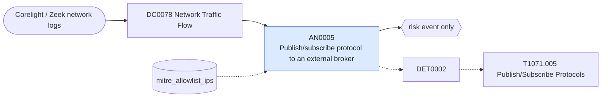

# AN0005 Publish/subscribe protocol to an external broker

[ATT&CK analytic](https://attack.mitre.org/detectionstrategies/DET0002#AN0005) · DET0002 Behavioral Detection of Publish/Subscribe Protocol Misuse for C2 · [T1071.005 Publish/Subscribe Protocols](https://attack.mitre.org/techniques/T1071/005) · tactics: command-and-control · platforms: Network Devices

**Content type:** anomaly → risk event only · **Severity:** low · **Status:** implemented · **Technique prevalence score:** 1

Corelight conn.log shows an internal host connecting to an external MQTT, AMQP, STOMP or XMPP broker. Pub/sub services are used as low-profile C2 channels; most enterprise hosts never talk to them.



## What ATT&CK asks for

> Detects pub/sub traffic over unusual ports, high-frequency topic publications, and connections to known-bad or dynamic broker endpoints outside allowlisted infrastructure.

## What this implementation detects

Corelight conn.log shows an internal host connecting to an external MQTT, AMQP, STOMP or XMPP broker. Pub/sub services are used as low-profile C2 channels; most enterprise hosts never talk to them.

**Not covered:** Topic names and message rates need protocol logs (mqtt.log and similar) that the default Corelight log set does not include; broker reputation is not checked.

## Tuning

ATT&CK mutable elements and where each is bound. Edit macros in `local/macros.conf` and lookups in place; do not edit the search.

| Mutable element | ATT&CK guidance | Bound to | Default |
|---|---|---|---|
| BrokerReputationList | Dynamic blocklist or threat intel feed for C2 brokers | macro `mitre_an0005_pubsub` | `(dest_port IN (1883, 8883, 5671, 5672, 61613, 61614, 5222, 5223, 5269) OR service IN ("mqtt", "amqp", "xmpp", "stomp"))` |
| PayloadLengthThreshold | Exfil-style long topic messages vs telemetry-style short messages | lookup `mitre_allowlist_ips` — IoT gateways and messaging clients allowed to reach external brokers (cidr column). |  |

## Splunk

Stanza `[MITRE - AN0005 - Publish/subscribe protocol to an external broker - Rule]` in `DA-ESS-mitre-attack-detections`. Schedule `14-59/15 * * * *`, window `-20m@m` to `-5m@m`. Ships disabled.

```spl
`mitre_dc0078_corelight` `mitre_st_corelight_conn`
| `mitre_normalize_zeek`
| search `mitre_an0005_pubsub`
| where NOT `mitre_is_internal(dest)` AND `mitre_is_internal(src)`
| lookup mitre_allowlist_ips cidr AS src OUTPUT reason AS allow_reason
| where isnull(allow_reason)
| stats count min(_time) as firstTime max(_time) as lastTime sum(bytes_out) as bytes_out values(dest_port) as dest_port values(service) as service by src dest
| `mitre_ctime(firstTime)` | `mitre_ctime(lastTime)`
| `mitre_an0005_filter`
```

Risk: `src` (system, 20). Threat objects: `dest`. Message: $src$ connected to external pub/sub broker $dest$

Throttle: src, dest for 86400s.

Data components: [DC0078](../data-components/DC0078-network-traffic-flow.md).

## Sigma

Rule file: `dist/sigma/rules/an0005_publish_subscribe_protocol_to_an_external_broker.yml`.

## Known false positives

- IoT devices, building-management systems and chat clients using XMPP.
