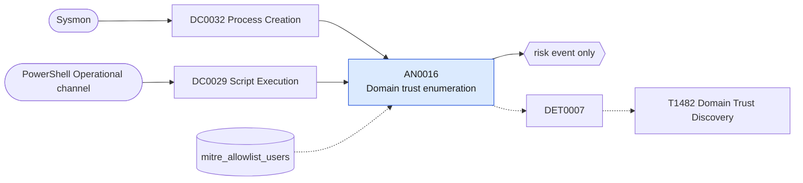

# AN0016 Domain trust enumeration

[ATT&CK analytic](https://attack.mitre.org/detectionstrategies/DET0007#AN0016) · DET0007 Detection of Domain Trust Discovery via API, Script, and CLI Enumeration · [T1482 Domain Trust Discovery](https://attack.mitre.org/techniques/T1482) · tactics: discovery · platforms: Windows

**Content type:** anomaly → risk event only · **Severity:** low · **Status:** implemented · **Technique prevalence score:** 47

nltest /domain_trusts, /all_trusts or /trusted_domains, dsquery or AdFind filters for trustedDomain objects, Get-ADTrust, PowerView Get-DomainTrust and Get-NetDomainTrust, or the .NET GetAllTrustRelationships call, from a process command line or a PowerShell script block. Trust mapping is a standard step before moving between domains and appears in most pre-ransomware discovery bursts.



## What ATT&CK asks for

> Adversary uses nltest, PowerShell, or Win32/.NET API to enumerate domain trust relationships (via DSEnumerateDomainTrusts, GetAllTrustRelationships, or LDAP queries), followed by discovery or authentication staging.

## What this implementation detects

nltest /domain_trusts, /all_trusts or /trusted_domains, dsquery or AdFind filters for trustedDomain objects, Get-ADTrust, PowerView Get-DomainTrust and Get-NetDomainTrust, or the .NET GetAllTrustRelationships call, from a process command line or a PowerShell script block. Trust mapping is a standard step before moving between domains and appears in most pre-ransomware discovery bursts.

**Not covered:** LDAP queries for trustedDomain objects from tooling with no command line need directory-service access auditing (4662 with SACLs on the System container) or Corelight ldap.log; the API-level DsEnumerateDomainTrusts call is invisible.

## Tuning

ATT&CK mutable elements and where each is bound. Edit macros in `local/macros.conf` and lookups in place; do not edit the search.

| Mutable element | ATT&CK guidance | Bound to | Default |
|---|---|---|---|
| ParentImage | Tune based on expected script hosts or authorized administrators invoking trust enumeration. | filter macro `mitre_an0016_filter` |  |
| TimeWindow | Correlate enumeration + subsequent Kerberos activity or DC interaction within a bounded window. | filter macro `mitre_an0016_filter` (not bound separately) | `search *` |
| UserContext | Prioritize detection for non-admin or unexpected user accounts performing enumeration. | lookup `mitre_allowlist_users` — Identity and AD-health accounts. |  |
| API_Name | Flag uncommon or low-prevalence API calls like DSEnumerateDomainTrusts for inspection. | macro `mitre_an0016_patterns` | `("*domain_trusts*", "*all_trusts*", "*trusted_domains*", "*trustedDomain*", "*trustdmp*", "*Get-ADTrust*", "*Get-DomainTrust*", "*Get-NetDomainTrust*", "*Get-NetForestTrust*", "*Get-ForestTrust*", "*GetAllTrustRelationships*")` |

## Splunk

Stanza `[MITRE - AN0016 - Domain trust enumeration - Rule]` in `DA-ESS-mitre-attack-detections`. Schedule `1-59/15 * * * *`, window `-20m@m` to `-5m@m`. Ships disabled.

```spl
(`mitre_dc0032_sysmon` EventCode=1 CommandLine IN `mitre_an0016_patterns`)
OR (`mitre_dc0029_powershell_logging` EventCode=4104 ScriptBlockText IN `mitre_an0016_patterns`)
| `mitre_normalize_host`
| eval process_name=lower(replace(coalesce(Image, "powershell.exe"), "^.*\\\\", "")), evidence=substr(coalesce(CommandLine, ScriptBlockText), 1, 300)
| search `mitre_not_allowlisted_user`
| stats count min(_time) as firstTime max(_time) as lastTime values(evidence) as evidence values(process_name) as process_name by dest user
| eval evidence=mvindex(evidence, 0, 4)
| `mitre_ctime(firstTime)` | `mitre_ctime(lastTime)`
| `mitre_an0016_filter`
```

Risk: `dest` (system, 25), `user` (user, 30). Threat objects: `process_name`. Message: Domain trusts enumerated on $dest$ by $user$

Throttle: dest, user for 86400s.

Data components: [DC0032](../data-components/DC0032-process-creation.md), [DC0029](../data-components/DC0029-script-execution.md).

## Sigma

Rule file: `dist/sigma/rules/an0016_domain_trust_enumeration.yml`.

## Known false positives

- Domain administrators and AD health tooling checking trusts.
