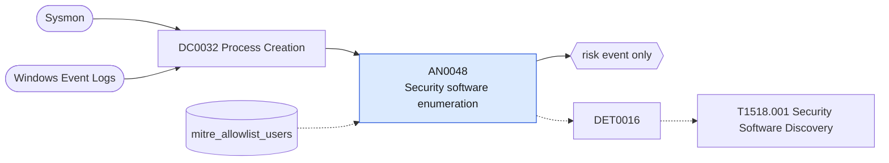

# AN0048 Security software enumeration

[ATT&CK analytic](https://attack.mitre.org/detectionstrategies/DET0016#AN0048) · DET0016 Security Software Discovery Across Platforms · [T1518.001 Security Software Discovery](https://attack.mitre.org/techniques/T1518/001) · tactics: discovery · platforms: Windows

**Content type:** anomaly → risk event only · **Severity:** low · **Status:** implemented · **Technique prevalence score:** 172

A process queries which security products are present: WMI SecurityCenter2 AntiVirusProduct or FirewallProduct, Get-MpComputerStatus / Get-MpPreference, netsh firewall show, sc query of security services, findstr for security product names, or reg query of Defender, Trellix or Sysmon keys.



## What ATT&CK asks for

> Adversary executes commands to enumerate installed antivirus, EDR, or firewall agents using WMI, registry queries, and built-in tools (e.g., tasklist, netsh, sc query). Correlated with elevated process privileges or scripting engine usage.

## What this implementation detects

A process queries which security products are present: WMI SecurityCenter2 AntiVirusProduct or FirewallProduct, Get-MpComputerStatus / Get-MpPreference, netsh firewall show, sc query of security services, findstr for security product names, or reg query of Defender, Trellix or Sysmon keys.

**Not covered:** Module loads and the elevated-privilege correlation are not evaluated. Generic tasklist or sc query without a security-product filter is covered by AN0095.

## Tuning

ATT&CK mutable elements and where each is bound. Edit macros in `local/macros.conf` and lookups in place; do not edit the search.

| Mutable element | ATT&CK guidance | Bound to | Default |
|---|---|---|---|
| ParentProcess | Defenders can tune based on trusted or known-good parent process relationships | lookup `mitre_allowlist_users` — Compliance and inventory accounts. |  |
| ImagePathContains | Regex match on adversary tool or enumeration script used | macro `mitre_an0048_patterns` | `((Processes.process_name="wmic.exe" Processes.process IN ("*securitycenter*", "*antivirusproduct*", "*firewallproduct*", "*antispywareproduct*")) OR (Processes.process_name IN ("powershell.exe", "pwsh.exe") Processes.process IN ("*antivirusproduct*", "*securitycenter2*", "*get-mpcomputerstatus*", "*get-mppreference*")) OR (Processes.process_name="netsh.exe" Processes.process IN ("*advfirewall*show*", "*firewall*show*")) OR (Processes.process_name="sc.exe" Processes.process="*query*" Processes.process IN ("*windefend*", "*sysmon*", "*mfe*", "*sense*")) OR (Processes.process_name IN ("cmd.exe", "findstr.exe") Processes.process="*findstr*" Processes.process IN ("*defender*", "*sysmon*", "*crowdstrike*", "*carbon*", "*mcafee*", "*trellix*", "*sentinel*", "*symantec*", "*virus*", "*sophos*")) OR (Processes.process_name="reg.exe" Processes.process="*query*" Processes.process IN ("*windows defender*", "*\\mcafee*", "*\\trellix*", "*\\sysmon*")))` |

## Splunk

Stanza `[MITRE - AN0048 - Security software enumeration - Rule]` in `DA-ESS-mitre-attack-detections`. Schedule `8-59/15 * * * *`, window `-20m@m` to `-5m@m`. Ships disabled.

```spl
| tstats `mitre_summariesonly` count min(_time) as firstTime max(_time) as lastTime
    from `mitre_dc0032_dm` where `mitre_dc0032_dm_where` `mitre_an0048_patterns`
    by Processes.dest Processes.user Processes.parent_process_name Processes.process_name Processes.process
| `drop_dm_object_name(Processes)`
| search `mitre_not_allowlisted_user`
| `mitre_ctime(firstTime)` | `mitre_ctime(lastTime)`
| `mitre_an0048_filter`
```

Risk: `dest` (system, 25), `user` (user, 25). Threat objects: `process`. Message: Security software enumerated on $dest$ by $user$

Throttle: dest, user for 14400s.

Data components: [DC0032](../data-components/DC0032-process-creation.md).

## Sigma

Rule file: `dist/sigma/rules/an0048_security_software_enumeration.yml`.

## Known false positives

- Compliance checks, installers verifying prerequisites and help-desk scripts.
