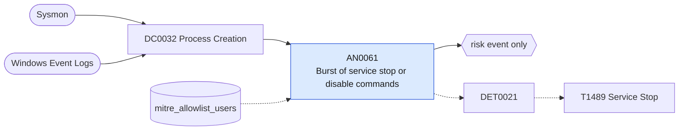

# AN0061 Burst of service stop or disable commands

[ATT&CK analytic](https://attack.mitre.org/detectionstrategies/DET0021#AN0061) · DET0021 Behavioral Detection for Service Stop across Platforms · [T1489 Service Stop](https://attack.mitre.org/techniques/T1489) · tactics: impact · platforms: Windows

**Content type:** anomaly → risk event only · **Severity:** medium · **Status:** implemented · **Technique prevalence score:** 64

One user on one host runs several distinct service stop, delete or disable commands (net stop, sc stop/delete/config disabled, taskkill /f, Stop-Service, Set-Service Disabled) within ten minutes. Ransomware and wipers stop databases, mail and backup services this way before encrypting.



## What ATT&CK asks for

> Adversary disables or stops critical services (e.g., Exchange, SQL, AV, endpoint monitoring) using native utilities or API calls, often preceding destructive actions (T1485, T1486). Behavioral chain: Elevated execution context + stop-service or sc.exe or ChangeServiceConfigW + terminated or disabled service + possible follow-up file manipulation.

## What this implementation detects

One user on one host runs several distinct service stop, delete or disable commands (net stop, sc stop/delete/config disabled, taskkill /f, Stop-Service, Set-Service Disabled) within ten minutes. Ransomware and wipers stop databases, mail and backup services this way before encrypting.

**Not covered:** The resulting service state changes (7036) and privilege assignment (4672) are not correlated; the ServiceName element is not used to weight critical services.

## Tuning

ATT&CK mutable elements and where each is bound. Edit macros in `local/macros.conf` and lookups in place; do not edit the search.

| Mutable element | ATT&CK guidance | Bound to | Default |
|---|---|---|---|
| TimeWindow | Time span between elevated privilege use and critical service stop | macro `mitre_an0061_threshold` — Distinct stop/disable command lines per host and user per 10-minute bucket. | `5` |
| ServiceName | Service names of interest (e.g., MSExchangeIS, SQLSERVERAGENT) | filter macro `mitre_an0061_filter` (not bound separately) | `search *` |
| ParentProcess | Upstream process lineage leading to service stop | lookup `mitre_allowlist_users` — Patching and deployment accounts that stop services in bulk. |  |

## Splunk

Stanza `[MITRE - AN0061 - Burst of service stop or disable commands - Rule]` in `DA-ESS-mitre-attack-detections`. Schedule `11-59/15 * * * *`, window `-30m@m` to `-5m@m`. Ships disabled.

```spl
| tstats `mitre_summariesonly` count from `mitre_dc0032_dm` where `mitre_dc0032_dm_where`
    ((Processes.process_name IN ("net.exe", "net1.exe") Processes.process="* stop *")
      OR (Processes.process_name="sc.exe" Processes.process IN ("* stop *", "* delete *", "*start=*disabled*"))
      OR (Processes.process_name="taskkill.exe" Processes.process="*/f*")
      OR (Processes.process_name IN ("powershell.exe", "pwsh.exe") Processes.process IN ("*stop-service*", "*set-service*disabled*")))
    by Processes.dest Processes.user Processes.process _time span=10m
| `drop_dm_object_name(Processes)`
| stats sum(count) as count min(_time) as firstTime max(_time) as lastTime dc(process) as distinct_commands values(process) as process by dest user _time
| where distinct_commands >= `mitre_an0061_threshold`
| search `mitre_not_allowlisted_user`
| `mitre_ctime(firstTime)` | `mitre_ctime(lastTime)`
| `mitre_an0061_filter`
```

Risk: `dest` (system, 50), `user` (user, 40). Message: $distinct_commands$ service stop commands on $dest$ by $user$ in ten minutes

Throttle: dest, user for 3600s.

Data components: [DC0032](../data-components/DC0032-process-creation.md).

## Sigma

Rule file: `dist/sigma/rules/an0061_burst_of_service_stop_or_disable_commands.yml` (base rule plus a correlation rule).

## Known false positives

- Patch orchestration, application upgrades and clean shutdown scripts.
