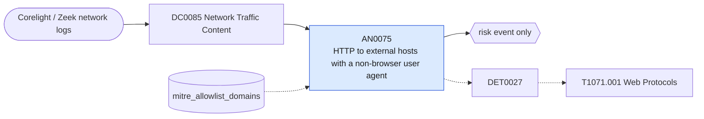

# AN0075 HTTP to external hosts with a non-browser user agent

[ATT&CK analytic](https://attack.mitre.org/detectionstrategies/DET0027#AN0075) · DET0027 Detection of Web Protocol-Based C2 Over HTTP, HTTPS, or WebSockets · [T1071.001 Web Protocols](https://attack.mitre.org/techniques/T1071/001) · tactics: command-and-control · platforms: Windows

**Content type:** anomaly → risk event only · **Severity:** medium · **Status:** implemented · **Technique prevalence score:** 510

Corelight http.log requests from an internal client to a non-internal server whose User-Agent is a scripting or tooling default (PowerShell, python-requests, curl, wget, Go-http-client, certutil, BITS, WinHTTP, Java, libwww-perl) or is absent. Reports request counts and the upload share of bytes per client, server and agent.



## What ATT&CK asks for

> Detects unexpected or high-volume HTTP/S/WebSocket communication from suspicious processes (e.g., PowerShell, rundll32) using uncommon user agents or mimicking browser traffic to unusual domains or IPs.

## What this implementation detects

Corelight http.log requests from an internal client to a non-internal server whose User-Agent is a scripting or tooling default (PowerShell, python-requests, curl, wget, Go-http-client, certutil, BITS, WinHTTP, Java, libwww-perl) or is absent. Reports request counts and the upload share of bytes per client, server and agent.

**Not covered:** The endpoint leg (which process made the connection, Sysmon 3/22) and TLS traffic (ssl.log has no user agent) are not included; the upload-ratio element is reported but not used as a condition.

## Tuning

ATT&CK mutable elements and where each is bound. Edit macros in `local/macros.conf` and lookups in place; do not edit the search.

| Mutable element | ATT&CK guidance | Bound to | Default |
|---|---|---|---|
| ProcessNameExclusions | Filter out legitimate browser/network utilities | lookup `mitre_allowlist_domains` — Processes are not visible on the wire; allow-list update and telemetry domains instead (wildcards supported). |  |
| UserAgentAnomalies | Detect non-browser user-agents or spoofed headers | macro `mitre_an0075_user_agents` | `http_user_agent IN ("*powershell*", "python-requests*", "python-urllib*", "curl/*", "wget/*", "go-http-client*", "*certutil*", "microsoft bits*", "winhttp*", "java/*", "libwww-perl*", "ruby*", "(none)")` |
| OutboundByteRatioThreshold | Flag when outbound > inbound volume by 90%+ | filter macro `mitre_an0075_filter` — upload_ratio is in the results; add e.g. where upload_ratio >= 0.9 to require upload-heavy sessions. |  |

## Splunk

Stanza `[MITRE - AN0075 - HTTP to external hosts with a non-browser user agent - Rule]` in `DA-ESS-mitre-attack-detections`. Schedule `10-59/15 * * * *`, window `-20m@m` to `-5m@m`. Ships disabled.

```spl
`mitre_dc0085_corelight` `mitre_st_corelight_http`
| `mitre_normalize_zeek` | `mitre_normalize_zeek_http`
| fillnull value="(none)" http_user_agent
| where NOT `mitre_is_internal(dest)`
| search `mitre_an0075_user_agents`
| lookup mitre_allowlist_domains domain as http_host OUTPUT reason as allow_reason
| where isnull(allow_reason)
| stats count min(_time) as firstTime max(_time) as lastTime sum(request_body_len) as bytes_out sum(response_body_len) as bytes_in dc(uri) as distinct_uris by src dest http_host http_user_agent
| eval upload_ratio=round(coalesce(bytes_out, 0) / (coalesce(bytes_out, 0) + coalesce(bytes_in, 0) + 1), 2)
| `mitre_ctime(firstTime)` | `mitre_ctime(lastTime)`
| `mitre_an0075_filter`
```

Risk: `src` (system, 35). Threat objects: `http_host`, `http_user_agent`. Message: $src$ made HTTP requests to $http_host$ with user agent $http_user_agent$

Throttle: src, http_host for 14400s.

Data components: [DC0085](../data-components/DC0085-network-traffic-content.md).

## Sigma

Rule file: `dist/sigma/rules/an0075_http_to_external_hosts_with_a_non_browser_user_agent.yml`.

## Known false positives

- Package managers, software updaters, monitoring probes and internal automation calling external APIs.
