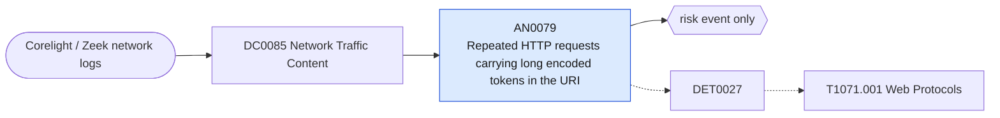

# AN0079 Repeated HTTP requests carrying long encoded tokens in the URI

[ATT&CK analytic](https://attack.mitre.org/detectionstrategies/DET0027#AN0079) · DET0027 Detection of Web Protocol-Based C2 Over HTTP, HTTPS, or WebSockets · [T1071.001 Web Protocols](https://attack.mitre.org/techniques/T1071/001) · tactics: command-and-control · platforms: Network Devices

**Content type:** anomaly → risk event only · **Severity:** low · **Status:** implemented · **Technique prevalence score:** 510

Corelight http.log requests to non-internal servers whose URI contains a long base64/base64url-like token, repeated several times from the same client to the same host. Encoded data in the URI is a common carrier for beacon check-ins and small exfiltration.



## What ATT&CK asks for

> Detects Web protocol misuse such as encoded HTTP headers, WebSocket upgrade requests with abnormal payloads, or TLS handshake anomalies suggesting embedded C2 channels.

## What this implementation detects

Corelight http.log requests to non-internal servers whose URI contains a long base64/base64url-like token, repeated several times from the same client to the same host. Encoded data in the URI is a common carrier for beacon check-ins and small exfiltration.

**Not covered:** Cookie and header encoding, WebSocket upgrade payloads and JA3/TLS fingerprint mismatches are not evaluated (cookies are not in the default http.log; JA3 needs an expected-client baseline).

## Tuning

ATT&CK mutable elements and where each is bound. Edit macros in `local/macros.conf` and lookups in place; do not edit the search.

| Mutable element | ATT&CK guidance | Bound to | Default |
|---|---|---|---|
| HeaderEncodingPattern | Base64, hex, or UTF-16 encoding in URI, cookie, or host | macro `mitre_an0079_token_length` — Minimum length of the encoded token in the URI. | `120` |
| TLSFingerprintMismatch | JA3 hash deviation from known clients | macro `mitre_an0079_min_requests` — Not a TLS control; minimum number of such requests per client and host in the window. | `5` |

## Splunk

Stanza `[MITRE - AN0079 - Repeated HTTP requests carrying long encoded tokens in the URI - Rule]` in `DA-ESS-mitre-attack-detections`. Schedule `8-59/15 * * * *`, window `-65m@m` to `-5m@m`. Ships disabled.

```spl
`mitre_dc0085_corelight` `mitre_st_corelight_http`
| `mitre_normalize_zeek` | `mitre_normalize_zeek_http`
| where NOT `mitre_is_internal(dest)`
| rex field=uri "(?<encoded_token>[A-Za-z0-9+/=_-]{100,})"
| eval token_length=len(encoded_token)
| where token_length >= `mitre_an0079_token_length`
| lookup mitre_allowlist_domains domain as http_host OUTPUT reason as allow_reason
| where isnull(allow_reason)
| stats count min(_time) as firstTime max(_time) as lastTime max(token_length) as max_token_length dc(uri) as distinct_uris values(method) as http_method by src dest http_host
| where count >= `mitre_an0079_min_requests`
| `mitre_ctime(firstTime)` | `mitre_ctime(lastTime)`
| `mitre_an0079_filter`
```

Risk: `src` (system, 25). Threat objects: `http_host`. Message: $src$ sent $count$ HTTP requests with long encoded URI tokens to $http_host$

Throttle: src, http_host for 14400s.

Data components: [DC0085](../data-components/DC0085-network-traffic-content.md).

## Sigma

Rule file: `dist/sigma/rules/an0079_repeated_http_requests_carrying_long_encoded_tokens_in_the_u.yml`.

## Known false positives

- Single sign-on redirects (SAML requests, JWTs), ad and telemetry beacons, signed download URLs. Allow-list the domains.
