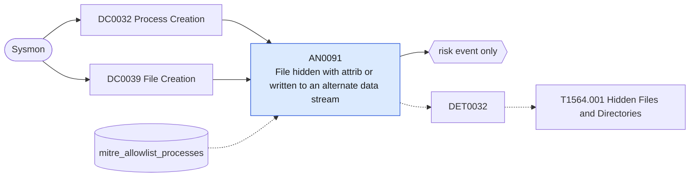

# AN0091 File hidden with attrib or written to an alternate data stream

[ATT&CK analytic](https://attack.mitre.org/detectionstrategies/DET0032#AN0091) · DET0032 Detection Strategy for Hidden Files and Directories · [T1564.001 Hidden Files and Directories](https://attack.mitre.org/techniques/T1564/001) · tactics: stealth · platforms: Windows

**Content type:** anomaly → risk event only · **Severity:** medium · **Status:** implemented · **Technique prevalence score:** 76

attrib +h (or PowerShell setting the Hidden attribute) on a file or folder, or a Sysmon FileCreateStreamHash (15) for a named alternate data stream other than the Zone.Identifier and SmartScreen streams Windows writes itself. Both hide a payload from casual listing and from tools that ignore attributes or streams.



## What ATT&CK asks for

> Suspicious use of attrib.exe or PowerShell commands to set hidden attributes on files/directories. Defender view: processes modifying file attributes to 'hidden' or creating files with ADS (alternate data streams).

## What this implementation detects

attrib +h (or PowerShell setting the Hidden attribute) on a file or folder, or a Sysmon FileCreateStreamHash (15) for a named alternate data stream other than the Zone.Identifier and SmartScreen streams Windows writes itself. Both hide a payload from casual listing and from tools that ignore attributes or streams.

**Not covered:** Attributes set through the SetFileAttributes API without a command line are invisible; ADS coverage depends on the Sysmon config logging FileCreateStreamHash for the paths that matter.

## Tuning

ATT&CK mutable elements and where each is bound. Edit macros in `local/macros.conf` and lookups in place; do not edit the search.

| Mutable element | ATT&CK guidance | Bound to | Default |
|---|---|---|---|
| MonitoredExtensions | Filter hidden file detection by sensitive file extensions (.exe, .dll, .bat). | macro `mitre_an0091_hide_commands` | `((Image="*\\attrib.exe" CommandLine="*+h*") OR CommandLine IN ("*FileAttributes]::Hidden*", "*Attributes*=*Hidden*", "*attrib*+h *"))` |
| ADSMonitoring | Enable detection of alternate data streams depending on organizational usage. | macro `mitre_an0091_benign_streams` | `TargetFilename IN ("*:Zone.Identifier", "*:SmartScreen", "*:favicon", "*:OECustomProperty", "*:com.dropbox.*", "*:AFP_AfpInfo", "*:encryptable")` |
| ProcessName *(implementation)* | Backup, sync and imaging tools that set attributes or streams routinely. | lookup `mitre_allowlist_processes` |  |

## Splunk

Stanza `[MITRE - AN0091 - File hidden with attrib or written to an alternate data stream - Rule]` in `DA-ESS-mitre-attack-detections`. Schedule `13-59/15 * * * *`, window `-20m@m` to `-5m@m`. Ships disabled.

```spl
(`mitre_dc0032_sysmon` EventCode=1 `mitre_an0091_hide_commands`)
OR (`mitre_dc0039_sysmon` EventCode=15 TargetFilename="*:*:*" NOT `mitre_an0091_benign_streams`)
| `mitre_normalize_host`
| eval process_name=lower(replace(Image, "^.*\\\\", "")), technique=if(EventCode==15, "alternate data stream", "hidden attribute"), artifact=if(EventCode==15, TargetFilename, CommandLine)
| search `mitre_not_allowlisted_process`
| stats count min(_time) as firstTime max(_time) as lastTime values(technique) as technique values(artifact) as artifact values(process_name) as process_name by dest user
| eval artifact=mvindex(artifact, 0, 19)
| `mitre_ctime(firstTime)` | `mitre_ctime(lastTime)`
| `mitre_an0091_filter`
```

Risk: `dest` (system, 30), `user` (user, 25). Threat objects: `process_name`. Message: Files hidden on $dest$ by $user$ ($technique$)

Throttle: dest, user for 86400s.

Data components: [DC0032](../data-components/DC0032-process-creation.md), [DC0039](../data-components/DC0039-file-creation.md).

## Sigma

Rule file: `dist/sigma/rules/an0091_file_hidden_with_attrib_or_written_to_an_alternate_data_stre.yml`.

## Known false positives

- Installers and sync clients that hide their own folders; browsers and Office writing private streams not yet in the benign list.
