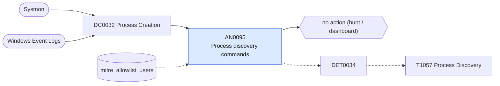

# AN0095 Process discovery commands

[ATT&CK analytic](https://attack.mitre.org/detectionstrategies/DET0034#AN0095) · DET0034 Detection of Adversarial Process Discovery Behavior · [T1057 Process Discovery](https://attack.mitre.org/techniques/T1057) · tactics: discovery · platforms: Windows

**Content type:** hunting → no action (hunt / dashboard) · **Severity:** informational · **Status:** implemented · **Technique prevalence score:** 379

Lists hosts and users enumerating running processes with tasklist, qprocess, query process, wmic process list/get, Get-Process or Win32_Process queries, with the parent process so non-interactive origins (Office, WMI, script hosts) stand out.



## What ATT&CK asks for

> Identifies adversary behavior that launches commands or invokes APIs to enumerate active processes (e.g., tasklist.exe, Get-Process, or CreateToolhelp32Snapshot). Detects execution combined with parent process lineage, network session context, or remote origin.

## What this implementation detects

Lists hosts and users enumerating running processes with tasklist, qprocess, query process, wmic process list/get, Get-Process or Win32_Process queries, with the parent process so non-interactive origins (Office, WMI, script hosts) stand out.

**Not covered:** API-level enumeration (CreateToolhelp32Snapshot) and process-access events are not included. No finding or risk is produced.

## Tuning

ATT&CK mutable elements and where each is bound. Edit macros in `local/macros.conf` and lookups in place; do not edit the search.

| Mutable element | ATT&CK guidance | Bound to | Default |
|---|---|---|---|
| ParentProcessName | Used to scope suspicious discovery from non-interactive or non-standard parent processes like Office macros, WMI, or script engines | filter macro `mitre_an0095_filter` — Narrow to suspicious parents, e.g. search parent_process_name IN ("winword.exe", "wmiprvse.exe", "wscript.exe"). |  |
| CommandLinePattern | Adversaries may obfuscate or vary process discovery commands (e.g., aliases, PowerShell variants) | lookup `mitre_allowlist_users` — Monitoring and inventory accounts. |  |
| TimeWindow | Helps detect bursty discovery behavior within a short timeframe | filter macro `mitre_an0095_filter` (not bound separately) | `search *` |

## Splunk

Stanza `[MITRE - AN0095 - Process discovery commands - Rule]` in `DA-ESS-mitre-attack-detections`. Schedule `10-59/15 * * * *`, window `-20m@m` to `-5m@m`. Ships disabled.

```spl
| tstats `mitre_summariesonly` count from `mitre_dc0032_dm` where `mitre_dc0032_dm_where`
    (Processes.process_name IN ("tasklist.exe", "qprocess.exe")
      OR (Processes.process_name="query.exe" Processes.process="*process*")
      OR (Processes.process_name="wmic.exe" Processes.process="*process*" Processes.process IN ("* list*", "* get*") NOT Processes.process="*call*")
      OR (Processes.process_name IN ("powershell.exe", "pwsh.exe") Processes.process IN ("*get-process*", "* gps *", "*win32_process*") NOT Processes.process="*invoke-wmimethod*"))
    by Processes.dest Processes.user Processes.parent_process_name Processes.process _time span=10m
| `drop_dm_object_name(Processes)`
| search `mitre_not_allowlisted_user`
| stats sum(count) as count dc(process) as distinct_commands values(process) as process by dest user parent_process_name _time
| sort - count
| `mitre_an0095_filter`
```

Data components: [DC0032](../data-components/DC0032-process-creation.md).

## Sigma

Rule file: `dist/sigma/rules/an0095_process_discovery_commands.yml`.

## Known false positives

- Monitoring agents and administrators.
