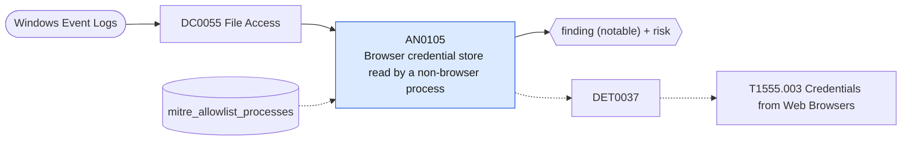

# AN0105 Browser credential store read by a non-browser process

[ATT&CK analytic](https://attack.mitre.org/detectionstrategies/DET0037#AN0105) · DET0037 Detect Suspicious Access to Browser Credential Stores · [T1555.003 Credentials from Web Browsers](https://attack.mitre.org/techniques/T1555/003) · tactics: credential-access · platforms: Windows

**Content type:** ttp → finding (notable) + risk · **Severity:** high · **Status:** implemented · **Technique prevalence score:** 119

A process that is not the browser itself opens a browser credential or cookie database (Chromium Login Data, Cookies and Local State; Firefox logins.json and key4.db), seen as Security 4663 on the file.



## What ATT&CK asks for

> Detects unauthorized access to web browser credential stores (e.g., Chrome Login Data, Edge Credential Locker) by processes other than the browser itself. Correlates file reads of credential databases with subsequent API calls to `CryptUnprotectData` or memory inspection attempts.

## What this implementation detects

A process that is not the browser itself opens a browser credential or cookie database (Chromium Login Data, Cookies and Local State; Firefox logins.json and key4.db), seen as Security 4663 on the file.

**Not covered:** DPAPI CryptUnprotectData calls and process-memory inspection are not visible. Requires object-access auditing with SACLs on the browser profile files; without them this search returns nothing.

## Tuning

ATT&CK mutable elements and where each is bound. Edit macros in `local/macros.conf` and lookups in place; do not edit the search.

| Mutable element | ATT&CK guidance | Bound to | Default |
|---|---|---|---|
| MonitoredPaths | Browser-specific credential storage paths such as Chrome Login Data, IE Credential Locker | macro `mitre_an0105_paths` | `ObjectName IN ("*\\Google\\Chrome\\User Data\\*\\Login Data*", "*\\Microsoft\\Edge\\User Data\\*\\Login Data*", "*\\BraveSoftware\\*\\Login Data*", "*\\User Data\\Local State", "*\\User Data\\*\\Cookies", "*\\User Data\\*\\Network\\Cookies", "*\\Mozilla\\Firefox\\Profiles\\*\\logins.json", "*\\Mozilla\\Firefox\\Profiles\\*\\key4.db")` |
| TimeWindow | Correlation window between file read and process memory/API access | lookup `mitre_allowlist_processes` — No window is used; allow-list backup, sync and endpoint-security processes that read browser profiles. |  |

## Splunk

Stanza `[MITRE - AN0105 - Browser credential store read by a non-browser process - Rule]` in `DA-ESS-mitre-attack-detections`. Schedule `0-59/15 * * * *`, window `-20m@m` to `-5m@m`. Ships disabled.

```spl
`mitre_dc0055_wineventlog` EventCode=4663 `mitre_an0105_paths`
    NOT ProcessName IN ("*\\chrome.exe", "*\\msedge.exe", "*\\msedgewebview2.exe", "*\\firefox.exe", "*\\brave.exe", "*\\opera.exe", "*\\MsMpEng.exe", "*\\SearchProtocolHost.exe")
| `mitre_normalize_host`
| eval process_name=replace(ProcessName, "^.*\\\\", ""), file_path=ObjectName
| search `mitre_not_allowlisted_process`
| stats count min(_time) as firstTime max(_time) as lastTime values(file_path) as file_path values(AccessMask) as access_mask by dest user process_name
| `mitre_ctime(firstTime)` | `mitre_ctime(lastTime)`
| `mitre_an0105_filter`
```

Risk: `dest` (system, 65), `user` (user, 65). Threat objects: `process_name`. Message: $process_name$ read browser credential stores on $dest$

Throttle: dest, process_name for 3600s.

Data components: [DC0055](../data-components/DC0055-file-access.md).

## Sigma

Rule file: `dist/sigma/rules/an0105_browser_credential_store_read_by_a_non_browser_process.yml`.

## Known false positives

- Profile backup and migration tools, password managers importing saved logins, endpoint DLP agents.
