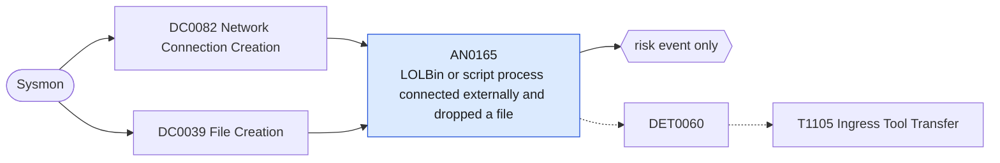

# AN0165 LOLBin or script process connected externally and dropped a file

[ATT&CK analytic](https://attack.mitre.org/detectionstrategies/DET0060#AN0165) · DET0060 Detect Ingress Tool Transfers via Behavioral Chain · [T1105 Ingress Tool Transfer](https://attack.mitre.org/techniques/T1105) · tactics: command-and-control · platforms: Windows

**Content type:** anomaly → risk event only · **Severity:** medium · **Status:** implemented · **Technique prevalence score:** 651

The same process instance (joined on Sysmon ProcessGuid) both initiates a network connection to a non-internal address and creates a file in a user-writable staging path. Scoped to utilities and interpreters commonly used to pull tools down (certutil, bitsadmin, PowerShell, curl, mshta, regsvr32, rundll32, msiexec, script hosts, cmd, expand, esentutl, finger, wmic).



## What ATT&CK asks for

> Unusual or uncommon processes initiate network connections to external destinations followed by file creation (tools downloaded).

## What this implementation detects

The same process instance (joined on Sysmon ProcessGuid) both initiates a network connection to a non-internal address and creates a file in a user-writable staging path. Scoped to utilities and interpreters commonly used to pull tools down (certutil, bitsadmin, PowerShell, curl, mshta, regsvr32, rundll32, msiexec, script hosts, cmd, expand, esentutl, finger, wmic).

**Not covered:** Downloads performed by browsers or by custom binaries are out of scope by design. DNS lookups (EventCode 22) are not used. Sysmon must log NetworkConnect and FileCreate for these images.

## Tuning

ATT&CK mutable elements and where each is bound. Edit macros in `local/macros.conf` and lookups in place; do not edit the search.

| Mutable element | ATT&CK guidance | Bound to | Default |
|---|---|---|---|
| ParentProcessName | Tune for known good updaters (e.g., ChromeUpdate, OneDrive) | macro `mitre_an0165_download_processes` — The processes considered. Known updaters are not in this list; exclude specific hosts or users in the filter macro. | `Image IN ("*\\certutil.exe", "*\\bitsadmin.exe", "*\\powershell.exe", "*\\pwsh.exe", "*\\curl.exe", "*\\mshta.exe", "*\\regsvr32.exe", "*\\rundll32.exe", "*\\msiexec.exe", "*\\wscript.exe", "*\\cscript.exe", "*\\cmd.exe", "*\\expand.exe", "*\\esentutl.exe", "*\\finger.exe", "*\\wmic.exe")` |
| DestinationIPCategory | Allow filtering by internal vs external IP blocks | macro `mitre_is_internal(1)` — Shared macro in the TA; edit it to match your address plan. |  |
| FilePathRegex | Focus on uncommon file drop paths (e.g., C:\Users\Public\) | macro `mitre_an0165_drop_paths` | `TargetFilename IN ("*\\Users\\Public\\*", "*\\AppData\\Local\\Temp\\*", "*\\Windows\\Temp\\*", "*\\ProgramData\\*", "*\\Downloads\\*", "*\\PerfLogs\\*") NOT TargetFilename IN ("*__PSScriptPolicyTest_*", "*\\StartupProfileData-*", "*.log", "*.etl")` |

## Splunk

Stanza `[MITRE - AN0165 - LOLBin or script process connected externally and dropped a file - Rule]` in `DA-ESS-mitre-attack-detections`. Schedule `8-59/15 * * * *`, window `-20m@m` to `-5m@m`. Ships disabled.

```spl
(`mitre_dc0082_sysmon` EventCode=3 Initiated=true `mitre_an0165_download_processes`)
  OR (`mitre_dc0039_sysmon` EventCode=11 `mitre_an0165_download_processes` `mitre_an0165_drop_paths`)
| `mitre_normalize_host`
| eval external=if(EventCode==3 AND NOT `mitre_is_internal(DestinationIp)`, 1, 0), dropped=if(EventCode==11, 1, 0), process_name=replace(Image, "^.*\\\\", "")
| stats min(_time) as firstTime max(_time) as lastTime max(external) as external max(dropped) as dropped values(DestinationIp) as dest_ip values(DestinationHostname) as dest_host values(TargetFilename) as file_path by dest user ProcessGuid process_name
| where external=1 AND dropped=1
| `mitre_ctime(firstTime)` | `mitre_ctime(lastTime)`
| `mitre_an0165_filter`
```

Risk: `dest` (system, 45), `user` (user, 35). Threat objects: `process_name`, `dest_ip`. Message: $process_name$ on $dest$ connected externally and wrote files to a staging path

Throttle: dest, ProcessGuid for 3600s.

Data components: [DC0082](../data-components/DC0082-network-connection-creation.md), [DC0039](../data-components/DC0039-file-creation.md).

## Sigma

Rule file: `dist/sigma/rules/an0165_lolbin_or_script_process_connected_externally_and_dropped_a_.yml` (base rule plus a correlation rule).

## Known false positives

- Software installation and update scripts run through PowerShell, msiexec or cmd.
