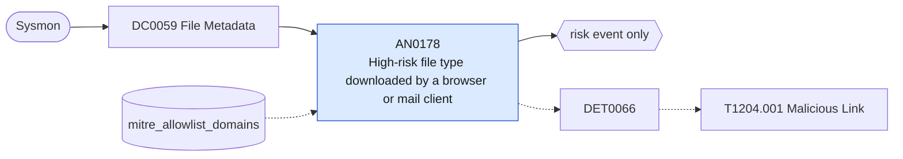

# AN0178 High-risk file type downloaded by a browser or mail client

[ATT&CK analytic](https://attack.mitre.org/detectionstrategies/DET0066#AN0178) · DET0066 User Execution – Malicious Link (click → suspicious egress → download/write → follow-on activity) · [T1204.001 Malicious Link](https://attack.mitre.org/techniques/T1204/001) · tactics: execution · platforms: Windows

**Content type:** anomaly → risk event only · **Severity:** medium · **Status:** implemented · **Technique prevalence score:** 149

Sysmon FileCreateStreamHash (15) records a Zone.Identifier stream (mark of the web) on a file with an executable, script, shortcut or disk-image extension, written by a browser or mail client. The HostUrl in the stream is extracted so the download domain can be allow-listed or investigated.



## What ATT&CK asks for

> Behavioral chain: (1) a user-facing app (browser/Office/email client) launches a URL or handles a link, then (2) the same process lineage makes an outbound connection to an untrusted domain/IP, (3) a file is downloaded or unpacked to a user-writable location shortly after the click. Optional enrichment: subsequent child execution by LOLBINs.

## What this implementation detects

Sysmon FileCreateStreamHash (15) records a Zone.Identifier stream (mark of the web) on a file with an executable, script, shortcut or disk-image extension, written by a browser or mail client. The HostUrl in the stream is extracted so the download domain can be allow-listed or investigated.

**Not covered:** The click (URL launch) and the following execution are not joined here; DET0294 covers write-then-run. Downloads that strip the mark of the web (some archivers, curl) are not seen.

## Tuning

ATT&CK mutable elements and where each is bound. Edit macros in `local/macros.conf` and lookups in place; do not edit the search.

| Mutable element | ATT&CK guidance | Bound to | Default |
|---|---|---|---|
| TimeWindow | Correlation window (e.g., 15m) between link click / first egress / file write. | filter macro `mitre_an0178_filter` |  |
| BrowserParents | Processes considered link sources: chrome.exe, msedge.exe, firefox.exe, winword.exe, outlook.exe, teams.exe. | macro `mitre_an0178_downloaders` | `Image IN ("*\\chrome.exe", "*\\msedge.exe", "*\\firefox.exe", "*\\brave.exe", "*\\opera.exe", "*\\iexplore.exe", "*\\outlook.exe", "*\\thunderbird.exe", "*\\teams.exe", "*\\ms-teams.exe")` |
| UserPaths | User-writable directories to monitor (%USERPROFILE%\Downloads, %TEMP%, %APPDATA%\*, OneDrive caches). | filter macro `mitre_an0178_filter` |  |
| SuspiciousTLDs | High-risk TLD and domain list (e.g., .top .xyz .monster; newly observed domains/NOD). | macro `mitre_an0178_risky_types` | `TargetFilename IN ("*.exe:Zone.Identifier", "*.scr:Zone.Identifier", "*.js:Zone.Identifier", "*.jse:Zone.Identifier", "*.vbs:Zone.Identifier", "*.vbe:Zone.Identifier", "*.wsf:Zone.Identifier", "*.hta:Zone.Identifier", "*.lnk:Zone.Identifier", "*.iso:Zone.Identifier", "*.img:Zone.Identifier", "*.vhd:Zone.Identifier", "*.vhdx:Zone.Identifier", "*.one:Zone.Identifier", "*.msi:Zone.Identifier", "*.bat:Zone.Identifier", "*.cmd:Zone.Identifier", "*.ps1:Zone.Identifier", "*.cpl:Zone.Identifier", "*.appx:Zone.Identifier", "*.msix:Zone.Identifier")` |
| AllowedCDNs | Corporate CDNs/update hosts to reduce false positives. | lookup `mitre_allowlist_domains` — Software vendors' download domains (domain column, wildcards allowed). |  |

## Splunk

Stanza `[MITRE - AN0178 - High-risk file type downloaded by a browser or mail client - Rule]` in `DA-ESS-mitre-attack-detections`. Schedule `9-59/15 * * * *`, window `-20m@m` to `-5m@m`. Ships disabled.

```spl
`mitre_dc0059_sysmon` EventCode=15 `mitre_an0178_downloaders` `mitre_an0178_risky_types`
| `mitre_normalize_host`
| rex field=Contents "(?i)HostUrl=(?<url>[^\s\r\n]+)"
| rex field=url "(?i)^[a-z]+://(?<url_domain>[^/:]+)"
| lookup mitre_allowlist_domains domain AS url_domain OUTPUT reason AS allow_reason
| where isnull(allow_reason)
| eval file_path=replace(TargetFilename, ":Zone.Identifier$", ""), process_name=replace(Image, "^.*\\\\", "")
| stats count min(_time) as firstTime max(_time) as lastTime values(file_path) as file_path values(url) as url by dest user process_name url_domain
| `mitre_ctime(firstTime)` | `mitre_ctime(lastTime)`
| `mitre_an0178_filter`
```

Risk: `dest` (system, 30), `user` (user, 30). Threat objects: `url_domain`. Message: $user$ downloaded a high-risk file type from $url_domain$ on $dest$

Throttle: dest, url_domain for 14400s.

Data components: [DC0059](../data-components/DC0059-file-metadata.md).

## Sigma

Rule file: `dist/sigma/rules/an0178_high_risk_file_type_downloaded_by_a_browser_or_mail_client.yml`.

## Known false positives

- Software downloads by users and administrators from vendor sites not yet allow-listed.
