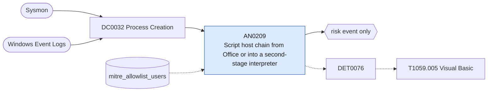

# AN0209 Script host chain from Office or into a second-stage interpreter

[ATT&CK analytic](https://attack.mitre.org/detectionstrategies/DET0076#AN0209) · DET0076 Behavioral Detection of Visual Basic Execution (VBS/VBA/VBScript) · [T1059.005 Visual Basic](https://attack.mitre.org/techniques/T1059/005) · tactics: execution · platforms: Windows

**Content type:** anomaly → risk event only · **Severity:** medium · **Status:** implemented · **Technique prevalence score:** 193

Two links of the Visual Basic execution chain: an Office application starts wscript, cscript or mshta; or one of those script hosts starts PowerShell, cmd or a proxy-execution utility.



## What ATT&CK asks for

> Detects execution of VB-based scripts or macros (VBS/VBA/VBScript) through cscript.exe/wscript.exe, Office-based process chains, or HTA usage. Focuses on chained behavior: Office or HTML container spawns script host > script host spawns PowerShell, network connections, or process injection.

## What this implementation detects

Two links of the Visual Basic execution chain: an Office application starts wscript, cscript or mshta; or one of those script hosts starts PowerShell, cmd or a proxy-execution utility.

**Not covered:** Scripting-engine module loads (vbscript.dll, scrrun.dll), script entropy and time-of-day conditions are not evaluated.

## Tuning

ATT&CK mutable elements and where each is bound. Edit macros in `local/macros.conf` and lookups in place; do not edit the search.

| Mutable element | ATT&CK guidance | Bound to | Default |
|---|---|---|---|
| ParentProcess | Microsoft Word/Excel or mshta.exe spawning wscript.exe/cscript.exe. | macro `mitre_an0209_office_parents` | `Processes.parent_process_name IN ("winword.exe", "excel.exe", "powerpnt.exe", "outlook.exe", "msaccess.exe", "mspub.exe", "onenote.exe")` |
| UserContext | Script execution by non-admin users or service accounts. | lookup `mitre_allowlist_users` — Accounts that run logon or management VBScript by design. |  |
| TimeWindow | Script execution outside normal business hours or patching cycle. | filter macro `mitre_an0209_filter` (not bound separately) | `search *` |
| PayloadEntropyThreshold | High entropy indicative of obfuscation or encoding in the script. | filter macro `mitre_an0209_filter` (not bound separately) | `search *` |
| ModuleName | Loading of vbscript.dll, scrrun.dll, or other scripting engine modules. | filter macro `mitre_an0209_filter` (not bound separately) | `search *` |

## Splunk

Stanza `[MITRE - AN0209 - Script host chain from Office or into a second-stage interpreter - Rule]` in `DA-ESS-mitre-attack-detections`. Schedule `10-59/15 * * * *`, window `-20m@m` to `-5m@m`. Ships disabled.

```spl
| tstats `mitre_summariesonly` count min(_time) as firstTime max(_time) as lastTime
    from `mitre_dc0032_dm` where `mitre_dc0032_dm_where`
    ((`mitre_an0209_office_parents` Processes.process_name IN ("wscript.exe", "cscript.exe", "mshta.exe"))
      OR (Processes.parent_process_name IN ("wscript.exe", "cscript.exe", "mshta.exe") Processes.process_name IN ("powershell.exe", "pwsh.exe", "cmd.exe", "rundll32.exe", "regsvr32.exe", "certutil.exe", "bitsadmin.exe", "schtasks.exe", "msiexec.exe", "wmic.exe")))
    by Processes.dest Processes.user Processes.parent_process_name Processes.process_name Processes.process
| `drop_dm_object_name(Processes)`
| search `mitre_not_allowlisted_user`
| `mitre_ctime(firstTime)` | `mitre_ctime(lastTime)`
| `mitre_an0209_filter`
```

Risk: `dest` (system, 40), `user` (user, 40). Threat objects: `process_name`. Message: Script host chain $parent_process_name$ to $process_name$ on $dest$

Throttle: dest, user, process_name for 3600s.

Data components: [DC0032](../data-components/DC0032-process-creation.md).

## Sigma

Rule file: `dist/sigma/rules/an0209_script_host_chain_from_office_or_into_a_second_stage_interpr.yml`.

## Known false positives

- Logon scripts, software deployment and legacy line-of-business automation written in VBScript.
