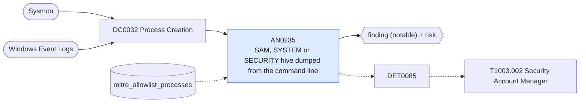

# AN0235 SAM, SYSTEM or SECURITY hive dumped from the command line

[ATT&CK analytic](https://attack.mitre.org/detectionstrategies/DET0085#AN0235) · DET0085 Credential Dumping from SAM via Registry Dump and Local File Access · [T1003.002 Security Account Manager](https://attack.mitre.org/techniques/T1003/002) · tactics: credential-access · platforms: Windows

**Content type:** ttp → finding (notable) + risk · **Severity:** high · **Status:** implemented · **Technique prevalence score:** 59

A process saves or exports the SAM, SYSTEM or SECURITY registry hive (reg save / reg export and PowerShell equivalents) or reads the hive files under System32\config directly, including through a shadow-copy path. Either gives offline access to local account hashes.



## What ATT&CK asks for

> An adversary running with SYSTEM-level privileges executes commands or accesses registry keys to dump the SAM hive or directly reads sensitive local files from the config directory. This behavior often involves sequential access to HKLM\SAM, HKLM\SYSTEM, and creation of .save or .dmp files, enabling offline hash extraction.

## What this implementation detects

A process saves or exports the SAM, SYSTEM or SECURITY registry hive (reg save / reg export and PowerShell equivalents) or reads the hive files under System32\config directly, including through a shadow-copy path. Either gives offline access to local account hashes.

**Not covered:** Registry and file-creation legs of ATT&CK's chain (hive key access, .save/.dmp file creation) and the TimeWindow between SAM and SYSTEM dumps are not correlated; one command is enough to fire.

## Tuning

ATT&CK mutable elements and where each is bound. Edit macros in `local/macros.conf` and lookups in place; do not edit the search.

| Mutable element | ATT&CK guidance | Bound to | Default |
|---|---|---|---|
| CommandLinePattern | Detectable variations include `reg save`, `reg.exe save`, or PowerShell equivalents for dumping SAM/SYSTEM hives. | filter macro `mitre_an0235_filter` (not bound separately) | `search *` |
| TargetFilePath | Defenders can tune based on dump file path patterns (e.g., `%TEMP%\sam.save`, `C:\Users\Public\*.dmp`). | filter macro `mitre_an0235_filter` (not bound separately) | `search *` |
| RegistryPath | Tune for HKLM\SAM, HKLM\SYSTEM or access via direct \Device\Harddisk paths. | macro `mitre_an0235_hives` — Hive roots followed by a space, so sub-key exports by administrators do not match. | `Processes.process IN ("*hklm\\sam *", "*hklm\\system *", "*hklm\\security *", "*hkey_local_machine\\sam *", "*hkey_local_machine\\system *", "*hkey_local_machine\\security *")` |
| TimeWindow | Temporal gap between SAM and SYSTEM hive dumping can be tuned (e.g., 3 minutes). | filter macro `mitre_an0235_filter` (not bound separately) | `search *` |
| ParentProcessName | Useful for suppressing known-good access (e.g., backup tools). | lookup `mitre_allowlist_processes` — Backup tools that save hives (process_name column). |  |

## Splunk

Stanza `[MITRE - AN0235 - SAM, SYSTEM or SECURITY hive dumped from the command line - Rule]` in `DA-ESS-mitre-attack-detections`. Schedule `6-59/15 * * * *`, window `-20m@m` to `-5m@m`. Ships disabled.

```spl
| tstats `mitre_summariesonly` count min(_time) as firstTime max(_time) as lastTime
    from `mitre_dc0032_dm` where `mitre_dc0032_dm_where`
    ((Processes.process_name IN ("reg.exe", "powershell.exe", "pwsh.exe", "cmd.exe") Processes.process IN ("* save *", "* export *") `mitre_an0235_hives`)
      OR Processes.process IN ("*\\system32\\config\\sam*", "*\\system32\\config\\security*"))
    by Processes.dest Processes.user Processes.parent_process_name Processes.process_name Processes.process
| `drop_dm_object_name(Processes)`
| search `mitre_not_allowlisted_process`
| `mitre_ctime(firstTime)` | `mitre_ctime(lastTime)`
| `mitre_an0235_filter`
```

Risk: `dest` (system, 70), `user` (user, 70). Threat objects: `process_name`. Message: Registry credential hive dumped by $process_name$ on $dest$

Throttle: dest, user for 3600s.

Data components: [DC0032](../data-components/DC0032-process-creation.md).

## Sigma

Rule file: `dist/sigma/rules/an0235_sam_system_or_security_hive_dumped_from_the_command_line.yml`.

## Known false positives

- System-state backup software and some imaging tools save these hives.
