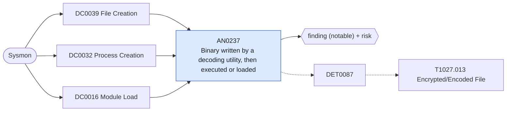

# AN0237 Binary written by a decoding utility, then executed or loaded

[ATT&CK analytic](https://attack.mitre.org/detectionstrategies/DET0087#AN0237) · DET0087 Encrypted or Encoded File Payload Detection Strategy · [T1027.013 Encrypted/Encoded File](https://attack.mitre.org/techniques/T1027/013) · tactics: stealth · platforms: Windows

**Content type:** ttp → finding (notable) + risk · **Severity:** high · **Status:** implemented · **Technique prevalence score:** 310

A decoder or script host (certutil, PowerShell, cmd, expand, esentutl, extrac32, makecab, mshta, script hosts) writes a PE file into a staging path (Sysmon 11), and within ten minutes that file is started as a process (Sysmon 1) or loaded as a module (Sysmon 7). Joined on host and file path: the decode-then-run chain ATT&CK describes, where AN0767 only sees the decode command.



## What ATT&CK asks for

> Detection of processes that load or decode encrypted/encoded files in memory and subsequently execute or inject them, indicating payload unpacking or memory-resident malware.

## What this implementation detects

A decoder or script host (certutil, PowerShell, cmd, expand, esentutl, extrac32, makecab, mshta, script hosts) writes a PE file into a staging path (Sysmon 11), and within ten minutes that file is started as a process (Sysmon 1) or loaded as a module (Sysmon 7). Joined on host and file path: the decode-then-run chain ATT&CK describes, where AN0767 only sees the decode command.

**Not covered:** In-memory decoding with no file on disk (reflective loading) is not visible here; AN1095 covers its injection step. The process-access leg is not used.

## Tuning

ATT&CK mutable elements and where each is bound. Edit macros in `local/macros.conf` and lookups in place; do not edit the search.

| Mutable element | ATT&CK guidance | Bound to | Default |
|---|---|---|---|
| Image | Path of decoder utilities (e.g., certutil.exe, powershell.exe) can vary across environments. | macro `mitre_an0237_decoders` | `Image IN ("*\\certutil.exe", "*\\powershell.exe", "*\\pwsh.exe", "*\\cmd.exe", "*\\expand.exe", "*\\esentutl.exe", "*\\extrac32.exe", "*\\makecab.exe", "*\\mshta.exe", "*\\wscript.exe", "*\\cscript.exe")` |
| CommandLine | Base64/hex strings used may change per encoded payload. | macro `mitre_an0237_staging_paths` — A parenthesised value list used with IN for the written file, the started image and the loaded module. | `("*\\AppData\\*", "*\\Users\\Public\\*", "*\\Windows\\Temp\\*", "*\\ProgramData\\*", "*\\PerfLogs\\*", "*\\Downloads\\*")` |
| TimeWindow | The duration between file decode and execution may differ across implementations. | macro `mitre_an0237_window_seconds` | `600` |

## Splunk

Stanza `[MITRE - AN0237 - Binary written by a decoding utility, then executed or loaded - Rule]` in `DA-ESS-mitre-attack-detections`. Schedule `7-59/15 * * * *`, window `-75m@m` to `-5m@m`. Ships disabled.

```spl
(`mitre_dc0039_sysmon` EventCode=11 `mitre_an0237_decoders` TargetFilename IN `mitre_an0237_staging_paths` TargetFilename IN ("*.exe", "*.dll", "*.scr", "*.cpl", "*.ocx", "*.sys"))
  OR (`mitre_dc0032_sysmon` EventCode=1 Image IN `mitre_an0237_staging_paths`)
  OR (`mitre_dc0016_sysmon` EventCode=7 ImageLoaded IN `mitre_an0237_staging_paths`)
| `mitre_normalize_host`
| eval file_path=lower(case(EventCode==11, TargetFilename, EventCode==7, ImageLoaded, true(), Image))
| eval decode_time=if(EventCode==11, _time, null()), run_time=if(EventCode!=11, _time, null()), decoder=if(EventCode==11, replace(Image, "^.*\\\\", ""), null()), how=case(EventCode==1, "executed", EventCode==7, "loaded")
| stats min(decode_time) as decode_time min(run_time) as run_time values(decoder) as decoder values(how) as how values(eval(if(EventCode==7, Image, null()))) as loaded_by values(user) as user by dest file_path
| where isnotnull(decode_time) AND isnotnull(run_time) AND run_time >= decode_time AND run_time - decode_time <= `mitre_an0237_window_seconds`
| eval process_name=mvindex(decoder, 0), firstTime=decode_time, lastTime=run_time
| `mitre_ctime(firstTime)` | `mitre_ctime(lastTime)`
| `mitre_an0237_filter`
```

Risk: `dest` (system, 70), `user` (user, 60). Threat objects: `file_path`, `process_name`. Message: $process_name$ wrote $file_path$ on $dest$, which then ran

Throttle: dest, file_path for 86400s.

Data components: [DC0039](../data-components/DC0039-file-creation.md), [DC0032](../data-components/DC0032-process-creation.md), [DC0016](../data-components/DC0016-module-load.md).

## Sigma

Rule file: `dist/sigma/rules/an0237_binary_written_by_a_decoding_utility_then_executed_or_loaded.yml` (base rule plus a correlation rule).

Uses a temporal (unordered) correlation because the Splunk pySigma backend does not implement temporal_ordered; the Splunk search enforces the order and also matches module loads.

## Known false positives

- Installers launched from PowerShell or cmd that unpack and run their own binaries from Temp.
