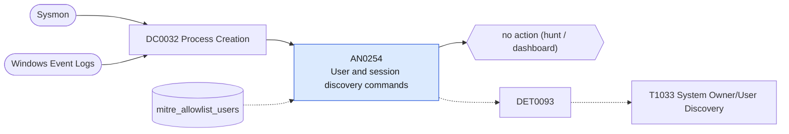

# AN0254 User and session discovery commands

[ATT&CK analytic](https://attack.mitre.org/detectionstrategies/DET0093#AN0254) · DET0093 Behavioral Detection of User Discovery via Local and Remote Enumeration · [T1033 System Owner/User Discovery](https://attack.mitre.org/techniques/T1033) · tactics: discovery · platforms: Windows

**Content type:** hunting → no action (hunt / dashboard) · **Severity:** informational · **Status:** implemented · **Technique prevalence score:** 300

Lists hosts and users running whoami, quser, qwinsta, query user/session or echoing the USERNAME variable, with parent process, in ten-minute buckets. whoami from a service, web server or script-host parent is the usual lead.



## What ATT&CK asks for

> Adversary launches built-in system tools (e.g., whoami, query user, net user) or scripts that enumerate user account information via local execution or remote API queries (e.g., WMI, PowerShell).

## What this implementation detects

Lists hosts and users running whoami, quser, qwinsta, query user/session or echoing the USERNAME variable, with parent process, in ten-minute buckets. whoami from a service, web server or script-host parent is the usual lead.

**Not covered:** Account enumeration (net user, Get-LocalUser, Get-ADUser) belongs to T1087 and is covered by AN0363. No finding or risk is produced.

## Tuning

ATT&CK mutable elements and where each is bound. Edit macros in `local/macros.conf` and lookups in place; do not edit the search.

| Mutable element | ATT&CK guidance | Bound to | Default |
|---|---|---|---|
| ParentProcessContext | Identify if enumeration originates from non-interactive shell or system service | filter macro `mitre_an0254_filter` — e.g. search parent_process_name IN ("w3wp.exe", "services.exe", "wmiprvse.exe", "wscript.exe"). |  |
| TimeWindow | Tune temporal grouping of enumeration + lateral movement attempts | filter macro `mitre_an0254_filter` (not bound separately) | `search *` |
| UserContext | Flag unexpected users issuing enumeration commands (e.g., service accounts) | lookup `mitre_allowlist_users` |  |

## Splunk

Stanza `[MITRE - AN0254 - User and session discovery commands - Rule]` in `DA-ESS-mitre-attack-detections`. Schedule `3-59/15 * * * *`, window `-20m@m` to `-5m@m`. Ships disabled.

```spl
| tstats `mitre_summariesonly` count from `mitre_dc0032_dm` where `mitre_dc0032_dm_where`
    (Processes.process_name IN ("whoami.exe", "quser.exe", "qwinsta.exe")
      OR (Processes.process_name="query.exe" Processes.process IN ("*user*", "*session*"))
      OR (Processes.process_name="cmd.exe" Processes.process="*echo*%username%*"))
    by Processes.dest Processes.user Processes.parent_process_name Processes.process _time span=10m
| `drop_dm_object_name(Processes)`
| search `mitre_not_allowlisted_user`
| stats sum(count) as count dc(process) as distinct_commands values(process) as process by dest user parent_process_name _time
| sort - count
| `mitre_an0254_filter`
```

Data components: [DC0032](../data-components/DC0032-process-creation.md).

## Sigma

Rule file: `dist/sigma/rules/an0254_user_and_session_discovery_commands.yml`.

## Known false positives

- Logon scripts, management tooling and administrators.
