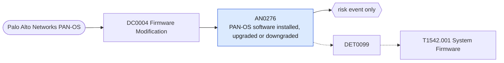

# AN0276 PAN-OS software installed, upgraded or downgraded

[ATT&CK analytic](https://attack.mitre.org/detectionstrategies/DET0099#AN0276) · DET0099 Detection Strategy for T1542.001 Pre-OS Boot: System Firmware · [T1542.001 System Firmware](https://attack.mitre.org/techniques/T1542/001) · tactics: stealth, persistence · platforms: Network Devices

**Content type:** anomaly → risk event only · **Severity:** medium · **Status:** implemented · **Technique prevalence score:** 3

A Palo Alto system log records a PAN-OS software image being installed, upgraded, downgraded or a boot image changed. Firmware changes outside a planned upgrade are how network-device implants persist.



## What ATT&CK asks for

> Unauthorized firmware uploads to routers, switches, or firewalls via TFTP/FTP/SCP. Logs showing boot variable or startup image path changes redirecting to non-standard firmware images. Abnormal reboots or firmware rollback attempts following configuration modification events.

## What this implementation detects

A Palo Alto system log records a PAN-OS software image being installed, upgraded, downgraded or a boot image changed. Firmware changes outside a planned upgrade are how network-device implants persist.

**Not covered:** Image hashes (ApprovedFirmwareHashes) and the uploading source are not in the system log; dynamic content updates (apps, threats, antivirus) are excluded. Routers and switches need the netdev_syslog feed.

## Tuning

ATT&CK mutable elements and where each is bound. Edit macros in `local/macros.conf` and lookups in place; do not edit the search.

| Mutable element | ATT&CK guidance | Bound to | Default |
|---|---|---|---|
| ApprovedFirmwareHashes | Known good firmware image hashes stored for validation. | filter macro `mitre_an0276_filter` |  |
| MaintenanceWindows | Expected time periods when firmware uploads or reboots are considered normal. | filter macro `mitre_an0276_filter` |  |
| SourceIPWhitelist | List of trusted management IPs allowed to initiate firmware uploads. | macro `mitre_an0276_patterns` | `(description IN ("*software*install*", "*panos*install*", "*pan-os*install*", "*upgrade*", "*downgrade*", "*boot image*", "*software image*") NOT description IN ("*content*", "*antivirus*", "*wildfire*", "*threat*", "*app*"))` |

## Splunk

Stanza `[MITRE - AN0276 - PAN-OS software installed, upgraded or downgraded - Rule]` in `DA-ESS-mitre-attack-detections`. Schedule `4-59/15 * * * *`, window `-20m@m` to `-5m@m`. Ships disabled.

```spl
`mitre_dc0004_palo_alto` `mitre_st_palo_alto_system` `mitre_an0276_patterns`
| `mitre_normalize_pan_system`
| stats count min(_time) as firstTime max(_time) as lastTime values(description) as description values(user) as user by dvc
| rename dvc as dest
| `mitre_ctime(firstTime)` | `mitre_ctime(lastTime)`
| `mitre_an0276_filter`
```

Risk: `dest` (system, 30). Message: PAN-OS software change on firewall $dest$

Throttle: dest for 86400s.

Data components: [DC0004](../data-components/DC0004-firmware-modification.md).

## Sigma

Rule file: `dist/sigma/rules/an0276_pan_os_software_installed_upgraded_or_downgraded.yml`.

## Known false positives

- Planned PAN-OS upgrades.
