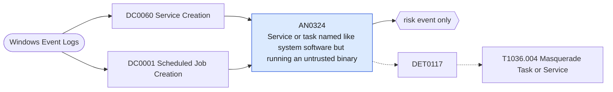

# AN0324 Service or task named like system software but running an untrusted binary

[ATT&CK analytic](https://attack.mitre.org/detectionstrategies/DET0117#AN0324) · DET0117 Detection of Masqueraded Tasks or Services with Suspicious Naming and Execution · [T1036.004 Masquerade Task or Service](https://attack.mitre.org/techniques/T1036/004) · tactics: stealth · platforms: Windows

**Content type:** anomaly → risk event only · **Severity:** medium · **Status:** implemented · **Technique prevalence score:** 126

A service (System 7045) or scheduled task (Security 4698) is created with a name that imitates Windows, Microsoft or common vendor updaters, while its binary is outside System32 and Program Files. Legitimate software with those names installs into Program Files; impostors usually run from ProgramData, AppData or Temp.



## What ATT&CK asks for

> Creation or modification of Windows services or scheduled tasks with names or descriptions mimicking legitimate entries, followed by anomalous execution of untrusted binaries or LOLBAS.

## What this implementation detects

A service (System 7045) or scheduled task (Security 4698) is created with a name that imitates Windows, Microsoft or common vendor updaters, while its binary is outside System32 and Program Files. Legitimate software with those names installs into Program Files; impostors usually run from ProgramData, AppData or Temp.

**Not covered:** Name similarity is a keyword list, not an edit-distance comparison (SPL has no Levenshtein function); binary reputation is not checked.

## Tuning

ATT&CK mutable elements and where each is bound. Edit macros in `local/macros.conf` and lookups in place; do not edit the search.

| Mutable element | ATT&CK guidance | Bound to | Default |
|---|---|---|---|
| TaskNameSimilarityThreshold | Similarity threshold for comparing new task/service names to known legitimate names (e.g., Levenshtein distance) | macro `mitre_an0324_impersonated_names` | `(ServiceName IN ("*svchost*", "*windows*", "*microsoft*", "*wuauserv*", "*update*", "*defender*", "*google*", "*chrome*", "*adobe*", "*onedrive*", "*edge*", "*intel*", "*nvidia*") OR TaskName IN ("*svchost*", "*windows*", "*microsoft*", "*update*", "*defender*", "*google*", "*chrome*", "*adobe*", "*onedrive*", "*edge*", "*intel*", "*nvidia*"))` |
| BinaryReputationScore | Confidence level required for allowing a binary, often from unsigned or untrusted source | macro `mitre_an0324_trusted_paths` — Matched with NOT; add vendor install roots here. | `binary IN ("c:\\windows\\system32\\*", "\"c:\\windows\\system32\\*", "%systemroot%\\system32\\*", "\"%systemroot%\\system32\\*", "%windir%\\system32\\*", "c:\\windows\\syswow64\\*", "c:\\program files*", "\"c:\\program files*", "%programfiles%*", "\"%programfiles%*", "system32\\*", "c:\\windows\\microsoft.net\\*")` |
| ExecutionContext | Whether the execution came from SYSTEM, service accounts, or user contexts | filter macro `mitre_an0324_filter` |  |

## Splunk

Stanza `[MITRE - AN0324 - Service or task named like system software but running an untrusted binary - Rule]` in `DA-ESS-mitre-attack-detections`. Schedule `10-59/15 * * * *`, window `-20m@m` to `-5m@m`. Ships disabled.

```spl
(`mitre_dc0060_wineventlog` EventCode=7045 `mitre_an0324_impersonated_names`)
  OR (`mitre_dc0001_wineventlog` EventCode=4698 `mitre_an0324_impersonated_names`)
| `mitre_normalize_host`
| rex field=TaskContent "(?i)(?:<|&lt;)Command(?:>|&gt;)\s*(?<task_command>[^<&]+?)\s*(?:<|&lt;)/Command"
| eval object_name=coalesce(ServiceName, TaskName), object_type=if(EventCode==7045, "service", "scheduled_task"), binary=lower(trim(coalesce(ImagePath, task_command)))
| where isnotnull(binary)
| search NOT `mitre_an0324_trusted_paths`
| stats count min(_time) as firstTime max(_time) as lastTime values(binary) as binary values(object_type) as object_type by dest user object_name
| `mitre_ctime(firstTime)` | `mitre_ctime(lastTime)`
| `mitre_an0324_filter`
```

Risk: `dest` (system, 45), `user` (user, 30). Threat objects: `binary`. Message: $object_name$ on $dest$ imitates system software but runs $binary$

Throttle: dest, object_name for 86400s.

Data components: [DC0060](../data-components/DC0060-service-creation.md), [DC0001](../data-components/DC0001-scheduled-job-creation.md).

## Sigma

Rule file: `dist/sigma/rules/an0324_service_or_task_named_like_system_software_but_running_an_un.yml`.

## Known false positives

- Vendor updaters installed per user (some browser and conferencing updaters run from AppData or ProgramData).
