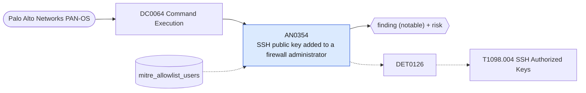

# AN0354 SSH public key added to a firewall administrator

[ATT&CK analytic](https://attack.mitre.org/detectionstrategies/DET0126#AN0354) · DET0126 Detection Strategy for SSH Key Injection in Authorized Keys · [T1098.004 SSH Authorized Keys](https://attack.mitre.org/techniques/T1098/004) · tactics: persistence, privilege-escalation · platforms: Network Devices

**Content type:** ttp → finding (notable) + risk · **Severity:** high · **Status:** implemented · **Technique prevalence score:** 13

A Palo Alto configuration change sets a public key on an administrator account (mgt-config users ... public-key), which allows SSH login without the password and survives password resets.



## What ATT&CK asks for

> Use of command-line like `ip ssh pubkey-chain` to bind SSH keys to privileged accounts on routers or switches.

## What this implementation detects

A Palo Alto configuration change sets a public key on an administrator account (mgt-config users ... public-key), which allows SSH login without the password and survives password resets.

**Not covered:** Routers and switches (ip ssh pubkey-chain) need the netdev_syslog feed.

## Tuning

ATT&CK mutable elements and where each is bound. Edit macros in `local/macros.conf` and lookups in place; do not edit the search.

| Mutable element | ATT&CK guidance | Bound to | Default |
|---|---|---|---|
| CLIUserRole | Was the role allowed to push persistent config changes? | lookup `mitre_allowlist_users` — Administrators who manage key-based access. |  |
| DeviceModel | Variations in syntax or log behavior across device OS | filter macro `mitre_an0354_filter` |  |

## Splunk

Stanza `[MITRE - AN0354 - SSH public key added to a firewall administrator - Rule]` in `DA-ESS-mitre-attack-detections`. Schedule `10-59/15 * * * *`, window `-20m@m` to `-5m@m`. Ships disabled.

```spl
`mitre_dc0064_palo_alto` `mitre_st_palo_alto_config` cmd IN ("set", "edit", "add") path="*mgt-config*users*" path="*public-key*"
| `mitre_normalize_pan`
| eval dest=coalesce(dvc_name, dest, host), config_path=path
| search `mitre_not_allowlisted_user`
| stats count min(_time) as firstTime max(_time) as lastTime values(config_path) as config_path values(client) as client by dest user
| `mitre_ctime(firstTime)` | `mitre_ctime(lastTime)`
| `mitre_an0354_filter`
```

Risk: `dest` (system, 60), `user` (user, 60). Message: SSH key added to an administrator on firewall $dest$ by $user$

Throttle: dest, user for 3600s.

Data components: [DC0064](../data-components/DC0064-command-execution.md).

## Sigma

Rule file: `dist/sigma/rules/an0354_ssh_public_key_added_to_a_firewall_administrator.yml`.

## Known false positives

- Planned move to key-based administrator access.
