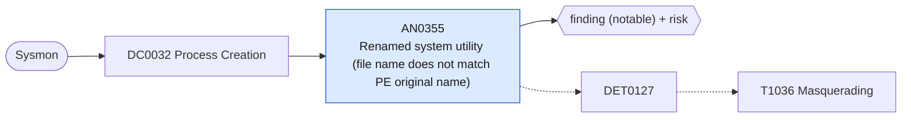

# AN0355 Renamed system utility (file name does not match PE original name)

[ATT&CK analytic](https://attack.mitre.org/detectionstrategies/DET0127#AN0355) · DET0127 Behavioral Detection of Masquerading Across Platforms via Metadata and Execution Discrepancy · [T1036 Masquerading](https://attack.mitre.org/techniques/T1036) · tactics: stealth · platforms: Windows

**Content type:** ttp → finding (notable) + risk · **Severity:** medium · **Status:** implemented · **Technique prevalence score:** 89

Sysmon reports an OriginalFileName belonging to a commonly abused utility (cmd, PowerShell, script hosts, mshta, rundll32, regsvr32, certutil, bitsadmin, wmic, msbuild, installutil, net, reg, schtasks, sc, PsExec, ProcDump) while the image on disk has a different file name.



## What ATT&CK asks for

> Adversary renames LOLBINs or deploys binaries with spoofed file names, internal PE metadata, or misleading icons to appear legitimate. File creation is followed by execution or service registration inconsistent with known usage.

## What this implementation detects

Sysmon reports an OriginalFileName belonging to a commonly abused utility (cmd, PowerShell, script hosts, mshta, rundll32, regsvr32, certutil, bitsadmin, wmic, msbuild, installutil, net, reg, schtasks, sc, PsExec, ProcDump) while the image on disk has a different file name.

**Not covered:** Service registration of the renamed binary (7045) and spoofed icons or other PE metadata are not evaluated.

## Tuning

ATT&CK mutable elements and where each is bound. Edit macros in `local/macros.conf` and lookups in place; do not edit the search.

| Mutable element | ATT&CK guidance | Bound to | Default |
|---|---|---|---|
| OriginalFilenameMismatch | Compare executable file name with PE metadata OriginalFilename field | macro `mitre_an0355_original_names` | `OriginalFileName IN ("Cmd.Exe", "PowerShell.EXE", "pwsh.dll", "cscript.exe", "wscript.exe", "MSHTA.EXE", "RUNDLL32.EXE", "REGSVR32.EXE", "CertUtil.exe", "bitsadmin.exe", "wmic.exe", "MSBuild.exe", "InstallUtil.exe", "net.exe", "net1.exe", "reg.exe", "schtasks.exe", "sc.exe", "psexec.c", "procdump")` |
| KnownSystemUtilityPaths | Tune based on expected installation directories for signed binaries | filter macro `mitre_an0355_filter` |  |
| TimeWindow | Correlation window between file creation and service/process execution | filter macro `mitre_an0355_filter` (not bound separately) | `search *` |

## Splunk

Stanza `[MITRE - AN0355 - Renamed system utility (file name does not match PE original name) - Rule]` in `DA-ESS-mitre-attack-detections`. Schedule `0-59/15 * * * *`, window `-20m@m` to `-5m@m`. Ships disabled.

```spl
`mitre_dc0032_sysmon` EventCode=1 `mitre_an0355_original_names`
| `mitre_normalize_host`
| eval process_name=lower(replace(Image, "^.*\\\\", "")), original_file_name=lower(OriginalFileName)
| eval expected=case(original_file_name=="pwsh.dll", "pwsh.exe", original_file_name=="psexec.c", "psexec.exe;psexec64.exe", original_file_name=="procdump", "procdump.exe;procdump64.exe", true(), original_file_name)
| where NOT like(";".expected.";", "%;".process_name.";%")
| stats count min(_time) as firstTime max(_time) as lastTime values(CommandLine) as process values(ParentImage) as parent_process by dest user Image process_name original_file_name
| `mitre_ctime(firstTime)` | `mitre_ctime(lastTime)`
| `mitre_an0355_filter`
```

Risk: `dest` (system, 55), `user` (user, 45). Threat objects: `process_name`. Message: Renamed $original_file_name$ executed as $process_name$ on $dest$

Throttle: dest, Image for 86400s.

Data components: [DC0032](../data-components/DC0032-process-creation.md).

## Sigma

Rule file: `dist/sigma/rules/an0355_renamed_system_utility_file_name_does_not_match_pe_original_.yml`.

## Known false positives

- Software that bundles a renamed copy of a Windows utility; some packaging tools.
