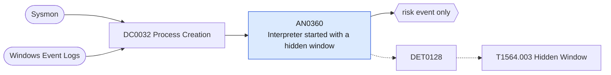

# AN0360 Interpreter started with a hidden window

[ATT&CK analytic](https://attack.mitre.org/detectionstrategies/DET0128#AN0360) · DET0128 Detection Strategy for Hidden Windows · [T1564.003 Hidden Window](https://attack.mitre.org/techniques/T1564/003) · tactics: stealth · platforms: Windows

**Content type:** anomaly → risk event only · **Severity:** low · **Status:** implemented · **Technique prevalence score:** 81

PowerShell is started with a hidden WindowStyle argument, or cmd uses start /min or /b to launch an interpreter, from a parent that is not a known management agent.



## What ATT&CK asks for

> Suspicious use of scripting parameters or registry edits to hide process windows (e.g., powershell.exe -WindowStyle Hidden, or registry modifications pushing window positions off screen). Defender view: correlation of hidden execution with anomalous process lineage or hVNC-like CreateDesktop API calls.

## What this implementation detects

PowerShell is started with a hidden WindowStyle argument, or cmd uses start /min or /b to launch an interpreter, from a parent that is not a known management agent.

**Not covered:** Registry-based window hiding and hVNC-style CreateDesktop use are not covered. Hidden windows are common in legitimate automation, hence the low score.

## Tuning

ATT&CK mutable elements and where each is bound. Edit macros in `local/macros.conf` and lookups in place; do not edit the search.

| Mutable element | ATT&CK guidance | Bound to | Default |
|---|---|---|---|
| HiddenProcessScope | Restrict to processes where hidden execution is unexpected (e.g., PowerShell, cmd, wscript). | macro `mitre_an0360_hidden_args` | `((Processes.process_name IN ("powershell.exe", "pwsh.exe") Processes.process IN ("*-w hidden*", "*-w h *", "*-wi* hidden*", "*-win* hidden*", "*-windowstyle hidden*", "*-windowstyle h *", "*-w 1 *", "*-windowstyle 1*")) OR (Processes.process_name="cmd.exe" Processes.process IN ("*start /min *", "*start /b *") Processes.process IN ("*powershell*", "*wscript*", "*cscript*", "*mshta*", "*rundll32*")))` |
| ParentProcessCorrelation | Correlate hidden execution with suspicious parent processes to reduce false positives. | filter macro `mitre_an0360_filter` — Exclude management agents by parent, e.g. search NOT parent_process_name IN ("ccmexec.exe", "gpscript.exe"). |  |

## Splunk

Stanza `[MITRE - AN0360 - Interpreter started with a hidden window - Rule]` in `DA-ESS-mitre-attack-detections`. Schedule `7-59/15 * * * *`, window `-20m@m` to `-5m@m`. Ships disabled.

```spl
| tstats `mitre_summariesonly` count min(_time) as firstTime max(_time) as lastTime
    from `mitre_dc0032_dm` where `mitre_dc0032_dm_where` `mitre_an0360_hidden_args`
    by Processes.dest Processes.user Processes.parent_process_name Processes.process_name Processes.process
| `drop_dm_object_name(Processes)`
| `mitre_ctime(firstTime)` | `mitre_ctime(lastTime)`
| `mitre_an0360_filter`
```

Risk: `dest` (system, 20), `user` (user, 20). Threat objects: `process`. Message: Hidden-window interpreter on $dest$ started by $parent_process_name$

Throttle: dest, user, parent_process_name for 14400s.

Data components: [DC0032](../data-components/DC0032-process-creation.md).

## Sigma

Rule file: `dist/sigma/rules/an0360_interpreter_started_with_a_hidden_window.yml`.

## Known false positives

- Logon scripts, scheduled maintenance tasks and software updaters.
