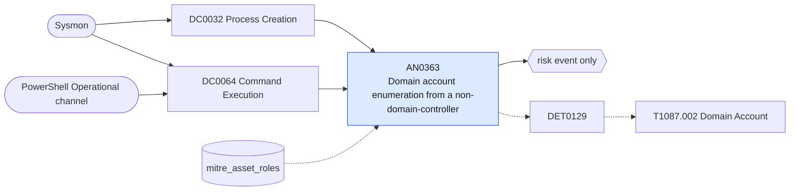

# AN0363 Domain account enumeration from a non-domain-controller

[ATT&CK analytic](https://attack.mitre.org/detectionstrategies/DET0129#AN0363) · DET0129 Domain Account Enumeration Across Platforms · [T1087.002 Domain Account](https://attack.mitre.org/techniques/T1087/002) · tactics: discovery · platforms: Windows

**Content type:** anomaly → risk event only · **Severity:** low · **Status:** implemented · **Technique prevalence score:** 96

net user/group/accounts with /domain, dsquery, adfind, ldifde or csvde is run, or PowerShell executes Get-ADUser, Get-ADGroupMember, PowerView account cmdlets or a DirectorySearcher user filter (seen in the process command line or in a 4104 script block), on a host that is not listed as a domain controller in mitre_asset_roles.



## What ATT&CK asks for

> Adversary enumeration of domain accounts using net.exe, PowerShell, WMI, or LDAP queries from non-domain controllers or non-admin endpoints.

## What this implementation detects

net user/group/accounts with /domain, dsquery, adfind, ldifde or csvde is run, or PowerShell executes Get-ADUser, Get-ADGroupMember, PowerView account cmdlets or a DirectorySearcher user filter (seen in the process command line or in a 4104 script block), on a host that is not listed as a domain controller in mitre_asset_roles.

**Not covered:** LDAP bind and search volume seen by Corelight (ldap_search.log) is not correlated; the TimeWindow burst condition is left to the filter macro.

## Tuning

ATT&CK mutable elements and where each is bound. Edit macros in `local/macros.conf` and lookups in place; do not edit the search.

| Mutable element | ATT&CK guidance | Bound to | Default |
|---|---|---|---|
| CommandLinePattern | Detect variations of 'net user /domain', 'Get-ADUser', 'Get-ADGroupMember'. | macro `mitre_an0363_commands` | `((Image IN ("*\\net.exe", "*\\net1.exe") CommandLine IN ("* user* /do*", "* group* /do*", "* accounts* /do*")) OR Image IN ("*\\dsquery.exe", "*\\adfind.exe", "*\\ldifde.exe", "*\\csvde.exe") OR CommandLine IN ("*Get-ADUser*", "*Get-ADGroupMember*", "*Get-DomainUser*", "*Get-NetUser*", "*samaccounttype=805306368*"))` |
| TimeWindow | Tune detection for bursts of enumeration commands or search queries. | filter macro `mitre_an0363_filter` |  |
| SourceHost | Restrict detection to non-DC or non-admin systems where such commands are unexpected. | lookup `mitre_asset_roles` — Rows with role=domain_controller are excluded through the shared macro mitre_hosts_with_role(1). |  |

## Splunk

Stanza `[MITRE - AN0363 - Domain account enumeration from a non-domain-controller - Rule]` in `DA-ESS-mitre-attack-detections`. Schedule `14-59/15 * * * *`, window `-20m@m` to `-5m@m`. Ships disabled.

```spl
(`mitre_dc0032_sysmon` EventCode=1 `mitre_an0363_commands`)
  OR (`mitre_dc0064_powershell_logging` EventCode=4104 ScriptBlockText IN ("*Get-ADUser*", "*Get-ADGroupMember*", "*Get-DomainUser*", "*Get-NetUser*", "*Get-DomainGroupMember*", "*samaccounttype=805306368*"))
| `mitre_normalize_host`
| search NOT `mitre_hosts_with_role(domain_controller)`
| eval command=coalesce(CommandLine, substr(ScriptBlockText, 1, 500)), source=if(EventCode==4104, "script_block", "process")
| stats count min(_time) as firstTime max(_time) as lastTime values(source) as source values(command) as command by dest user
| `mitre_ctime(firstTime)` | `mitre_ctime(lastTime)`
| `mitre_an0363_filter`
```

Risk: `dest` (system, 25), `user` (user, 25). Message: Domain account enumeration on $dest$ by $user$

Throttle: dest, user for 14400s.

Data components: [DC0032](../data-components/DC0032-process-creation.md), [DC0064](../data-components/DC0064-command-execution.md).

## Sigma

Rule file: `dist/sigma/rules/an0363_domain_account_enumeration_from_a_non_domain_controller.yml`.

## Known false positives

- Identity administrators, help desk and HR or provisioning scripts.
