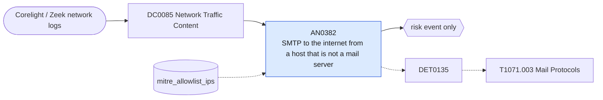

# AN0382 SMTP to the internet from a host that is not a mail server

[ATT&CK analytic](https://attack.mitre.org/detectionstrategies/DET0135#AN0382) · DET0135 Detection of Mail Protocol-Based C2 Activity (SMTP, IMAP, POP3) · [T1071.003 Mail Protocols](https://attack.mitre.org/techniques/T1071/003) · tactics: command-and-control · platforms: Network Devices

**Content type:** anomaly → risk event only · **Severity:** medium · **Status:** implemented · **Technique prevalence score:** 32

Corelight smtp.log shows an internal host delivering mail directly to an external server. Mail should leave through the mail relays; direct SMTP from workstations and servers is used for C2 and exfiltration over mail and by spam bots.



## What ATT&CK asks for

> Detects hosts transmitting large volumes of SMTP, IMAP, or POP3 traffic to external IPs or relays that aren't associated with the enterprise mail infrastructure.

## What this implementation detects

Corelight smtp.log shows an internal host delivering mail directly to an external server. Mail should leave through the mail relays; direct SMTP from workstations and servers is used for C2 and exfiltration over mail and by spam bots.

**Not covered:** IMAP and POP3 to external mailboxes are not included (smtp.log only); the outflow-to-inflow ratio is reported but not a condition.

## Tuning

ATT&CK mutable elements and where each is bound. Edit macros in `local/macros.conf` and lookups in place; do not edit the search.

| Mutable element | ATT&CK guidance | Bound to | Default |
|---|---|---|---|
| ExternalMailRelayFilter | Dest IPs not matching sanctioned SMTP/IMAP relays | lookup `mitre_allowlist_ips` — Mail relays and anything else allowed to send SMTP out (cidr column). |  |
| OutflowToInflowRatio | Outbound email bytes vastly exceed response | filter macro `mitre_an0382_filter` |  |

## Splunk

Stanza `[MITRE - AN0382 - SMTP to the internet from a host that is not a mail server - Rule]` in `DA-ESS-mitre-attack-detections`. Schedule `9-59/15 * * * *`, window `-20m@m` to `-5m@m`. Ships disabled.

```spl
`mitre_dc0085_corelight` `mitre_st_corelight_smtp`
| `mitre_normalize_zeek`
| where NOT `mitre_is_internal(dest)` AND `mitre_is_internal(src)`
| lookup mitre_allowlist_ips cidr AS src OUTPUT reason AS allow_reason
| where isnull(allow_reason)
| stats count as messages min(_time) as firstTime max(_time) as lastTime dc(dest) as distinct_servers values(mailfrom) as mailfrom values(rcptto) as rcptto values(helo) as helo by src
| eval rcptto=mvindex(rcptto, 0, 9)
| `mitre_ctime(firstTime)` | `mitre_ctime(lastTime)`
| `mitre_an0382_filter`
```

Risk: `src` (system, 35). Message: $src$ sent $messages$ messages directly to external SMTP servers

Throttle: src for 14400s.

Data components: [DC0085](../data-components/DC0085-network-traffic-content.md).

## Sigma

Rule file: `dist/sigma/rules/an0382_smtp_to_the_internet_from_a_host_that_is_not_a_mail_server.yml`.

## Known false positives

- Appliances and scanners configured to send notifications straight to a cloud mail service; allow-list them.
