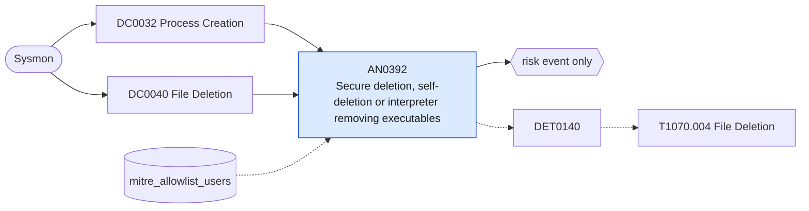

# AN0392 Secure deletion, self-deletion or interpreter removing executables

[ATT&CK analytic](https://attack.mitre.org/detectionstrategies/DET0140#AN0392) · DET0140 Behavioral Detection of Malicious File Deletion · [T1070.004 File Deletion](https://attack.mitre.org/techniques/T1070/004) · tactics: stealth · platforms: Windows

**Content type:** anomaly → risk event only · **Severity:** medium · **Status:** implemented · **Technique prevalence score:** 380

Three deletion patterns used to remove artifacts: secure-delete tools (SDelete, cipher /w, fsutil USN journal deletion); a command line that waits and then deletes, the usual self-deletion idiom (ping/timeout/choice followed by del); and a script interpreter or LOLBin deleting an executable or script from a staging path (Sysmon 23/26).



## What ATT&CK asks for

> Detects adversary behavior deleting artifacts (e.g., dropped payloads, evidence files) using native or external utilities (e.g., del, erase, SDelete). Detects deletion events correlated with unusual process lineage or timing post-execution.

## What this implementation detects

Three deletion patterns used to remove artifacts: secure-delete tools (SDelete, cipher /w, fsutil USN journal deletion); a command line that waits and then deletes, the usual self-deletion idiom (ping/timeout/choice followed by del); and a script interpreter or LOLBin deleting an executable or script from a staging path (Sysmon 23/26).

**Not covered:** The correlation with the deleting process's earlier execution and with 4663 object access is not made; plain del of user files is out of scope.

## Tuning

ATT&CK mutable elements and where each is bound. Edit macros in `local/macros.conf` and lookups in place; do not edit the search.

| Mutable element | ATT&CK guidance | Bound to | Default |
|---|---|---|---|
| TimeWindow | Defines correlation window after suspicious binary execution or login session. | filter macro `mitre_an0392_filter` — Not correlated with prior execution in this search. |  |
| FilePathPattern | Focuses on deletion of temp files, malware staging dirs, or known indicators. | macro `mitre_an0392_artifact_paths` | `TargetFilename IN ("*\\AppData\\Local\\Temp\\*", "*\\Windows\\Temp\\*", "*\\Users\\Public\\*", "*\\ProgramData\\*", "*\\PerfLogs\\*", "*\\Downloads\\*") TargetFilename IN ("*.exe", "*.dll", "*.ps1", "*.bat", "*.cmd", "*.vbs", "*.js", "*.hta", "*.scr")` |
| UserContext | Privilege level or impersonated user deleting sensitive files. | lookup `mitre_allowlist_users` |  |

## Splunk

Stanza `[MITRE - AN0392 - Secure deletion, self-deletion or interpreter removing executables - Rule]` in `DA-ESS-mitre-attack-detections`. Schedule `1-59/15 * * * *`, window `-20m@m` to `-5m@m`. Ships disabled.

```spl
(`mitre_dc0032_sysmon` EventCode=1 (Image IN ("*\\sdelete.exe", "*\\sdelete64.exe") OR OriginalFileName="sdelete.exe"
    OR (Image="*\\cipher.exe" CommandLine="* /w:*")
    OR (Image="*\\fsutil.exe" CommandLine="*usn*deletejournal*")
    OR (Image="*\\cmd.exe" CommandLine IN ("*ping*127.0.0.1*&*del *", "*timeout*&*del *", "*choice /c*&*del *", "*ping -n*&*del *"))))
  OR (`mitre_dc0040_sysmon` EventCode IN (23, 26) Image IN ("*\\cmd.exe", "*\\powershell.exe", "*\\pwsh.exe", "*\\wscript.exe", "*\\cscript.exe", "*\\mshta.exe", "*\\rundll32.exe", "*\\regsvr32.exe") `mitre_an0392_artifact_paths`)
| `mitre_normalize_host`
| eval signal=case(EventCode IN (23, 26), "interpreter_deleted_executable", match(CommandLine, "(?i)sdelete|cipher|fsutil"), "secure_delete", true(), "self_delete"), process_name=replace(Image, "^.*\\\\", "")
| search `mitre_not_allowlisted_user`
| stats count min(_time) as firstTime max(_time) as lastTime values(signal) as signals values(CommandLine) as process values(TargetFilename) as file_path by dest user process_name
| `mitre_ctime(firstTime)` | `mitre_ctime(lastTime)`
| `mitre_an0392_filter`
```

Risk: `dest` (system, 35), `user` (user, 30). Threat objects: `process_name`. Message: Artifact deletion by $process_name$ on $dest$

Throttle: dest, process_name for 3600s.

Data components: [DC0032](../data-components/DC0032-process-creation.md), [DC0040](../data-components/DC0040-file-deletion.md).

## Sigma

Rule file: `dist/sigma/rules/an0392_secure_deletion_self_deletion_or_interpreter_removing_execut.yml`.

## Known false positives

- Installers and updaters that remove their own temporary executables; administrators wiping free space.
