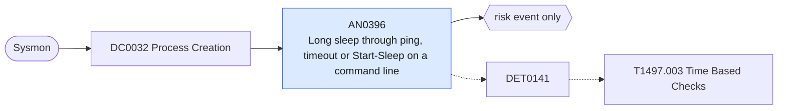

# AN0396 Long sleep through ping, timeout or Start-Sleep on a command line

[ATT&CK analytic](https://attack.mitre.org/detectionstrategies/DET0141#AN0396) · DET0141 Detect Time-Based Evasion via Sleep, Timer Loops, and Delayed Execution · [T1497.003 Time Based Checks](https://attack.mitre.org/techniques/T1497/003) · tactics: stealth, discovery · platforms: Windows

**Content type:** anomaly → risk event only · **Severity:** low · **Status:** implemented · **Technique prevalence score:** 51

A command line that delays for a long time (ping -n N to loopback, timeout /t N, choice /t N, Start-Sleep N) above a threshold, launched by something other than an interactive shell. Payloads stall to outlast sandbox analysis windows and to separate stages in time.



## What ATT&CK asks for

> Process creation involving suspicious delays (e.g., Sleep, ping -n loops, WaitForSingleObject), followed by sensitive system access or lateral movement behaviors.

## What this implementation detects

A command line that delays for a long time (ping -n N to loopback, timeout /t N, choice /t N, Start-Sleep N) above a threshold, launched by something other than an interactive shell. Payloads stall to outlast sandbox analysis windows and to separate stages in time.

**Not covered:** Sleeps inside a binary (Sleep, WaitForSingleObject, NtDelayExecution) are invisible; short ping-then-delete chains are AN0392's self-deletion leg.

## Tuning

ATT&CK mutable elements and where each is bound. Edit macros in `local/macros.conf` and lookups in place; do not edit the search.

| Mutable element | ATT&CK guidance | Bound to | Default |
|---|---|---|---|
| SleepDurationThreshold | Defines maximum allowable sleep duration in milliseconds before triggering anomaly detection. | macro `mitre_an0396_min_delay_seconds` | `60` |
| TimeBetweenExecutionAndNextStage | Temporal window between initial process and next stage (e.g., lateral movement or persistence), used to correlate dormant activity. | filter macro `mitre_an0396_filter` |  |
| UserContext | Whether the activity occurs in SYSTEM or user context may affect legitimacy scoring. | macro `mitre_an0396_interactive_parents` | `ParentImage IN ("*\\explorer.exe", "*\\WindowsTerminal.exe", "*\\OpenConsole.exe", "*\\conhost.exe")` |

## Splunk

Stanza `[MITRE - AN0396 - Long sleep through ping, timeout or Start-Sleep on a command line - Rule]` in `DA-ESS-mitre-attack-detections`. Schedule `0-59/15 * * * *`, window `-20m@m` to `-5m@m`. Ships disabled.

```spl
`mitre_dc0032_sysmon` EventCode=1 CommandLine IN ("*ping*-n *", "*timeout*/t *", "*choice*/t *", "*Start-Sleep*", "*sleep -*") NOT `mitre_an0396_interactive_parents`
| `mitre_normalize_host`
| rex field=CommandLine "(?i)(?:ping[^|&]*\s-n\s+|timeout(?:\.exe)?\s+/t\s+|choice[^|&]*/t\s+|start-sleep\s+(?:-s(?:econds)?\s+)?|sleep\s+-s\s+)(?<delay>\d+)"
| eval delay=tonumber(delay), process_name=lower(replace(Image, "^.*\\\\", "")), parent_process_name=lower(replace(ParentImage, "^.*\\\\", ""))
| where delay >= `mitre_an0396_min_delay_seconds`
| search `mitre_not_allowlisted_process`
| stats count min(_time) as firstTime max(_time) as lastTime max(delay) as delay values(CommandLine) as process by dest user parent_process_name
| eval process=mvindex(process, 0, 9)
| `mitre_ctime(firstTime)` | `mitre_ctime(lastTime)`
| `mitre_an0396_filter`
```

Risk: `dest` (system, 20). Threat objects: `parent_process_name`. Message: $parent_process_name$ on $dest$ slept $delay$ seconds from the command line

Throttle: dest, parent_process_name for 86400s.

Data components: [DC0032](../data-components/DC0032-process-creation.md).

## Sigma

Rule file: `dist/sigma/rules/an0396_long_sleep_through_ping_timeout_or_start_sleep_on_a_command_.yml`.

## Known false positives

- Batch and installer scripts that wait for services or reboots; scheduled maintenance jobs.
