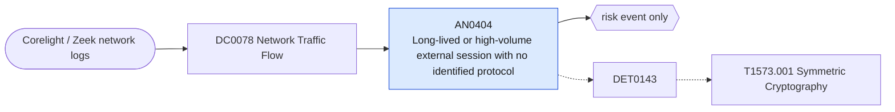

# AN0404 Long-lived or high-volume external session with no identified protocol

[ATT&CK analytic](https://attack.mitre.org/detectionstrategies/DET0143#AN0404) · DET0143 Detection Strategy for Encrypted Channel via Symmetric Cryptography across OS Platforms · [T1573.001 Symmetric Cryptography](https://attack.mitre.org/techniques/T1573/001) · tactics: command-and-control · platforms: Network Devices

**Content type:** anomaly → risk event only · **Severity:** low · **Status:** implemented · **Technique prevalence score:** 203

Corelight conn.log sessions to external hosts on non-standard ports where Zeek recognised no application protocol (service is empty), and that last a long time or move a lot of data: the shape of custom encrypted C2 that does not use TLS.



## What ATT&CK asks for

> Flows showing encrypted payloads with high entropy not matching TLS handshake patterns, particularly when occurring on non-standard ports. Defender observes NetFlow/IPFIX byte distribution anomalies or IDS/IPS detecting symmetric encryption patterns without associated key exchange.

## What this implementation detects

Corelight conn.log sessions to external hosts on non-standard ports where Zeek recognised no application protocol (service is empty), and that last a long time or move a lot of data: the shape of custom encrypted C2 that does not use TLS.

**Not covered:** Payload entropy is not available in conn.log; benign proprietary protocols look the same.

## Tuning

ATT&CK mutable elements and where each is bound. Edit macros in `local/macros.conf` and lookups in place; do not edit the search.

| Mutable element | ATT&CK guidance | Bound to | Default |
|---|---|---|---|
| PortProfiles | Baseline expected encryption by port/protocol. | macro `mitre_an0404_standard_ports` — Matched with NOT. | `dest_port IN (22, 25, 53, 80, 123, 443, 465, 587, 853, 993, 995, 3389, 8080, 8443)` |
| TrafficVolumeThreshold | Volume thresholds for distinguishing benign VPN traffic from hidden C2. | macro `mitre_an0404_condition` | `(duration >= 1800 OR bytes_out + bytes_in >= 52428800)` |

## Splunk

Stanza `[MITRE - AN0404 - Long-lived or high-volume external session with no identified protocol - Rule]` in `DA-ESS-mitre-attack-detections`. Schedule `41 * * * *`, window `-65m@m` to `-5m@m`. Ships disabled.

```spl
`mitre_dc0078_corelight` `mitre_st_corelight_conn` proto=tcp
| `mitre_normalize_zeek`
| where NOT `mitre_is_internal(dest)` AND `mitre_is_internal(src)` AND (isnull(service) OR service=="-" OR service=="")
| search NOT `mitre_an0404_standard_ports`
| eval duration=tonumber(duration), bytes_out=coalesce(tonumber(bytes_out), 0), bytes_in=coalesce(tonumber(bytes_in), 0)
| where `mitre_an0404_condition`
| stats count min(_time) as firstTime max(_time) as lastTime max(duration) as duration sum(bytes_out) as bytes_out sum(bytes_in) as bytes_in by src dest dest_port
| `mitre_ctime(firstTime)` | `mitre_ctime(lastTime)`
| `mitre_an0404_filter`
```

Risk: `src` (system, 20). Threat objects: `dest`. Message: $src$ held an unidentified-protocol session to $dest$ on port $dest_port$

Throttle: src, dest for 86400s.

Data components: [DC0078](../data-components/DC0078-network-traffic-flow.md).

## Sigma

Rule file: `dist/sigma/rules/an0404_long_lived_or_high_volume_external_session_with_no_identifie.yml`.

## Known false positives

- Proprietary vendor protocols, games, peer-to-peer and some VPN clients.
