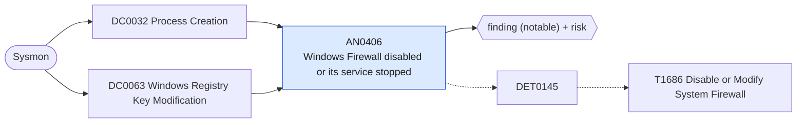

# AN0406 Windows Firewall disabled or its service stopped

[ATT&CK analytic](https://attack.mitre.org/detectionstrategies/DET0145#AN0406) · DET0145 Detection of Disabled or Modified System Firewalls across OS Platforms. · [T1686 Disable or Modify System Firewall](https://attack.mitre.org/techniques/T1686) · tactics: defense-impairment · platforms: Windows

**Content type:** ttp → finding (notable) + risk · **Severity:** high · **Status:** implemented · **Technique prevalence score:** 45

netsh turns a firewall profile off, PowerShell sets a profile to disabled, the firewall service (MpsSvc) is stopped or disabled, or a FirewallPolicy EnableFirewall registry value is set to 0.



## What ATT&CK asks for

> Detection of firewall tampering by monitoring processes executing netsh, PowerShell Set-NetFirewallProfile, or sc stop mpssvc. Registry modifications under HKLM\SYSTEM\CurrentControlSet\Services\SharedAccess\Parameters\FirewallPolicy also indicate adversarial actions.

## What this implementation detects

netsh turns a firewall profile off, PowerShell sets a profile to disabled, the firewall service (MpsSvc) is stopped or disabled, or a FirewallPolicy EnableFirewall registry value is set to 0.

**Not covered:** Rule additions that open specific ports (netsh advfirewall firewall add rule) are left to hunting.

## Tuning

ATT&CK mutable elements and where each is bound. Edit macros in `local/macros.conf` and lookups in place; do not edit the search.

| Mutable element | ATT&CK guidance | Bound to | Default |
|---|---|---|---|
| MonitoredCommands | List of admin tools and scripts allowed to legitimately modify firewall settings. | macro `mitre_an0406_commands` | `((Image="*\\netsh.exe" CommandLine IN ("*state off*", "*opmode disable*", "*opmode mode=disable*")) OR (Image IN ("*\\powershell.exe", "*\\pwsh.exe") CommandLine="*Set-NetFirewallProfile*" CommandLine="*-Enabled*False*") OR (Image IN ("*\\sc.exe", "*\\net.exe", "*\\net1.exe") CommandLine="*mpssvc*" CommandLine IN ("* stop*", "*disabled*")))` |
| AlertThreshold | Number of firewall rule changes within a time window before triggering alert. | filter macro `mitre_an0406_filter` |  |

## Splunk

Stanza `[MITRE - AN0406 - Windows Firewall disabled or its service stopped - Rule]` in `DA-ESS-mitre-attack-detections`. Schedule `5-59/15 * * * *`, window `-20m@m` to `-5m@m`. Ships disabled.

```spl
(`mitre_dc0032_sysmon` EventCode=1 `mitre_an0406_commands`)
  OR (`mitre_dc0063_sysmon` EventCode=13 TargetObject="*\\FirewallPolicy\\*\\EnableFirewall" Details="DWORD (0x00000000)")
| `mitre_normalize_host`
| eval signal=if(EventCode==13, "registry_disable", "command_disable"), process_name=replace(Image, "^.*\\\\", "")
| stats count min(_time) as firstTime max(_time) as lastTime values(signal) as signals values(CommandLine) as process values(TargetObject) as registry_path by dest user process_name
| `mitre_ctime(firstTime)` | `mitre_ctime(lastTime)`
| `mitre_an0406_filter`
```

Risk: `dest` (system, 60), `user` (user, 50). Threat objects: `process_name`. Message: Windows Firewall disabled on $dest$ by $process_name$

Throttle: dest for 3600s.

Data components: [DC0032](../data-components/DC0032-process-creation.md), [DC0063](../data-components/DC0063-windows-registry-key-modification.md).

## Sigma

Rule file: `dist/sigma/rules/an0406_windows_firewall_disabled_or_its_service_stopped.yml`.

## Known false positives

- Troubleshooting by administrators; third-party firewalls that disable the Windows one at install.
