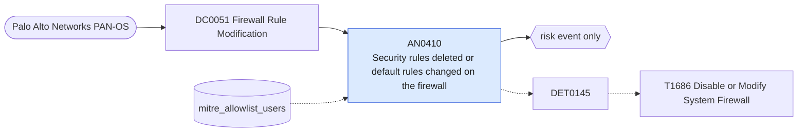

# AN0410 Security rules deleted or default rules changed on the firewall

[ATT&CK analytic](https://attack.mitre.org/detectionstrategies/DET0145#AN0410) · DET0145 Detection of Disabled or Modified System Firewalls across OS Platforms. · [T1686 Disable or Modify System Firewall](https://attack.mitre.org/techniques/T1686) · tactics: defense-impairment · platforms: Network Devices

**Content type:** anomaly → risk event only · **Severity:** medium · **Status:** implemented · **Technique prevalence score:** 45

A Palo Alto configuration change deletes, moves or renames security policy rules, or edits the default intrazone and interzone rules, by an administrator outside the allow-list. These are the changes that quietly widen what the firewall permits.



## What ATT&CK asks for

> Detection of firewall ACL or rule base changes through CLI (e.g., no access-list, permit any any). Monitor configuration commits from unusual users or sessions.

## What this implementation detects

A Palo Alto configuration change deletes, moves or renames security policy rules, or edits the default intrazone and interzone rules, by an administrator outside the allow-list. These are the changes that quietly widen what the firewall permits.

**Not covered:** Whether an edited rule became more permissive (any/any allow, disabled) cannot be seen, because the current add-on drops the change detail fields. Routers and switches need the netdev_syslog feed.

## Tuning

ATT&CK mutable elements and where each is bound. Edit macros in `local/macros.conf` and lookups in place; do not edit the search.

| Mutable element | ATT&CK guidance | Bound to | Default |
|---|---|---|---|
| AuthorizedAdmins | List of approved admin accounts allowed to modify firewall ACLs. | lookup `mitre_allowlist_users` — Firewall change administrators. |  |

## Splunk

Stanza `[MITRE - AN0410 - Security rules deleted or default rules changed on the firewall - Rule]` in `DA-ESS-mitre-attack-detections`. Schedule `11-59/15 * * * *`, window `-20m@m` to `-5m@m`. Ships disabled.

```spl
`mitre_dc0051_palo_alto` `mitre_st_palo_alto_config` path="*rulebase*security*"
    (cmd IN ("delete", "move", "rename") OR path IN ("*intrazone-default*", "*interzone-default*", "*default-security-rules*"))
| `mitre_normalize_pan`
| eval dest=coalesce(dvc_name, dest, host), config_path=path
| search `mitre_not_allowlisted_user`
| stats count min(_time) as firstTime max(_time) as lastTime values(cmd) as config_action values(config_path) as config_path values(client) as client by dest user
| `mitre_ctime(firstTime)` | `mitre_ctime(lastTime)`
| `mitre_an0410_filter`
```

Risk: `dest` (system, 40), `user` (user, 40). Message: Security rules removed or default rules changed on firewall $dest$ by $user$

Throttle: dest, user for 3600s.

Data components: [DC0051](../data-components/DC0051-firewall-rule-modification.md).

## Sigma

Rule file: `dist/sigma/rules/an0410_security_rules_deleted_or_default_rules_changed_on_the_firew.yml`.

## Known false positives

- Rule-base clean-ups and reordering during change windows.
