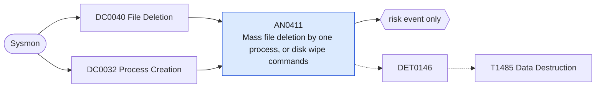

# AN0411 Mass file deletion by one process, or disk wipe commands

[ATT&CK analytic](https://attack.mitre.org/detectionstrategies/DET0146#AN0411) · DET0146 Detection of Data Destruction Across Platforms via Mass Overwrite and Deletion Patterns · [T1485 Data Destruction](https://attack.mitre.org/techniques/T1485) · tactics: impact · platforms: Windows

**Content type:** anomaly → risk event only · **Severity:** high · **Status:** implemented · **Technique prevalence score:** 50

One process deletes more than a threshold of distinct files in five minutes (Sysmon 23 and 26), or a command line wipes a disk or volume (diskpart clean, format /y, Clear-Disk, Remove-Partition) or recursively deletes a profile or share root. Destructive actors and wipers delete at a rate no normal application does outside cleanup tools.



## What ATT&CK asks for

> Adversary spawns command-line tools (e.g., del, cipher /w, SDelete) or scripts to recursively delete or overwrite user/system files. This may be correlated with abnormal file IO activity, registry writes, or tampering in critical system directories.

## What this implementation detects

One process deletes more than a threshold of distinct files in five minutes (Sysmon 23 and 26), or a command line wipes a disk or volume (diskpart clean, format /y, Clear-Disk, Remove-Partition) or recursively deletes a profile or share root. Destructive actors and wipers delete at a rate no normal application does outside cleanup tools.

**Not covered:** Sysmon 23/26 volume depends on the FileDelete rules in the Sysmon config (often scoped to a few extensions); overwrite-in-place wipers that never delete, and raw-disk writes, need DC0040's other sources and AN0602 for ransomware. Secure-delete tools are AN0392.

## Tuning

ATT&CK mutable elements and where each is bound. Edit macros in `local/macros.conf` and lookups in place; do not edit the search.

| Mutable element | ATT&CK guidance | Bound to | Default |
|---|---|---|---|
| TargetFilename | Filter file deletion activity to sensitive locations (e.g., %System32%, Documents, DB paths). | macro `mitre_an0411_benign_deleters` | `Image IN ("*\\cleanmgr.exe", "*\\TiWorker.exe", "*\\TrustedInstaller.exe", "*\\MsMpEng.exe", "*\\msiexec.exe", "*\\OneDrive.exe", "*\\chrome.exe", "*\\msedge.exe", "*\\firefox.exe", "*\\Teams.exe", "*\\ms-teams.exe", "*\\svchost.exe", "*\\SearchIndexer.exe", "*\\DismHost.exe", "*\\setup.exe")` |
| ProcessCommandLine | Tune for aggressive overwrite flags (e.g., /w, /q, /s) or temp file overwrites. | macro `mitre_an0411_wipe_commands` | `((Image="*\\diskpart.exe" CommandLine="*clean*") OR (Image="*\\format.com" CommandLine="*/y*") OR CommandLine IN ("*Clear-Disk*", "*Remove-Partition*", "*Format-Volume*", "*rd /s /q C:\\Users*", "*rmdir /s /q C:\\Users*", "*del /s /q /f C:\\Users*", "*Remove-Item*C:\\Users*-Recurse*"))` |
| VolumeThreshold | Threshold of unique file deletions or modifications within time window. | macro `mitre_an0411_threshold` — Distinct files deleted per process per 5 minutes. | `300` |
| TimeWindow | Correlate rapid file delete/overwrite behavior from same process/user. | filter macro `mitre_an0411_filter` |  |

## Splunk

Stanza `[MITRE - AN0411 - Mass file deletion by one process, or disk wipe commands - Rule]` in `DA-ESS-mitre-attack-detections`. Schedule `*/10 * * * *`, window `-15m@m` to `-5m@m`. Ships disabled.

```spl
(`mitre_dc0040_sysmon` EventCode IN (23, 26) NOT `mitre_an0411_benign_deleters`)
OR (`mitre_dc0032_sysmon` EventCode=1 `mitre_an0411_wipe_commands`)
| `mitre_normalize_host`
| eval process_name=lower(replace(Image, "^.*\\\\", "")), deleted=if(EventCode IN (23, 26), TargetFilename, null()), wipe=if(EventCode==1, CommandLine, null())
| search `mitre_not_allowlisted_process`
| bin _time span=5m
| stats dc(deleted) as files_deleted values(wipe) as wipe_command values(user) as user min(_time) as firstTime max(_time) as lastTime by dest process_name _time
| where files_deleted >= `mitre_an0411_threshold` OR isnotnull(wipe_command)
| `mitre_ctime(firstTime)` | `mitre_ctime(lastTime)`
| `mitre_an0411_filter`
```

Risk: `dest` (system, 60), `user` (user, 40). Threat objects: `process_name`. Message: $process_name$ deleted $files_deleted$ files or wiped storage on $dest$

Throttle: dest, process_name for 14400s.

Data components: [DC0040](../data-components/DC0040-file-deletion.md), [DC0032](../data-components/DC0032-process-creation.md).

## Sigma

Rule file: `dist/sigma/rules/an0411_mass_file_deletion_by_one_process_or_disk_wipe_commands.yml` (base rule plus a correlation rule).

## Known false positives

- Build and test tooling cleaning output folders; profile cleanup and re-imaging scripts; storage administrators formatting new volumes.
