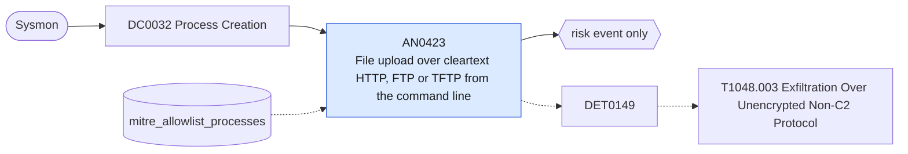

# AN0423 File upload over cleartext HTTP, FTP or TFTP from the command line

[ATT&CK analytic](https://attack.mitre.org/detectionstrategies/DET0149#AN0423) · DET0149 Detection of Exfiltration Over Unencrypted Non-C2 Protocol · [T1048.003 Exfiltration Over Unencrypted Non-C2 Protocol](https://attack.mitre.org/techniques/T1048/003) · tactics: exfiltration · platforms: Windows

**Content type:** anomaly → risk event only · **Severity:** medium · **Status:** implemented · **Technique prevalence score:** 48

A command line uploads a file over an unencrypted protocol: ftp.exe running a command script (-s:), tftp PUT, or curl, PowerShell or certutil/bitsadmin posting or putting a file to an http:// or ftp:// URL. Native and built-in clients are a common way to push staged data out over a channel separate from C2.



## What ATT&CK asks for

> Detects data access or staging events followed by outbound data flows using unencrypted protocols (e.g., FTP, HTTP) initiated by unexpected processes or to rare destinations.

## What this implementation detects

A command line uploads a file over an unencrypted protocol: ftp.exe running a command script (-s:), tftp PUT, or curl, PowerShell or certutil/bitsadmin posting or putting a file to an http:// or ftp:// URL. Native and built-in clients are a common way to push staged data out over a channel separate from C2.

**Not covered:** Uploads by custom tooling with no telling command line are left to the network analytics (AN0005 large cleartext uploads, AN1173 FTP/TFTP to the internet); bytes sent are not joined from Corelight here.

## Tuning

ATT&CK mutable elements and where each is bound. Edit macros in `local/macros.conf` and lookups in place; do not edit the search.

| Mutable element | ATT&CK guidance | Bound to | Default |
|---|---|---|---|
| UnencryptedProtocolList | Set of protocols considered suspicious for outbound data exfiltration (e.g., FTP, HTTP). | macro `mitre_an0423_upload_commands` | `((Image="*\\ftp.exe" CommandLine="*-s:*") OR (Image="*\\tftp.exe" CommandLine="*put*") OR (CommandLine IN ("*http://*", "*ftp://*") CommandLine IN ("* -T *", "*--upload-file*", "* -F *", "*--form*", "*--data-binary*@*", "* -d @*", "*-InFile*", "*UploadFile*", "*UploadData*", "* /upload *", "*-Method Put*", "*-Method Post*")))` |
| DataTransferSizeThreshold | Defines what amount of outbound data is considered abnormal for a host/user. | filter macro `mitre_an0423_filter` |  |
| ParentProcessDenylist | Processes that should not launch FTP/HTTP clients (e.g., winword.exe launching ftp.exe). | lookup `mitre_allowlist_processes` — Sanctioned transfer jobs (process_name with the parent that runs them). |  |

## Splunk

Stanza `[MITRE - AN0423 - File upload over cleartext HTTP, FTP or TFTP from the command line - Rule]` in `DA-ESS-mitre-attack-detections`. Schedule `5-59/15 * * * *`, window `-20m@m` to `-5m@m`. Ships disabled.

```spl
`mitre_dc0032_sysmon` EventCode=1 `mitre_an0423_upload_commands`
| `mitre_normalize_host`
| eval process_name=lower(replace(Image, "^.*\\\\", "")), parent_process_name=lower(replace(ParentImage, "^.*\\\\", "")), url=mvindex(split(replace(CommandLine, "^.*?((?:https?|ftp)://\S+).*$", "\1"), " "), 0)
| search `mitre_not_allowlisted_process`
| stats count min(_time) as firstTime max(_time) as lastTime values(CommandLine) as process values(url) as url values(parent_process_name) as parent_process_name by dest user process_name
| eval process=mvindex(process, 0, 9)
| `mitre_ctime(firstTime)` | `mitre_ctime(lastTime)`
| `mitre_an0423_filter`
```

Risk: `dest` (system, 35), `user` (user, 35). Threat objects: `process_name`. Message: Cleartext upload by $process_name$ on $dest$ as $user$

Throttle: dest, user for 86400s.

Data components: [DC0032](../data-components/DC0032-process-creation.md).

## Sigma

Rule file: `dist/sigma/rules/an0423_file_upload_over_cleartext_http_ftp_or_tftp_from_the_command.yml`.

## Known false positives

- Build agents and scripts pushing artefacts to internal HTTP or FTP repositories (allow-list them, or extend the filter to drop internal URLs).
