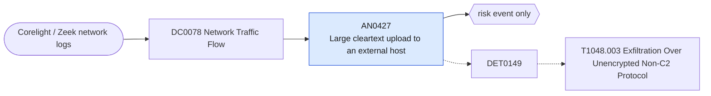

# AN0427 Large cleartext upload to an external host

[ATT&CK analytic](https://attack.mitre.org/detectionstrategies/DET0149#AN0427) · DET0149 Detection of Exfiltration Over Unencrypted Non-C2 Protocol · [T1048.003 Exfiltration Over Unencrypted Non-C2 Protocol](https://attack.mitre.org/techniques/T1048/003) · tactics: exfiltration · platforms: Network Devices

**Content type:** anomaly → risk event only · **Severity:** medium · **Status:** implemented · **Technique prevalence score:** 48

One internal host sends a large volume to external hosts within an hour over cleartext protocols (HTTP, FTP, FTP data, TFTP), seen in Corelight conn.log. Exfiltration over unencrypted protocols that are not the C2 channel.



## What ATT&CK asks for

> Detects use of unencrypted protocols (e.g., TFTP, FTP, HTTP) to transfer configuration files, routing tables, or logs to untrusted IP addresses, especially using administrative commands like `copy run ftp:`.

## What this implementation detects

One internal host sends a large volume to external hosts within an hour over cleartext protocols (HTTP, FTP, FTP data, TFTP), seen in Corelight conn.log. Exfiltration over unencrypted protocols that are not the C2 channel.

**Not covered:** Device-side copy commands (copy run ftp:) need network-device CLI logs; encrypted channels are covered by AN0988-style analytics, not here.

## Tuning

ATT&CK mutable elements and where each is bound. Edit macros in `local/macros.conf` and lookups in place; do not edit the search.

| Mutable element | ATT&CK guidance | Bound to | Default |
|---|---|---|---|
| ProtocolCommandWatchlist | Flag commands like `copy`, `archive tar`, or `upload` directed at external hosts. | macro `mitre_an0427_cleartext` | `service IN ("http", "ftp", "ftp-data", "tftp")` |
| DestinationIPBlocklist | Define external IP ranges unauthorized to receive router/switch configs. | macro `mitre_an0427_bytes_threshold` — Bytes sent per source per hour (100 MB). | `104857600` |

## Splunk

Stanza `[MITRE - AN0427 - Large cleartext upload to an external host - Rule]` in `DA-ESS-mitre-attack-detections`. Schedule `29 * * * *`, window `-65m@m` to `-5m@m`. Ships disabled.

```spl
`mitre_dc0078_corelight` `mitre_st_corelight_conn`
| `mitre_normalize_zeek`
| search `mitre_an0427_cleartext`
| where NOT `mitre_is_internal(dest)` AND `mitre_is_internal(src)`
| lookup mitre_allowlist_ips cidr AS src OUTPUT reason AS allow_reason
| where isnull(allow_reason)
| stats sum(bytes_out) as bytes_out sum(bytes_in) as bytes_in dc(dest) as distinct_destinations values(service) as service min(_time) as firstTime max(_time) as lastTime by src
| where bytes_out >= `mitre_an0427_bytes_threshold`
| eval mb_out=round(bytes_out / 1048576, 1)
| `mitre_ctime(firstTime)` | `mitre_ctime(lastTime)`
| `mitre_an0427_filter`
```

Risk: `src` (system, 40). Message: $src$ uploaded $mb_out$ MB to external hosts over cleartext protocols

Throttle: src for 14400s.

Data components: [DC0078](../data-components/DC0078-network-traffic-flow.md).

## Sigma

Not expressed in Sigma: The condition is a byte sum per source over an hour, which is a Splunk aggregation; Sigma has no sum correlation.

## Known false positives

- Backup or log shipping to an external service over HTTP; software update mirrors.
