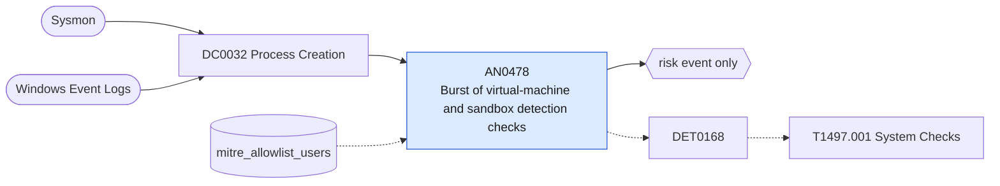

# AN0478 Burst of virtual-machine and sandbox detection checks

[ATT&CK analytic](https://attack.mitre.org/detectionstrategies/DET0168#AN0478) · DET0168 Virtualization/Sandbox Evasion via System Checks across Windows, Linux, macOS · [T1497.001 System Checks](https://attack.mitre.org/techniques/T1497/001) · tactics: stealth, discovery · platforms: Windows

**Content type:** anomaly → risk event only · **Severity:** medium · **Status:** implemented · **Technique prevalence score:** 81

One user on one host runs several distinct VM-detection checks within ten minutes: hardware model and manufacturer queries, BIOS and disk serials, video controller, and registry or file lookups for VirtualBox, VMware, QEMU, Hyper-V or sandbox artefacts. Malware does this before deciding whether to detonate.



## What ATT&CK asks for

> Script or binary performs a rapid sequence of system discovery checks (e.g., CPU count, RAM size, registry keys, running processes) indicative of VM detection

## What this implementation detects

One user on one host runs several distinct VM-detection checks within ten minutes: hardware model and manufacturer queries, BIOS and disk serials, video controller, and registry or file lookups for VirtualBox, VMware, QEMU, Hyper-V or sandbox artefacts. Malware does this before deciding whether to detonate.

**Not covered:** API-based checks (CPUID, timing, RAM size through GlobalMemoryStatusEx) leave no command line; module loads and process access legs are not used.

## Tuning

ATT&CK mutable elements and where each is bound. Edit macros in `local/macros.conf` and lookups in place; do not edit the search.

| Mutable element | ATT&CK guidance | Bound to | Default |
|---|---|---|---|
| TimeWindow | Sequence of system enumeration events within X seconds | macro `mitre_an0478_threshold` — Distinct check command lines per host and user per 10 minutes. | `3` |
| ProcessAncestry | Parent-child lineage to identify potentially suspicious launch sources (e.g., Office, browser, WMI, PowerShell) | macro `mitre_an0478_checks` | `((Processes.process_name="wmic.exe" Processes.process IN ("*computersystem*model*", "*computersystem*manufacturer*", "*bios*serialnumber*", "*diskdrive*", "*baseboard*", "*videocontroller*")) OR (Processes.process_name IN ("powershell.exe", "pwsh.exe") Processes.process IN ("*win32_computersystem*", "*win32_bios*", "*win32_diskdrive*", "*win32_videocontroller*", "*win32_baseboard*", "*msacpi_thermalzonetemperature*")) OR Processes.process IN ("*vbox*", "*virtualbox*", "*vmware*", "*vmtools*", "*qemu*", "*hardware\\acpi\\dsdt*", "*systembiosversion*", "*sandboxie*", "*sbiedll*"))` |
| UserContext | Limit to non-admin or interactive sessions if desired | lookup `mitre_allowlist_users` — Inventory and hardware-management accounts. |  |

## Splunk

Stanza `[MITRE - AN0478 - Burst of virtual-machine and sandbox detection checks - Rule]` in `DA-ESS-mitre-attack-detections`. Schedule `3-59/15 * * * *`, window `-30m@m` to `-5m@m`. Ships disabled.

```spl
| tstats `mitre_summariesonly` count from `mitre_dc0032_dm` where `mitre_dc0032_dm_where` `mitre_an0478_checks`
    by Processes.dest Processes.user Processes.parent_process_name Processes.process _time span=10m
| `drop_dm_object_name(Processes)`
| search `mitre_not_allowlisted_user`
| stats sum(count) as count dc(process) as distinct_checks values(process) as process values(parent_process_name) as parent_process_name min(_time) as firstTime max(_time) as lastTime by dest user _time
| where distinct_checks >= `mitre_an0478_threshold`
| `mitre_ctime(firstTime)` | `mitre_ctime(lastTime)`
| `mitre_an0478_filter`
```

Risk: `dest` (system, 40), `user` (user, 35). Message: $distinct_checks$ VM and sandbox checks on $dest$ by $user$

Throttle: dest, user for 3600s.

Data components: [DC0032](../data-components/DC0032-process-creation.md).

## Sigma

Rule file: `dist/sigma/rules/an0478_burst_of_virtual_machine_and_sandbox_detection_checks.yml` (base rule plus a correlation rule).

## Known false positives

- Hardware inventory scripts and virtualisation-aware installers (VMware Tools, Hyper-V integration).
