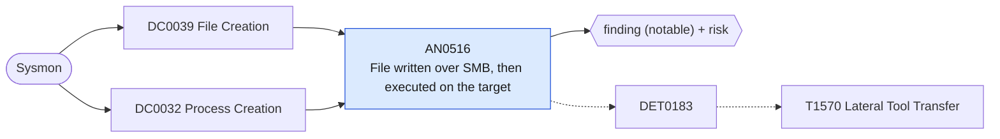

# AN0516 File written over SMB, then executed on the target

[ATT&CK analytic](https://attack.mitre.org/detectionstrategies/DET0183#AN0516) · DET0183 Detection Strategy for Lateral Tool Transfer across OS platforms · [T1570 Lateral Tool Transfer](https://attack.mitre.org/techniques/T1570) · tactics: lateral-movement · platforms: Windows

**Content type:** ttp → finding (notable) + risk · **Severity:** high · **Status:** implemented · **Technique prevalence score:** 83

A file arrives over SMB (Sysmon 11 with Image "System", which is how the kernel SMB server appears) in a staging location, and within ten minutes it runs on the same host, either directly as a process or as a script on an interpreter's command line. This is tool transfer followed by remote execution.



## What ATT&CK asks for

> Correlate suspicious file transfers over SMB or Admin$ shares with process creation events (e.g., cmd.exe, powershell.exe, certutil.exe) that do not align with normal administrative behavior. Detect remote file writes followed by execution of transferred binaries.

## What this implementation detects

A file arrives over SMB (Sysmon 11 with Image "System", which is how the kernel SMB server appears) in a staging location, and within ten minutes it runs on the same host, either directly as a process or as a script on an interpreter's command line. This is tool transfer followed by remote execution.

**Not covered:** Files dropped directly into C:\Windows (PsExec's service binary) are excluded for volume; AN1527 and AN1185 catch those. Share access events (5140/5145) and the source host are not joined, so the remote side comes from AN1468 or Corelight smb_files.

## Tuning

ATT&CK mutable elements and where each is bound. Edit macros in `local/macros.conf` and lookups in place; do not edit the search.

| Mutable element | ATT&CK guidance | Bound to | Default |
|---|---|---|---|
| TimeWindow | Time period between file transfer and execution used to correlate events | macro `mitre_an0516_window_seconds` | `600` |
| UserContext | Accounts allowed to perform legitimate administrative transfers | filter macro `mitre_an0516_filter` — The SMB write carries no user; exclude deployment targets or files here. |  |
| FilePathWhitelist | Exclude known legitimate software update directories | macro `mitre_an0516_staging_paths` — A parenthesised value list used with IN; software-distribution shares writing into these paths belong in the filter macro. | `("*\\Windows\\Temp\\*", "*\\ProgramData\\*", "*\\Users\\Public\\*", "*\\PerfLogs\\*", "*\\Users\\*\\AppData\\Local\\Temp\\*")` |

## Splunk

Stanza `[MITRE - AN0516 - File written over SMB, then executed on the target - Rule]` in `DA-ESS-mitre-attack-detections`. Schedule `13-59/15 * * * *`, window `-75m@m` to `-5m@m`. Ships disabled.

```spl
(`mitre_dc0039_sysmon` EventCode=11 Image="System" TargetFilename IN `mitre_an0516_staging_paths` TargetFilename IN ("*.exe", "*.dll", "*.ps1", "*.bat", "*.cmd", "*.vbs", "*.js", "*.hta", "*.scr"))
  OR (`mitre_dc0032_sysmon` EventCode=1 (Image IN `mitre_an0516_staging_paths` OR CommandLine IN `mitre_an0516_staging_paths`))
| `mitre_normalize_host`
| rex field=CommandLine "(?i)(?<cmd_path>[a-z]:\\\\[^\"]+?\.(ps1|bat|cmd|vbs|js|hta|dll))"
| eval file_path=lower(case(EventCode==11, TargetFilename, isnotnull(cmd_path), cmd_path, true(), Image))
| eval write_time=if(EventCode==11, _time, null()), exec_time=if(EventCode==1, _time, null()), process_name=if(EventCode==1, replace(Image, "^.*\\\\", ""), null())
| stats min(write_time) as write_time min(exec_time) as exec_time values(process_name) as process_name values(eval(if(EventCode==1, CommandLine, null()))) as process values(eval(if(EventCode==1, ParentImage, null()))) as parent_process values(user) as user by dest file_path
| where isnotnull(write_time) AND isnotnull(exec_time) AND exec_time >= write_time AND exec_time - write_time <= `mitre_an0516_window_seconds`
| eval firstTime=write_time, lastTime=exec_time
| `mitre_ctime(firstTime)` | `mitre_ctime(lastTime)`
| `mitre_an0516_filter`
```

Risk: `dest` (system, 70). Threat objects: `file_path`. Message: $file_path$ arrived over SMB on $dest$ and was executed

Throttle: dest, file_path for 86400s.

Data components: [DC0039](../data-components/DC0039-file-creation.md), [DC0032](../data-components/DC0032-process-creation.md).

## Sigma

Rule file: `dist/sigma/rules/an0516_file_written_over_smb_then_executed_on_the_target.yml` (base rule plus a correlation rule).

Uses a temporal (unordered) correlation because the Splunk pySigma backend does not implement temporal_ordered; scripts run through an interpreter are joined only in the Splunk search.

## Known false positives

- Software deployment that copies installers to targets over SMB and runs them (SCCM, PDQ, GPO scripts).
