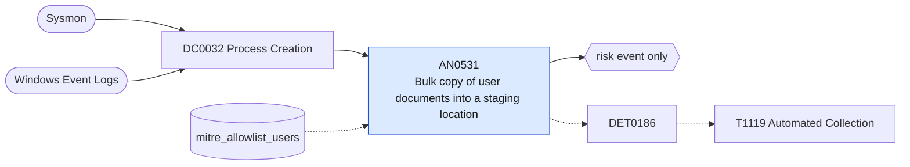

# AN0531 Bulk copy of user documents into a staging location

[ATT&CK analytic](https://attack.mitre.org/detectionstrategies/DET0186#AN0531) · DET0186 Automated File and API Collection Detection Across Platforms · [T1119 Automated Collection](https://attack.mitre.org/techniques/T1119) · tactics: collection · platforms: Windows

**Content type:** anomaly → risk event only · **Severity:** medium · **Status:** implemented · **Technique prevalence score:** 106

robocopy, xcopy or copy, or PowerShell Copy-Item / Get-ChildItem with document-type filters, copying from user profile folders (Documents, Desktop, Downloads, mail stores) into a staging location (Temp, Users\Public, ProgramData, PerfLogs, a mapped share) or recursively collecting document extensions.



## What ATT&CK asks for

> Automated execution of native utilities and scripts to discover, enumerate, and exfiltrate files and clipboard content. Focus is on detecting repeated file access, scripting engine use, and use of command-line utilities commonly leveraged by collection scripts.

## What this implementation detects

robocopy, xcopy or copy, or PowerShell Copy-Item / Get-ChildItem with document-type filters, copying from user profile folders (Documents, Desktop, Downloads, mail stores) into a staging location (Temp, Users\Public, ProgramData, PerfLogs, a mapped share) or recursively collecting document extensions.

**Not covered:** Clipboard collection and API-level file reads are not seen; the volume leg is AN0724 and archiving is AN0831.

## Tuning

ATT&CK mutable elements and where each is bound. Edit macros in `local/macros.conf` and lookups in place; do not edit the search.

| Mutable element | ATT&CK guidance | Bound to | Default |
|---|---|---|---|
| TimeWindow | Defines the lookback period for identifying burst activity or patterns in process/file events. | filter macro `mitre_an0531_filter` |  |
| SuspiciousFileExtensions | Tunable list of file extensions associated with collection (e.g., .pdf, .docx). | macro `mitre_an0531_patterns` | `((Processes.process_name IN ("robocopy.exe", "xcopy.exe", "cmd.exe") Processes.process IN ("*\\documents*", "*\\desktop*", "*\\downloads*", "*.pst*", "*.ost*") Processes.process IN ("*\\temp*", "*\\users\\public*", "*\\programdata*", "*\\perflogs*", "*\\\\*\\*$*")) OR (Processes.process_name IN ("powershell.exe", "pwsh.exe") Processes.process IN ("*copy-item*", "*get-childitem*") Processes.process IN ("*-include*", "*-filter*") Processes.process IN ("*.doc*", "*.xls*", "*.pdf*", "*.ppt*", "*.pst*", "*.kdbx*")))` |
| ProcessCountThreshold | The number of times a process executes before considered anomalous. | lookup `mitre_allowlist_users` — Backup and migration accounts. |  |

## Splunk

Stanza `[MITRE - AN0531 - Bulk copy of user documents into a staging location - Rule]` in `DA-ESS-mitre-attack-detections`. Schedule `5-59/15 * * * *`, window `-20m@m` to `-5m@m`. Ships disabled.

```spl
| tstats `mitre_summariesonly` count min(_time) as firstTime max(_time) as lastTime
    from `mitre_dc0032_dm` where `mitre_dc0032_dm_where` `mitre_an0531_patterns`
    by Processes.dest Processes.user Processes.parent_process_name Processes.process_name Processes.process
| `drop_dm_object_name(Processes)`
| search `mitre_not_allowlisted_user`
| `mitre_ctime(firstTime)` | `mitre_ctime(lastTime)`
| `mitre_an0531_filter`
```

Risk: `dest` (system, 35), `user` (user, 35). Threat objects: `process_name`. Message: Bulk document collection by $process_name$ on $dest$

Throttle: dest, user for 3600s.

Data components: [DC0032](../data-components/DC0032-process-creation.md).

## Sigma

Rule file: `dist/sigma/rules/an0531_bulk_copy_of_user_documents_into_a_staging_location.yml`.

## Known false positives

- Profile migrations, backup scripts and users copying their own files to a share.
