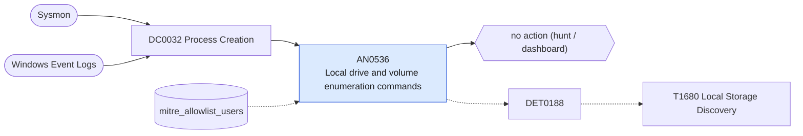

# AN0536 Local drive and volume enumeration commands

[ATT&CK analytic](https://attack.mitre.org/detectionstrategies/DET0188#AN0536) · DET0188 Local Storage Discovery via Drive Enumeration and Filesystem Probing · [T1680 Local Storage Discovery](https://attack.mitre.org/techniques/T1680) · tactics: discovery · platforms: Windows

**Content type:** hunting → no action (hunt / dashboard) · **Severity:** informational · **Status:** implemented · **Technique prevalence score:** 116

Lists hosts and users enumerating drives and volumes: wmic logicaldisk/volume, fsutil fsinfo drives, mountvol, Get-PSDrive, Get-Volume, Get-Disk, Get-Partition, in ten-minute buckets.



## What ATT&CK asks for

> Drive enumeration using PowerShell (`Get-PSDrive`), `wmic logicaldisk`, or Win32 API indicative of local volume enumeration by non-admin users or executed outside of baseline system inventory scripts.

## What this implementation detects

Lists hosts and users enumerating drives and volumes: wmic logicaldisk/volume, fsutil fsinfo drives, mountvol, Get-PSDrive, Get-Volume, Get-Disk, Get-Partition, in ten-minute buckets.

**Not covered:** API-level enumeration has no command line. No finding or risk.

## Tuning

ATT&CK mutable elements and where each is bound. Edit macros in `local/macros.conf` and lookups in place; do not edit the search.

| Mutable element | ATT&CK guidance | Bound to | Default |
|---|---|---|---|
| user_context | Non-system accounts performing drive enumeration may be higher fidelity indicators | lookup `mitre_allowlist_users` |  |
| parent_process_name | Baseline parent-child process lineage can help distinguish admin tools from malicious scripts | filter macro `mitre_an0536_filter` |  |

## Splunk

Stanza `[MITRE - AN0536 - Local drive and volume enumeration commands - Rule]` in `DA-ESS-mitre-attack-detections`. Schedule `9-59/15 * * * *`, window `-20m@m` to `-5m@m`. Ships disabled.

```spl
| tstats `mitre_summariesonly` count from `mitre_dc0032_dm` where `mitre_dc0032_dm_where`
    ((Processes.process_name="wmic.exe" Processes.process IN ("*logicaldisk*", "*volume*"))
      OR (Processes.process_name="fsutil.exe" Processes.process="*fsinfo*")
      OR Processes.process_name="mountvol.exe"
      OR (Processes.process_name IN ("powershell.exe", "pwsh.exe") Processes.process IN ("*get-psdrive*", "*get-volume*", "*get-disk*", "*get-partition*", "*win32_logicaldisk*")))
    by Processes.dest Processes.user Processes.parent_process_name Processes.process _time span=10m
| `drop_dm_object_name(Processes)`
| search `mitre_not_allowlisted_user`
| stats sum(count) as count dc(process) as distinct_commands values(process) as process by dest user parent_process_name _time
| sort - distinct_commands
| `mitre_an0536_filter`
```

Data components: [DC0032](../data-components/DC0032-process-creation.md).

## Sigma

Rule file: `dist/sigma/rules/an0536_local_drive_and_volume_enumeration_commands.yml`.

## Known false positives

- Inventory agents, backup software and administrators.
