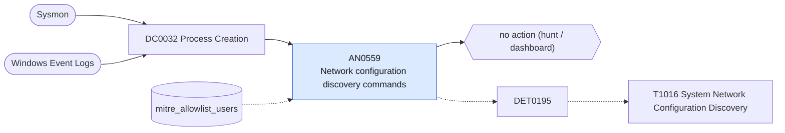

# AN0559 Network configuration discovery commands

[ATT&CK analytic](https://attack.mitre.org/detectionstrategies/DET0195#AN0559) · DET0195 Behavioral Detection of System Network Configuration Discovery · [T1016 System Network Configuration Discovery](https://attack.mitre.org/techniques/T1016) · tactics: discovery · platforms: Windows

**Content type:** hunting → no action (hunt / dashboard) · **Severity:** informational · **Status:** implemented · **Technique prevalence score:** 351

Lists hosts and users running ipconfig, route print, arp -a, nbtstat, getmac, netsh interface or wlan show, wmic nicconfig, or the Get-NetIPConfiguration / Get-NetAdapter / Get-NetRoute / Get-DnsClientServerAddress cmdlets, in ten-minute buckets.



## What ATT&CK asks for

> Execution of built-in tools (e.g., ipconfig, route, netsh) or PowerShell/WMI queries to enumerate IP, MAC, interface status, or routing configuration.

## What this implementation detects

Lists hosts and users running ipconfig, route print, arp -a, nbtstat, getmac, netsh interface or wlan show, wmic nicconfig, or the Get-NetIPConfiguration / Get-NetAdapter / Get-NetRoute / Get-DnsClientServerAddress cmdlets, in ten-minute buckets.

**Not covered:** PowerShell script-block content is not included. No finding or risk is produced.

## Tuning

ATT&CK mutable elements and where each is bound. Edit macros in `local/macros.conf` and lookups in place; do not edit the search.

| Mutable element | ATT&CK guidance | Bound to | Default |
|---|---|---|---|
| ParentProcess | Filter known/legit CLI chains (e.g., explorer.exe → cmd.exe) to reduce FP | filter macro `mitre_an0559_filter` — e.g. search NOT parent_process_name="explorer.exe" to drop interactive use. |  |
| UserContext | Target executions by non-admin or unexpected users | lookup `mitre_allowlist_users` |  |
| TimeWindow | Cluster enumeration commands within short time windows | filter macro `mitre_an0559_filter` (not bound separately) | `search *` |

## Splunk

Stanza `[MITRE - AN0559 - Network configuration discovery commands - Rule]` in `DA-ESS-mitre-attack-detections`. Schedule `4-59/15 * * * *`, window `-20m@m` to `-5m@m`. Ships disabled.

```spl
| tstats `mitre_summariesonly` count from `mitre_dc0032_dm` where `mitre_dc0032_dm_where`
    (Processes.process_name IN ("ipconfig.exe", "nbtstat.exe", "getmac.exe")
      OR (Processes.process_name="route.exe" Processes.process="*print*")
      OR (Processes.process_name="arp.exe" Processes.process="* -a*")
      OR (Processes.process_name="netsh.exe" Processes.process="*show*" Processes.process IN ("*interface*", "*wlan*", "* ip *"))
      OR (Processes.process_name="wmic.exe" Processes.process="*nicconfig*")
      OR (Processes.process_name IN ("powershell.exe", "pwsh.exe") Processes.process IN ("*get-netipconfiguration*", "*get-netadapter*", "*get-netroute*", "*get-dnsclientserveraddress*", "*get-netipaddress*")))
    by Processes.dest Processes.user Processes.parent_process_name Processes.process _time span=10m
| `drop_dm_object_name(Processes)`
| search `mitre_not_allowlisted_user`
| stats sum(count) as count dc(process) as distinct_commands values(process) as process values(parent_process_name) as parent_process_name by dest user _time
| sort - distinct_commands
| `mitre_an0559_filter`
```

Data components: [DC0032](../data-components/DC0032-process-creation.md).

## Sigma

Rule file: `dist/sigma/rules/an0559_network_configuration_discovery_commands.yml`.

## Known false positives

- VPN clients, network troubleshooting and logon scripts.
