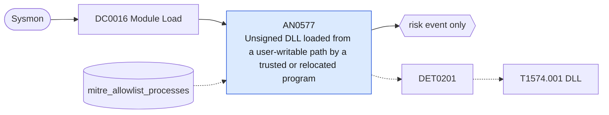

# AN0577 Unsigned DLL loaded from a user-writable path by a trusted or relocated program

[ATT&CK analytic](https://attack.mitre.org/detectionstrategies/DET0201#AN0577) · DET0201 Detection Strategy for Hijack Execution Flow for DLLs · [T1574.001 DLL](https://attack.mitre.org/techniques/T1574/001) · tactics: stealth, execution · platforms: Windows

**Content type:** anomaly → risk event only · **Severity:** medium · **Status:** implemented · **Technique prevalence score:** 162

Sysmon ImageLoad (7) of an unsigned or invalidly signed DLL from a user-writable directory, either into a program running from Windows or Program Files, or into a program running from the same user-writable directory as the DLL (the copied-signed-binary side-loading pattern).



## What ATT&CK asks for

> DLL hijacking behaviors including unexpected DLL loads from non-standard directories, replacement of DLLs, phantom DLL insertion, redirection file creation, and substitution of legitimate DLLs. Defender correlates file system modifications, registry changes, and module load telemetry to detect abnormal DLL behavior in trusted processes.

## What this implementation detects

Sysmon ImageLoad (7) of an unsigned or invalidly signed DLL from a user-writable directory, either into a program running from Windows or Program Files, or into a program running from the same user-writable directory as the DLL (the copied-signed-binary side-loading pattern).

**Not covered:** Hash baselines for substituted DLLs, phantom-DLL registry redirection (4657) and the DLL file creation are not correlated. Depends on Sysmon ImageLoad being enabled, which is high volume; scope it in the Sysmon config to unsigned images or user-writable paths.

## Tuning

ATT&CK mutable elements and where each is bound. Edit macros in `local/macros.conf` and lookups in place; do not edit the search.

| Mutable element | ATT&CK guidance | Bound to | Default |
|---|---|---|---|
| AllowedDllPaths | Known safe DLL directories to suppress false positives (e.g., C:\Windows\System32). | macro `mitre_an0577_untrusted_dll_paths` | `ImageLoaded IN ("*\\AppData\\*", "*\\Users\\Public\\*", "*\\Windows\\Temp\\*", "*\\ProgramData\\*", "*\\PerfLogs\\*", "*\\Downloads\\*")` |
| ProcessAllowList | Applications expected to load DLLs from non-standard locations (e.g., development tools). | lookup `mitre_allowlist_processes` — Applications that load their own unsigned plug-ins from AppData (process_name column). |  |
| TimeWindow | Correlation interval between DLL file creation, registry changes, and module load. | filter macro `mitre_an0577_filter` (not bound separately) | `search *` |
| HashBaseline | Baseline hashes for legitimate DLLs used to detect substitution. | filter macro `mitre_an0577_filter` — Not implemented; exclude known-good Hashes values here. |  |

## Splunk

Stanza `[MITRE - AN0577 - Unsigned DLL loaded from a user-writable path by a trusted or relocated program - Rule]` in `DA-ESS-mitre-attack-detections`. Schedule `12-59/15 * * * *`, window `-20m@m` to `-5m@m`. Ships disabled.

```spl
`mitre_dc0016_sysmon` EventCode=7 `mitre_an0577_untrusted_dll_paths` (Signed="false" OR SignatureStatus!="Valid")
| `mitre_normalize_host`
| eval process_name=replace(Image, "^.*\\\\", ""), image_dir=lower(replace(Image, "\\\\[^\\\\]+$", "")), dll_dir=lower(replace(ImageLoaded, "\\\\[^\\\\]+$", ""))
| eval pattern=case(match(lower(Image), "^c:\\\\(windows|program files)"), "trusted_program_loaded_user_dll", image_dir==dll_dir, "relocated_program_sideload", true(), null())
| where isnotnull(pattern)
| search `mitre_not_allowlisted_process`
| stats count min(_time) as firstTime max(_time) as lastTime values(ImageLoaded) as file_path values(pattern) as pattern values(Hashes) as file_hash by dest user process_name
| `mitre_ctime(firstTime)` | `mitre_ctime(lastTime)`
| `mitre_an0577_filter`
```

Risk: `dest` (system, 40), `user` (user, 30). Threat objects: `process_name`. Message: $process_name$ loaded an unsigned DLL from a user-writable path on $dest$

Throttle: dest, process_name for 3600s.

Data components: [DC0016](../data-components/DC0016-module-load.md).

## Sigma

Rule file: `dist/sigma/rules/an0577_unsigned_dll_loaded_from_a_user_writable_path_by_a_trusted_o.yml`.

## Known false positives

- Per-user applications and plug-ins (collaboration clients, browser extensions with native code) that ship unsigned DLLs in AppData.
