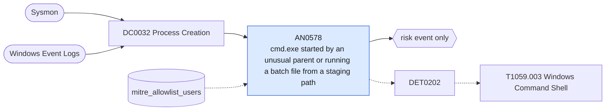

# AN0578 cmd.exe started by an unusual parent or running a batch file from a staging path

[ATT&CK analytic](https://attack.mitre.org/detectionstrategies/DET0202#AN0578) · DET0202 Behavioral Detection of Windows Command Shell Execution · [T1059.003 Windows Command Shell](https://attack.mitre.org/techniques/T1059/003) · tactics: execution · platforms: Windows

**Content type:** anomaly → risk event only · **Severity:** low · **Status:** implemented · **Technique prevalence score:** 480

cmd.exe is started by a browser, mail or chat client, Java, the print spooler, SQL Server or LSASS, or it runs a .bat/.cmd file located in Users\Public, a Temp directory or Downloads.



## What ATT&CK asks for

> Detects interactive or scripted abuse of cmd.exe, batch files, or shell invocation chains. Focuses on parent-child relationships (e.g., cmd.exe launched from unusual parents), anomalous command-line parameters, and chaining with discovery, credential access, or lateral movement behaviors.

## What this implementation detects

cmd.exe is started by a browser, mail or chat client, Java, the print spooler, SQL Server or LSASS, or it runs a .bat/.cmd file located in Users\Public, a Temp directory or Downloads.

**Not covered:** Office and script-host parents are covered by AN0819 and AN0209 and are excluded here to avoid double counting. Module loads, script block logging, time-of-day and admin-context conditions are not evaluated.

## Tuning

ATT&CK mutable elements and where each is bound. Edit macros in `local/macros.conf` and lookups in place; do not edit the search.

| Mutable element | ATT&CK guidance | Bound to | Default |
|---|---|---|---|
| ParentProcessName | Cmd.exe launched from uncommon parents (e.g., msedge.exe, winword.exe) may indicate abuse. | macro `mitre_an0578_unusual_parents` | `Processes.parent_process_name IN ("msedge.exe", "chrome.exe", "firefox.exe", "iexplore.exe", "brave.exe", "outlook.exe", "thunderbird.exe", "teams.exe", "ms-teams.exe", "java.exe", "javaw.exe", "spoolsv.exe", "lsass.exe", "sqlservr.exe")` |
| TimeWindow | Cmd or .bat execution during non-working hours may indicate automation or C2 activity. | filter macro `mitre_an0578_filter` (not bound separately) | `search *` |
| CommandLinePattern | Flags suspicious switches (e.g., /c ping, /k whoami) or command chaining (&&, ^). | filter macro `mitre_an0578_filter` (not bound separately) | `search *` |
| ScriptStoragePath | Batch file execution from %TEMP%, C:\Users\Public, or external drives. | macro `mitre_an0578_script_paths` | `Processes.process IN ("*\\users\\public\\*.bat*", "*\\users\\public\\*.cmd*", "*\\appdata\\local\\temp\\*.bat*", "*\\appdata\\local\\temp\\*.cmd*", "*\\windows\\temp\\*.bat*", "*\\windows\\temp\\*.cmd*", "*\\downloads\\*.bat*", "*\\downloads\\*.cmd*")` |
| UserContext | Flags admin-level users executing cmd outside expected baselines. | lookup `mitre_allowlist_users` |  |

## Splunk

Stanza `[MITRE - AN0578 - cmd.exe started by an unusual parent or running a batch file from a staging path - Rule]` in `DA-ESS-mitre-attack-detections`. Schedule `1-59/15 * * * *`, window `-20m@m` to `-5m@m`. Ships disabled.

```spl
| tstats `mitre_summariesonly` count min(_time) as firstTime max(_time) as lastTime
    from `mitre_dc0032_dm` where `mitre_dc0032_dm_where` Processes.process_name="cmd.exe"
    (`mitre_an0578_unusual_parents` OR `mitre_an0578_script_paths`) NOT Processes.process="*chrome-extension://*"
    by Processes.dest Processes.user Processes.parent_process_name Processes.process_name Processes.process
| `drop_dm_object_name(Processes)`
| search `mitre_not_allowlisted_user`
| `mitre_ctime(firstTime)` | `mitre_ctime(lastTime)`
| `mitre_an0578_filter`
```

Risk: `dest` (system, 30), `user` (user, 30). Threat objects: `parent_process_name`. Message: Unusual cmd.exe execution on $dest$ from $parent_process_name$

Throttle: dest, user, parent_process_name for 3600s.

Data components: [DC0032](../data-components/DC0032-process-creation.md).

## Sigma

Rule file: `dist/sigma/rules/an0578_cmd_exe_started_by_an_unusual_parent_or_running_a_batch_file.yml`.

## Known false positives

- Browser native-messaging hosts, Java application launchers, SQL Agent jobs and installers that unpack batch files to Temp.
