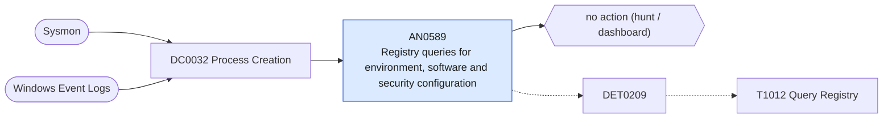

# AN0589 Registry queries for environment, software and security configuration

[ATT&CK analytic](https://attack.mitre.org/detectionstrategies/DET0209#AN0589) · DET0209 Detection of Registry Query for Environmental Discovery · [T1012 Query Registry](https://attack.mitre.org/techniques/T1012) · tactics: discovery · platforms: Windows

**Content type:** hunting → no action (hunt / dashboard) · **Severity:** informational · **Status:** implemented · **Technique prevalence score:** 141

Lists reg query, reg export and PowerShell registry reads against keys that reveal the environment: OS version, installed software, security products, saved RDP and PuTTY sessions, autoruns, and stored credentials (Winlogon, SNMP, VNC).



## What ATT&CK asks for

> Registry read access associated with suspicious or non-interactive processes querying system config, installed software, or security settings.

## What this implementation detects

Lists reg query, reg export and PowerShell registry reads against keys that reveal the environment: OS version, installed software, security products, saved RDP and PuTTY sessions, autoruns, and stored credentials (Winlogon, SNMP, VNC).

**Not covered:** Registry reads through APIs are not visible to Sysmon (EventCode 13/14 are writes); only the command line is seen. No finding or risk is produced.

## Tuning

ATT&CK mutable elements and where each is bound. Edit macros in `local/macros.conf` and lookups in place; do not edit the search.

| Mutable element | ATT&CK guidance | Bound to | Default |
|---|---|---|---|
| TargetRegistryPath | Focus detection on registry hives or keys likely to reveal environment info (e.g., HKLM\SOFTWARE\Microsoft\Windows NT\CurrentVersion). | macro `mitre_an0589_keys` | `Processes.process IN ("*currentversion\\uninstall*", "*windows nt\\currentversion*", "*\\terminal server client*", "*simontatham\\putty*", "*\\winlogon*", "*\\snmp\\parameters*", "*realvnc*", "*tightvnc*", "*\\currentversion\\run*", "*windows defender*", "*\\policies\\*", "*\\control\\lsa*")` |
| ParentProcess | May tune for suspicious parent processes such as cmd.exe, wscript.exe, or mshta.exe. | filter macro `mitre_an0589_filter` |  |
| TimeWindow | Controls how closely registry access must follow process creation for correlation. | filter macro `mitre_an0589_filter` (not bound separately) | `search *` |

## Splunk

Stanza `[MITRE - AN0589 - Registry queries for environment, software and security configuration - Rule]` in `DA-ESS-mitre-attack-detections`. Schedule `12-59/15 * * * *`, window `-20m@m` to `-5m@m`. Ships disabled.

```spl
| tstats `mitre_summariesonly` count from `mitre_dc0032_dm` where `mitre_dc0032_dm_where`
    ((Processes.process_name="reg.exe" Processes.process IN ("* query *", "* export *"))
      OR (Processes.process_name IN ("powershell.exe", "pwsh.exe") Processes.process IN ("*get-itemproperty*", "*get-childitem*hklm:*", "*get-childitem*hkcu:*", "*registry::*")))
    `mitre_an0589_keys`
    by Processes.dest Processes.user Processes.parent_process_name Processes.process _time span=10m
| `drop_dm_object_name(Processes)`
| stats sum(count) as count dc(process) as distinct_commands values(process) as process by dest user parent_process_name _time
| sort - distinct_commands
| `mitre_an0589_filter`
```

Data components: [DC0032](../data-components/DC0032-process-creation.md).

## Sigma

Rule file: `dist/sigma/rules/an0589_registry_queries_for_environment_software_and_security_confi.yml`.

## Known false positives

- Inventory agents and installers reading the Uninstall key; administrators.
