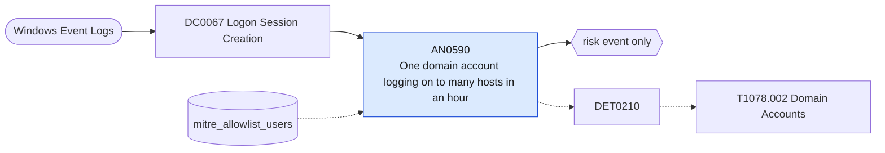

# AN0590 One domain account logging on to many hosts in an hour

[ATT&CK analytic](https://attack.mitre.org/detectionstrategies/DET0210#AN0590) · DET0210 Abuse of Domain Accounts · [T1078.002 Domain Accounts](https://attack.mitre.org/techniques/T1078/002) · tactics: stealth, persistence, privilege-escalation, initial-access · platforms: Windows

**Content type:** anomaly → risk event only · **Severity:** medium · **Status:** implemented · **Technique prevalence score:** 67

A user account (not a computer account) has network or remote-interactive logons (4624 types 3 and 10) on many distinct hosts within an hour: credential reuse across the estate after a domain account is compromised.



## What ATT&CK asks for

> Detection of suspicious logon behavior using valid domain accounts across multiple hosts, off-hours, or simultaneous sessions from geographically distant locations.

## What this implementation detects

A user account (not a computer account) has network or remote-interactive logons (4624 types 3 and 10) on many distinct hosts within an hour: credential reuse across the estate after a domain account is compromised.

**Not covered:** Off-hours and geographic anomalies are not evaluated; service and scanner accounts must be allow-listed or this is noisy on day one.

## Tuning

ATT&CK mutable elements and where each is bound. Edit macros in `local/macros.conf` and lookups in place; do not edit the search.

| Mutable element | ATT&CK guidance | Bound to | Default |
|---|---|---|---|
| TimeWindow | Tune for detection of off-hours or abnormal logon spikes. | macro `mitre_an0590_threshold` — Distinct hosts per account per hour. | `15` |
| UserContext | Scope to sensitive domain accounts (e.g., Domain Admins). | lookup `mitre_allowlist_users` — Service, scanner and admin-automation accounts. |  |
| LogonType | Distinguish between interactive, service, and network logons. | filter macro `mitre_an0590_filter` |  |

## Splunk

Stanza `[MITRE - AN0590 - One domain account logging on to many hosts in an hour - Rule]` in `DA-ESS-mitre-attack-detections`. Schedule `13 * * * *`, window `-65m@m` to `-5m@m`. Ships disabled.

```spl
`mitre_dc0067_wineventlog` EventCode=4624 LogonType IN (3, 10) NOT TargetUserName="*$" NOT TargetUserName IN ("ANONYMOUS LOGON", "-")
| `mitre_normalize_host`
| eval user=TargetUserName, src=IpAddress
| search `mitre_not_allowlisted_user`
| bin _time span=1h
| stats dc(dest) as distinct_hosts values(dest) as dest_list dc(src) as distinct_sources min(_time) as firstTime max(_time) as lastTime by user _time
| where distinct_hosts >= `mitre_an0590_threshold`
| eval dest_list=mvindex(dest_list, 0, 19)
| `mitre_ctime(firstTime)` | `mitre_ctime(lastTime)`
| `mitre_an0590_filter`
```

Risk: `user` (user, 40). Message: $user$ logged on to $distinct_hosts$ hosts in an hour

Throttle: user for 14400s.

Data components: [DC0067](../data-components/DC0067-logon-session-creation.md).

## Sigma

Rule file: `dist/sigma/rules/an0590_one_domain_account_logging_on_to_many_hosts_in_an_hour.yml` (base rule plus a correlation rule).

## Known false positives

- Vulnerability scanners, software deployment and inventory accounts; administrators doing estate-wide work.
