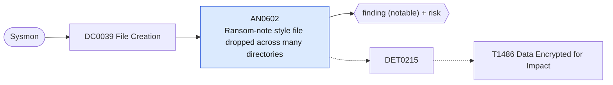

# AN0602 Ransom-note style file dropped across many directories

[ATT&CK analytic](https://attack.mitre.org/detectionstrategies/DET0215#AN0602) · DET0215 Detection of Multi-Platform File Encryption for Impact · [T1486 Data Encrypted for Impact](https://attack.mitre.org/techniques/T1486) · tactics: impact · platforms: Windows

**Content type:** ttp → finding (notable) + risk · **Severity:** critical · **Status:** implemented · **Technique prevalence score:** 111

One process creates files with ransom-note style names (README, DECRYPT, RECOVER, RESTORE, HOW_TO, HELP, RANSOM) in many distinct directories within five minutes. Ransomware writes its note into every folder it encrypts.



## What ATT&CK asks for

> High-frequency file write operations using uncommon extensions, followed by ransom note creation, registry tampering, or shadow copy deletion. Often uses CLI tools like vssadmin, wbadmin, cipher, or PowerShell.

## What this implementation detects

One process creates files with ransom-note style names (README, DECRYPT, RECOVER, RESTORE, HOW_TO, HELP, RANSOM) in many distinct directories within five minutes. Ransomware writes its note into every folder it encrypts.

**Not covered:** High-frequency renames to new extensions and file-time changes (Sysmon 2) are not counted, and the shadow-copy deletion leg is AN0933. Requires Sysmon FileCreate rules that include .txt/.hta/.html in user and share paths; many reduced configs exclude them.

## Tuning

ATT&CK mutable elements and where each is bound. Edit macros in `local/macros.conf` and lookups in place; do not edit the search.

| Mutable element | ATT&CK guidance | Bound to | Default |
|---|---|---|---|
| FileExtension | Non-standard or randomly generated file extensions may indicate encrypted content. | macro `mitre_an0602_note_names` | `TargetFilename IN ("*README*.txt", "*READ_ME*", "*DECRYPT*", "*RECOVER*", "*RESTORE*FILES*", "*HOW_TO*", "*HOW TO*", "*HELP_*", "*RANSOM*", "*!!!*.txt", "*.hta")` |
| TargetFolder | Focus on user document folders, network shares, or system paths like %System32%. | filter macro `mitre_an0602_filter` (not bound separately) | `search *` |
| TimeWindow | Correlate rapid writes and renames within seconds across high file count. | macro `mitre_an0602_dir_threshold` — Distinct directories receiving a note from one process per 5-minute bucket. | `10` |
| CommandLine | Flag common ransomware tools or functions (vssadmin delete shadows /all /quiet). | filter macro `mitre_an0602_filter` (not bound separately) | `search *` |

## Splunk

Stanza `[MITRE - AN0602 - Ransom-note style file dropped across many directories - Rule]` in `DA-ESS-mitre-attack-detections`. Schedule `*/5 * * * *`, window `-11m@m` to `-1m@m`. Ships disabled.

```spl
`mitre_dc0039_sysmon` EventCode=11 `mitre_an0602_note_names`
| `mitre_normalize_host`
| eval directory=replace(TargetFilename, "\\\\[^\\\\]+$", ""), process_name=replace(Image, "^.*\\\\", "")
| bin _time span=5m
| stats count min(_time) as firstTime max(_time) as lastTime dc(directory) as directory_count values(TargetFilename) as file_path by dest user process_name _time
| where directory_count >= `mitre_an0602_dir_threshold`
| eval file_path=mvindex(file_path, 0, 9)
| `mitre_ctime(firstTime)` | `mitre_ctime(lastTime)`
| `mitre_an0602_filter`
```

Risk: `dest` (system, 90), `user` (user, 70). Threat objects: `process_name`. Message: $process_name$ dropped ransom-note style files in $directory_count$ directories on $dest$

Throttle: dest, process_name for 3600s.

Data components: [DC0039](../data-components/DC0039-file-creation.md).

## Sigma

Rule file: `dist/sigma/rules/an0602_ransom_note_style_file_dropped_across_many_directories.yml` (base rule plus a correlation rule).

## Known false positives

- Source-code checkouts and installers that write a README into many folders; exclude the process in the filter macro.
