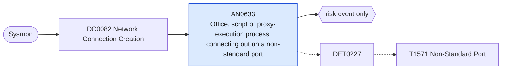

# AN0633 Office, script or proxy-execution process connecting out on a non-standard port

[ATT&CK analytic](https://attack.mitre.org/detectionstrategies/DET0227#AN0633) · DET0227 Detection Strategy for Non-Standard Ports · [T1571 Non-Standard Port](https://attack.mitre.org/techniques/T1571) · tactics: command-and-control · platforms: Windows

**Content type:** anomaly → risk event only · **Severity:** low · **Status:** implemented · **Technique prevalence score:** 95

Sysmon network connections (EventCode 3) initiated by Office applications, script hosts, PowerShell or proxy-execution utilities to a non-internal address on a destination port outside the list of standard service ports.



## What ATT&CK asks for

> Processes initiating outbound connections on uncommon ports or using protocols inconsistent with the assigned port. Correlating process creation with subsequent network connections reveals anomalies such as svchost.exe or Office applications using high, atypical ports.

## What this implementation detects

Sysmon network connections (EventCode 3) initiated by Office applications, script hosts, PowerShell or proxy-execution utilities to a non-internal address on a destination port outside the list of standard service ports.

**Not covered:** ATT&CK names the Windows Filtering Platform events (5156/5157); this uses Sysmon 3 from the same data component because it carries the process image reliably. Protocol-versus-port mismatch needs the network view (Corelight conn.log service field) and is not evaluated.

## Tuning

ATT&CK mutable elements and where each is bound. Edit macros in `local/macros.conf` and lookups in place; do not edit the search.

| Mutable element | ATT&CK guidance | Bound to | Default |
|---|---|---|---|
| PortThresholds | Define what constitutes a 'non-standard port' based on organizational baselines (e.g., allow 443/80/22 but flag 8088/587/3389 changes). | macro `mitre_an0633_standard_ports` | `DestinationPort IN (20, 21, 22, 25, 53, 80, 110, 123, 143, 389, 443, 445, 465, 587, 636, 993, 995, 3389, 5985, 5986, 8080, 8443)` |
| ProcessAllowList | Processes normally allowed to use non-standard ports (e.g., custom apps). | macro `mitre_an0633_processes` — The processes watched (not an allow-list); remove entries that legitimately use custom ports in your environment. | `Image IN ("*\\winword.exe", "*\\excel.exe", "*\\powerpnt.exe", "*\\outlook.exe", "*\\msaccess.exe", "*\\wscript.exe", "*\\cscript.exe", "*\\mshta.exe", "*\\powershell.exe", "*\\pwsh.exe", "*\\rundll32.exe", "*\\regsvr32.exe", "*\\msbuild.exe", "*\\installutil.exe", "*\\certutil.exe", "*\\cmd.exe", "*\\notepad.exe")` |
| TimeWindow | Correlate process creation and network activity within N seconds. | filter macro `mitre_an0633_filter` (not bound separately) | `search *` |

## Splunk

Stanza `[MITRE - AN0633 - Office, script or proxy-execution process connecting out on a non-standard port - Rule]` in `DA-ESS-mitre-attack-detections`. Schedule `6-59/15 * * * *`, window `-20m@m` to `-5m@m`. Ships disabled.

```spl
`mitre_dc0082_sysmon` EventCode=3 Initiated=true `mitre_an0633_processes` NOT `mitre_an0633_standard_ports`
| `mitre_normalize_host`
| where NOT `mitre_is_internal(DestinationIp)`
| eval process_name=replace(Image, "^.*\\\\", ""), dest_ip=DestinationIp, dest_port=DestinationPort
| stats count min(_time) as firstTime max(_time) as lastTime values(DestinationHostname) as dest_host by dest user process_name dest_ip dest_port
| `mitre_ctime(firstTime)` | `mitre_ctime(lastTime)`
| `mitre_an0633_filter`
```

Risk: `dest` (system, 30), `user` (user, 20). Threat objects: `dest_ip`, `process_name`. Message: $process_name$ on $dest$ connected to $dest_ip$ on port $dest_port$

Throttle: dest, process_name, dest_ip for 14400s.

Data components: [DC0082](../data-components/DC0082-network-connection-creation.md).

## Sigma

Rule file: `dist/sigma/rules/an0633_office_script_or_proxy_execution_process_connecting_out_on_a.yml`.

## Known false positives

- Add-ins and scripts calling business applications on custom ports; developer tooling.
