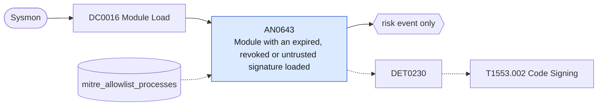

# AN0643 Module with an expired, revoked or untrusted signature loaded

[ATT&CK analytic](https://attack.mitre.org/detectionstrategies/DET0230#AN0643) · DET0230 Detect Suspicious or Malicious Code Signing Abuse · [T1553.002 Code Signing](https://attack.mitre.org/techniques/T1553/002) · tactics: defense-impairment · platforms: Windows

**Content type:** anomaly → risk event only · **Severity:** medium · **Status:** implemented · **Technique prevalence score:** 129

Sysmon ImageLoad (7) of a module that is signed but whose signature status is not valid (expired, revoked, untrusted root, bad digest), outside the Windows and Program Files directories. Stolen or revoked code-signing certificates and tampered signed binaries show up this way.



## What ATT&CK asks for

> Detects execution of binaries signed with unusual or recently issued certificates, correlation of process execution with abnormal publisher metadata, and mismatched certificate chains. Monitors for revoked or unknown code signing certificates used in high-privilege contexts.

## What this implementation detects

Sysmon ImageLoad (7) of a module that is signed but whose signature status is not valid (expired, revoked, untrusted root, bad digest), outside the Windows and Program Files directories. Stolen or revoked code-signing certificates and tampered signed binaries show up this way.

**Not covered:** Certificate issue date and issuing CA (CertificateAgeThreshold, AllowedCertificateAuthorities) are not in Sysmon events; process images (EventCode 1) carry no signature fields.

## Tuning

ATT&CK mutable elements and where each is bound. Edit macros in `local/macros.conf` and lookups in place; do not edit the search.

| Mutable element | ATT&CK guidance | Bound to | Default |
|---|---|---|---|
| AllowedCertificateAuthorities | Define trusted issuers to suppress noise from legitimate enterprise signing chains | macro `mitre_an0643_bad_status` | `SignatureStatus IN ("Expired", "Revoked", "Distrust", "UntrustedRoot", "*Bad*", "*Invalid*", "*NotTrusted*")` |
| TimeWindow | Correlation window for detecting execution of binaries with newly observed or anomalous certificates | filter macro `mitre_an0643_filter` |  |
| CertificateAgeThreshold | Baseline normal age of certificates; flag very recent or expired certificates | lookup `mitre_allowlist_processes` — Legacy applications known to ship expired-but-benign signatures (process_name column). |  |

## Splunk

Stanza `[MITRE - AN0643 - Module with an expired, revoked or untrusted signature loaded - Rule]` in `DA-ESS-mitre-attack-detections`. Schedule `6-59/15 * * * *`, window `-20m@m` to `-5m@m`. Ships disabled.

```spl
`mitre_dc0016_sysmon` EventCode=7 Signed="true" `mitre_an0643_bad_status` NOT ImageLoaded IN ("C:\\Windows\\*", "C:\\Program Files\\*", "C:\\Program Files (x86)\\*")
| `mitre_normalize_host`
| eval process_name=replace(Image, "^.*\\\\", "")
| search `mitre_not_allowlisted_process`
| stats count min(_time) as firstTime max(_time) as lastTime values(ImageLoaded) as file_path values(Signature) as signature values(SignatureStatus) as signature_status by dest user process_name
| `mitre_ctime(firstTime)` | `mitre_ctime(lastTime)`
| `mitre_an0643_filter`
```

Risk: `dest` (system, 35), `user` (user, 25). Threat objects: `signature`. Message: $process_name$ on $dest$ loaded a module with an invalid signature ($signature$)

Throttle: dest, process_name for 86400s.

Data components: [DC0016](../data-components/DC0016-module-load.md).

## Sigma

Rule file: `dist/sigma/rules/an0643_module_with_an_expired_revoked_or_untrusted_signature_loaded.yml`.

## Known false positives

- Old vendor software whose signing certificate has expired without timestamping.
