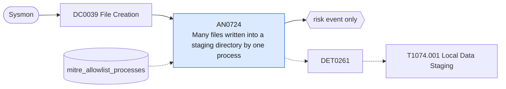

# AN0724 Many files written into a staging directory by one process

[ATT&CK analytic](https://attack.mitre.org/detectionstrategies/DET0261#AN0724) · DET0261 Detection of Local Data Staging Prior to Exfiltration · [T1074.001 Local Data Staging](https://attack.mitre.org/techniques/T1074/001) · tactics: collection · platforms: Windows

**Content type:** anomaly → risk event only · **Severity:** medium · **Status:** implemented · **Technique prevalence score:** 186

One process instance (Sysmon ProcessGuid) creates a large number of files in staging directories (Temp, Users\Public, ProgramData, PerfLogs, Windows\Tasks, recycle bin) within five minutes: the collect-then-stage step before archiving and exfiltration.



## What ATT&CK asks for

> Detects file reads across locations followed by writes to temp or staging directories, often compressed or encrypted, indicating local staging behavior.

## What this implementation detects

One process instance (Sysmon ProcessGuid) creates a large number of files in staging directories (Temp, Users\Public, ProgramData, PerfLogs, Windows\Tasks, recycle bin) within five minutes: the collect-then-stage step before archiving and exfiltration.

**Not covered:** The 4663 reads of the source files are not correlated (they need SACLs). Requires Sysmon FileCreate logging for these directories; reduced configs often exclude Temp.

## Tuning

ATT&CK mutable elements and where each is bound. Edit macros in `local/macros.conf` and lookups in place; do not edit the search.

| Mutable element | ATT&CK guidance | Bound to | Default |
|---|---|---|---|
| StagingDirList | Paths such as C:\Temp, C:\Windows\Tasks, etc. | macro `mitre_an0724_staging_dirs` | `TargetFilename IN ("*\\AppData\\Local\\Temp\\*", "*\\Windows\\Temp\\*", "*\\Users\\Public\\*", "*\\ProgramData\\*", "*\\PerfLogs\\*", "*\\Windows\\Tasks\\*", "*\\$Recycle.Bin\\*")` |
| ArchivingToolPatterns | Matches to 7z.exe, rar.exe, zip.exe, or custom scripts. | lookup `mitre_allowlist_processes` — Installers, browsers and updaters that legitimately unpack many files (process_name column). |  |
| TimeWindow | How long to correlate file reads followed by compression. | macro `mitre_an0724_file_threshold` — Files per process per 5-minute bucket. | `50` |

## Splunk

Stanza `[MITRE - AN0724 - Many files written into a staging directory by one process - Rule]` in `DA-ESS-mitre-attack-detections`. Schedule `2-59/15 * * * *`, window `-20m@m` to `-5m@m`. Ships disabled.

```spl
`mitre_dc0039_sysmon` EventCode=11 `mitre_an0724_staging_dirs`
| `mitre_normalize_host`
| eval process_name=replace(Image, "^.*\\\\", ""), directory=replace(TargetFilename, "\\\\[^\\\\]+$", "")
| search `mitre_not_allowlisted_process`
| bin _time span=5m
| stats count as file_count dc(directory) as directories min(_time) as firstTime max(_time) as lastTime values(directory) as directory by dest user process_name ProcessGuid _time
| where file_count >= `mitre_an0724_file_threshold`
| eval directory=mvindex(directory, 0, 4)
| `mitre_ctime(firstTime)` | `mitre_ctime(lastTime)`
| `mitre_an0724_filter`
```

Risk: `dest` (system, 35), `user` (user, 30). Threat objects: `process_name`. Message: $process_name$ wrote $file_count$ files into staging directories on $dest$

Throttle: dest, process_name for 3600s.

Data components: [DC0039](../data-components/DC0039-file-creation.md).

## Sigma

Rule file: `dist/sigma/rules/an0724_many_files_written_into_a_staging_directory_by_one_process.yml` (base rule plus a correlation rule).

## Known false positives

- Installers, browsers caching downloads, software deployment agents; allow-list them by process name.
