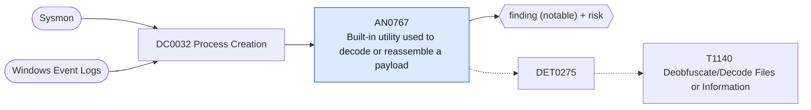

# AN0767 Built-in utility used to decode or reassemble a payload

[ATT&CK analytic](https://attack.mitre.org/detectionstrategies/DET0275#AN0767) · DET0275 Detect Adversary Deobfuscation or Decoding of Files and Payloads · [T1140 Deobfuscate/Decode Files or Information](https://attack.mitre.org/techniques/T1140) · tactics: stealth · platforms: Windows

**Content type:** ttp → finding (notable) + risk · **Severity:** medium · **Status:** implemented · **Technique prevalence score:** 410

certutil -decode / -decodehex, cmd copy /b concatenation of files, PowerShell FromBase64String written to disk, or expand.exe unpacking into a user-writable directory.



## What ATT&CK asks for

> An adversary leverages built-in tools such as certutil.exe, powershell.exe, or copy.exe to decode, reassemble, or extract hidden malicious content from obfuscated containers or encoded formats. The decoding utility often spawns shortly after file staging or download and may be chained with script interpreters or further payload execution.

## What this implementation detects

certutil -decode / -decodehex, cmd copy /b concatenation of files, PowerShell FromBase64String written to disk, or expand.exe unpacking into a user-writable directory.

**Not covered:** The staged-file creation that precedes decoding, the FileExtensionFilter element and the process-access leg are not correlated.

## Tuning

ATT&CK mutable elements and where each is bound. Edit macros in `local/macros.conf` and lookups in place; do not edit the search.

| Mutable element | ATT&CK guidance | Bound to | Default |
|---|---|---|---|
| ToolName | May vary across environments (e.g., certutil, powershell, copy, expand, 7zip) | macro `mitre_an0767_patterns` | `((Processes.process_name="certutil.exe" Processes.process IN ("*-decode *", "*/decode *", "*-decodehex *", "*/decodehex *")) OR (Processes.process_name="cmd.exe" Processes.process="*copy */b *+*") OR (Processes.process_name IN ("powershell.exe", "pwsh.exe") Processes.process="*frombase64string*" Processes.process IN ("*writeallbytes*", "*set-content*", "*out-file*")) OR (Processes.process_name="expand.exe" Processes.process IN ("*\\users\\*", "*\\programdata\\*", "*\\windows\\temp\\*")))` |
| FileExtensionFilter | Targets may use .txt, .cer, .enc, .b64, .zip, etc. to disguise payloads | filter macro `mitre_an0767_filter` (not bound separately) | `search *` |
| CommandLineRegex | Command syntax varies between base64 decoding, copy /b, and expand switches | filter macro `mitre_an0767_filter` (not bound separately) | `search *` |
| TimeWindow | Deobfuscation typically follows staging/download within a short timeframe | filter macro `mitre_an0767_filter` (not bound separately) | `search *` |

## Splunk

Stanza `[MITRE - AN0767 - Built-in utility used to decode or reassemble a payload - Rule]` in `DA-ESS-mitre-attack-detections`. Schedule `1-59/15 * * * *`, window `-20m@m` to `-5m@m`. Ships disabled.

```spl
| tstats `mitre_summariesonly` count min(_time) as firstTime max(_time) as lastTime
    from `mitre_dc0032_dm` where `mitre_dc0032_dm_where` `mitre_an0767_patterns`
    by Processes.dest Processes.user Processes.parent_process_name Processes.process_name Processes.process
| `drop_dm_object_name(Processes)`
| `mitre_ctime(firstTime)` | `mitre_ctime(lastTime)`
| `mitre_an0767_filter`
```

Risk: `dest` (system, 50), `user` (user, 40). Threat objects: `process_name`. Message: Payload decoded with $process_name$ on $dest$

Throttle: dest, process for 3600s.

Data components: [DC0032](../data-components/DC0032-process-creation.md).

## Sigma

Rule file: `dist/sigma/rules/an0767_built_in_utility_used_to_decode_or_reassemble_a_payload.yml`.

## Known false positives

- Certificate administration with certutil -decode; build and packaging scripts.
