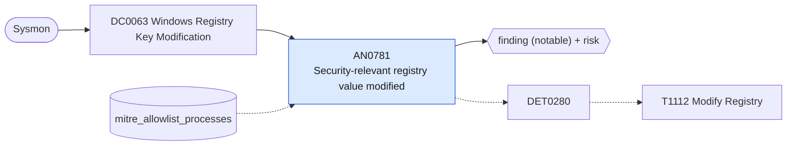

# AN0781 Security-relevant registry value modified

[ATT&CK analytic](https://attack.mitre.org/detectionstrategies/DET0280#AN0781) · DET0280 Behavior-Based Registry Modification Detection on Windows · [T1112 Modify Registry](https://attack.mitre.org/techniques/T1112) · tactics: defense-impairment, persistence · platforms: Windows

**Content type:** ttp → finding (notable) + risk · **Severity:** medium · **Status:** implemented · **Technique prevalence score:** 209

A value is set on a registry location that controls logon, credential handling or execution flow: Winlogon Userinit/Shell/Notify, LSA security, notification and authentication packages, RunAsPPL, DisableRestrictedAdmin, WDigest UseLogonCredential, Image File Execution Options Debugger, SilentProcessExit MonitorProcess, AppInit_DLLs, AppCertDlls, SafeDllSearchMode, EnableLUA and fDenyTSConnections. Uses raw Sysmon EventCode 13 so the writing process is available for allow-listing.



## What ATT&CK asks for

> Behavior chain involving abnormal registry modifications via CLI, PowerShell, WMI, or direct API calls, especially targeting persistence, privilege escalation, or defense evasion keys, potentially followed by service restart or process execution. Such as editing Notify/Userinit/Startup keys, or disabling SafeDllSearchMode.

## What this implementation detects

A value is set on a registry location that controls logon, credential handling or execution flow: Winlogon Userinit/Shell/Notify, LSA security, notification and authentication packages, RunAsPPL, DisableRestrictedAdmin, WDigest UseLogonCredential, Image File Execution Options Debugger, SilentProcessExit MonitorProcess, AppInit_DLLs, AppCertDlls, SafeDllSearchMode, EnableLUA and fDenyTSConnections. Uses raw Sysmon EventCode 13 so the writing process is available for allow-listing.

**Not covered:** The follow-on service restart or process execution and signature checks on the writing process are not correlated.

## Tuning

ATT&CK mutable elements and where each is bound. Edit macros in `local/macros.conf` and lookups in place; do not edit the search.

| Mutable element | ATT&CK guidance | Bound to | Default |
|---|---|---|---|
| RegistryKeyPathPatterns | Environment-specific list of monitored or critical registry keys, e.g., Run, Services, Security Settings, LSASS | macro `mitre_an0781_keys` | `TargetObject IN ("*\\Winlogon\\Userinit", "*\\Winlogon\\Shell", "*\\Winlogon\\Notify\\*", "*\\Control\\Lsa\\Security Packages", "*\\Control\\Lsa\\Notification Packages", "*\\Control\\Lsa\\Authentication Packages", "*\\Control\\Lsa\\RunAsPPL", "*\\Control\\Lsa\\DisableRestrictedAdmin", "*\\WDigest\\UseLogonCredential", "*\\Image File Execution Options\\*\\Debugger", "*\\SilentProcessExit\\*\\MonitorProcess", "*\\Windows\\AppInit_DLLs", "*\\Session Manager\\AppCertDlls\\*", "*\\Session Manager\\SafeDllSearchMode", "*\\Policies\\System\\EnableLUA", "*\\Terminal Server\\fDenyTSConnections")` |
| ParentProcessAllowList | Allowlist of legitimate registry tools (e.g., regedit.exe, msiexec.exe); used to filter known safe writes | lookup `mitre_allowlist_processes` — Management tools that set these values by policy (process_name column is the writing process). |  |
| TimeWindow | Correlate registry change with nearby process/service execution within a defined timeframe | filter macro `mitre_an0781_filter` (not bound separately) | `search *` |
| SignatureCheck | Flag unsigned executables or abnormal parent-child lineage performing registry modification | filter macro `mitre_an0781_filter` (not bound separately) | `search *` |

## Splunk

Stanza `[MITRE - AN0781 - Security-relevant registry value modified - Rule]` in `DA-ESS-mitre-attack-detections`. Schedule `11-59/15 * * * *`, window `-20m@m` to `-5m@m`. Ships disabled.

```spl
`mitre_dc0063_sysmon` EventCode=13 `mitre_an0781_keys`
| `mitre_normalize_host`
| eval process_name=replace(Image, "^.*\\\\", ""), registry_path=TargetObject, registry_value_data=Details
| search `mitre_not_allowlisted_process`
| stats count min(_time) as firstTime max(_time) as lastTime values(registry_value_data) as registry_value_data by dest user process_name registry_path
| `mitre_ctime(firstTime)` | `mitre_ctime(lastTime)`
| `mitre_an0781_filter`
```

Risk: `dest` (system, 55), `user` (user, 45). Threat objects: `registry_path`, `process_name`. Message: Sensitive registry value $registry_path$ modified on $dest$ by $process_name$

Throttle: dest, registry_path for 3600s.

Data components: [DC0063](../data-components/DC0063-windows-registry-key-modification.md).

## Sigma

Rule file: `dist/sigma/rules/an0781_security_relevant_registry_value_modified.yml`.

## Known false positives

- Group policy processing, OS upgrades and hardening baselines set several of these values.
