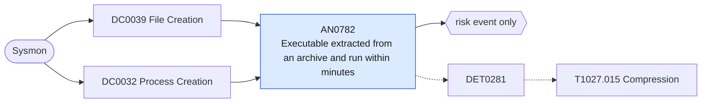

# AN0782 Executable extracted from an archive and run within minutes

[ATT&CK analytic](https://attack.mitre.org/detectionstrategies/DET0281#AN0782) · DET0281 Detection Strategy for Compressed Payload Creation and Execution · [T1027.015 Compression](https://attack.mitre.org/techniques/T1027/015) · tactics: stealth · platforms: Windows

**Content type:** anomaly → risk event only · **Severity:** medium · **Status:** implemented · **Technique prevalence score:** 52

An archiver or Explorer's built-in extraction writes an executable, script or library (Sysmon 11) into a user-writable folder, and a process starts from that exact path within five minutes. Compressed delivery (ZIP, RAR, 7z, ISO-in-ZIP, self-extractors) hides the payload from gateway scanning until the user runs it.



## What ATT&CK asks for

> Monitors for compression tool usage (e.g., 7zip, WinRAR, MakeCab) that follows or precedes file modification, suspicious file types (e.g., .exe, .dll) being compressed, or dropped from self-extracting archives followed by immediate execution.

## What this implementation detects

An archiver or Explorer's built-in extraction writes an executable, script or library (Sysmon 11) into a user-writable folder, and a process starts from that exact path within five minutes. Compressed delivery (ZIP, RAR, 7z, ISO-in-ZIP, self-extractors) hides the payload from gateway scanning until the user runs it.

**Not covered:** Payloads loaded as DLLs (rundll32 or sideloading) rather than run as a process are not matched; self-extracting archives that execute in memory without writing a file are invisible.

## Tuning

ATT&CK mutable elements and where each is bound. Edit macros in `local/macros.conf` and lookups in place; do not edit the search.

| Mutable element | ATT&CK guidance | Bound to | Default |
|---|---|---|---|
| CompressedFileType | Zip, .rar, .cab, .gz – tune based on expected legitimate use of compression in environment | macro `mitre_an0782_extractors` | `Image IN ("*\\7z.exe", "*\\7zG.exe", "*\\7zFM.exe", "*\\WinRAR.exe", "*\\rar.exe", "*\\unrar.exe", "*\\expand.exe", "*\\extrac32.exe", "*\\tar.exe", "*\\explorer.exe", "*\\PeaZip.exe", "*\\Bandizip.exe", "*\\winzip64.exe", "*\\winzip32.exe")` |
| SFXExecutionDelay | Expected time between archive unpacking and first execution – short delays are suspicious | macro `mitre_an0782_window_seconds` | `300` |
| UserContext | Restrict detection to non-admin or interactive users if excessive FPs from sys admin activity | macro `mitre_an0782_user_paths` | `Image IN ("C:\\Users\\*", "C:\\ProgramData\\*", "C:\\Windows\\Temp\\*", "C:\\$Recycle.Bin\\*", "C:\\PerfLogs\\*")` |
| PayloadTypes *(implementation)* |  | macro `mitre_an0782_payload_types` | `TargetFilename IN ("*.exe", "*.scr", "*.com", "*.pif", "*.bat", "*.cmd", "*.vbs", "*.js", "*.jse", "*.wsf", "*.hta", "*.ps1", "*.lnk", "*.msi")` |

## Splunk

Stanza `[MITRE - AN0782 - Executable extracted from an archive and run within minutes - Rule]` in `DA-ESS-mitre-attack-detections`. Schedule `*/15 * * * *`, window `-25m@m` to `-5m@m`. Ships disabled.

```spl
(`mitre_dc0039_sysmon` EventCode=11 `mitre_an0782_extractors` `mitre_an0782_payload_types`)
OR (`mitre_dc0032_sysmon` EventCode=1 `mitre_an0782_user_paths`)
| `mitre_normalize_host`
| eval file_path=lower(if(EventCode==11, TargetFilename, Image)), extract_time=if(EventCode==11, _time, null()), exec_time=if(EventCode==1, _time, null()), extractor=if(EventCode==11, lower(replace(Image, "^.*\\\\", "")), null()), command=if(EventCode==1, CommandLine, null())
| stats min(extract_time) as extract_time min(exec_time) as exec_time values(extractor) as extractor values(command) as process values(user) as user by dest file_path
| where isnotnull(extract_time) AND isnotnull(exec_time) AND exec_time >= extract_time AND exec_time - extract_time <= `mitre_an0782_window_seconds`
| eval process_name=replace(file_path, "^.*\\\\", ""), firstTime=extract_time, lastTime=exec_time
| search `mitre_not_allowlisted_process`
| `mitre_ctime(firstTime)` | `mitre_ctime(lastTime)`
| `mitre_an0782_filter`
```

Risk: `dest` (system, 35), `user` (user, 30). Threat objects: `file_path`. Message: $process_name$ extracted by $extractor$ and run on $dest$

Throttle: dest, file_path for 86400s.

Data components: [DC0039](../data-components/DC0039-file-creation.md), [DC0032](../data-components/DC0032-process-creation.md).

## Sigma

Rule file: `dist/sigma/rules/an0782_executable_extracted_from_an_archive_and_run_within_minutes.yml`.

## Known false positives

- Users unzipping and running installers or portable tools from Downloads; software updaters that unpack into Temp.
