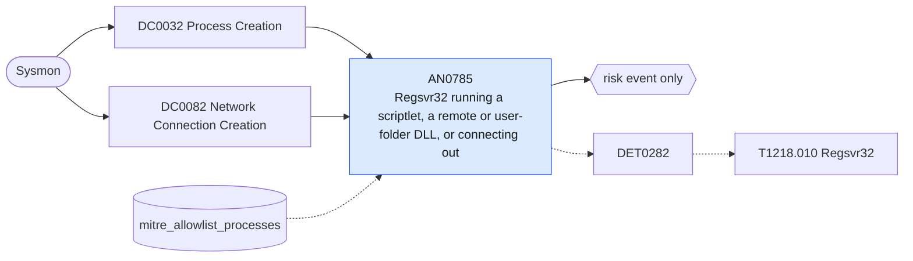

# AN0785 Regsvr32 running a scriptlet, a remote or user-folder DLL, or connecting out

[ATT&CK analytic](https://attack.mitre.org/detectionstrategies/DET0282#AN0785) · DET0282 Detection Strategy for System Binary Proxy Execution: Regsvr32 · [T1218.010 Regsvr32](https://attack.mitre.org/techniques/T1218/010) · tactics: stealth · platforms: Windows

**Content type:** anomaly → risk event only · **Severity:** medium · **Status:** implemented · **Technique prevalence score:** 49

regsvr32 invoked with scrobj.dll or a .sct scriptlet, with /i: pointing at a URL (Squiblydoo), or registering a DLL from a user-writable folder; or regsvr32 itself opening an outbound connection to an external address. Legitimate registration targets signed DLLs under Program Files and System32 and never needs the network.



## What ATT&CK asks for

> Detection focuses on identifying anomalous regsvr32.exe executions that deviate from normal administrative or system use. Defenders may observe regsvr32.exe loading scriptlets or DLLs from unusual paths (especially temporary directories or remote URLs), command-line arguments invoking /i or /u with suspicious file references, network connections initiated by regsvr32.exe, and unsigned or untrusted DLLs being loaded shortly after regsvr32.exe invocation. Correlated sequences include regsvr32.exe process creation, module load of DLL/scriptlet, and optional outbound network traffic.

## What this implementation detects

regsvr32 invoked with scrobj.dll or a .sct scriptlet, with /i: pointing at a URL (Squiblydoo), or registering a DLL from a user-writable folder; or regsvr32 itself opening an outbound connection to an external address. Legitimate registration targets signed DLLs under Program Files and System32 and never needs the network.

**Not covered:** The module-load leg (unsigned DLL loaded by regsvr32) is not joined; renamed copies of regsvr32 are caught only through OriginalFileName on the process leg.

## Tuning

ATT&CK mutable elements and where each is bound. Edit macros in `local/macros.conf` and lookups in place; do not edit the search.

| Mutable element | ATT&CK guidance | Bound to | Default |
|---|---|---|---|
| AllowedDLLPaths | Directories where DLL loading via regsvr32.exe is expected (e.g., C:\Windows\System32). | lookup `mitre_allowlist_processes` — Installers that register DLLs from their own ProgramData or Temp folders (process_name regsvr32.exe with a parent). |  |
| ScriptletExtensions | File extensions considered suspicious when executed by regsvr32.exe (e.g., .sct, .ocx). | macro `mitre_an0785_suspicious_args` | `(CommandLine IN ("*scrobj.dll*", "*.sct*", "*/i:http*", "*-i:http*", "*/i:ftp*", "*/i:\\\\*") OR CommandLine IN ("*\\AppData\\Local\\Temp\\*", "*\\Downloads\\*", "*\\Users\\Public\\*", "*\\ProgramData\\*", "*\\Windows\\Temp\\*", "*\\AppData\\Roaming\\*", "*\\PerfLogs\\*"))` |
| TimeWindow | Timeframe to correlate regsvr32.exe process creation with subsequent module loads and network connections. | filter macro `mitre_an0785_filter` |  |
| ParentProcessWhitelist | Parent processes from which regsvr32.exe is expected (e.g., explorer.exe during legitimate COM object registration). | filter macro `mitre_an0785_filter` |  |

## Splunk

Stanza `[MITRE - AN0785 - Regsvr32 running a scriptlet, a remote or user-folder DLL, or connecting out - Rule]` in `DA-ESS-mitre-attack-detections`. Schedule `8-59/15 * * * *`, window `-20m@m` to `-5m@m`. Ships disabled.

```spl
(`mitre_dc0032_sysmon` EventCode=1 (Image="*\\regsvr32.exe" OR OriginalFileName="REGSVR32.EXE") `mitre_an0785_suspicious_args`)
OR (`mitre_dc0082_sysmon` EventCode=3 Initiated="true" Image="*\\regsvr32.exe")
| `mitre_normalize_host`
| where EventCode==1 OR NOT `mitre_is_internal(DestinationIp)`
| eval process_name="regsvr32.exe", parent_process_name=lower(replace(ParentImage, "^.*\\\\", "")), signal=if(EventCode==1, CommandLine, "connection to ".DestinationIp.":".DestinationPort)
| search `mitre_not_allowlisted_process`
| stats count min(_time) as firstTime max(_time) as lastTime values(signal) as signal values(parent_process_name) as parent_process_name values(user) as user by dest
| eval signal=mvindex(signal, 0, 9)
| `mitre_ctime(firstTime)` | `mitre_ctime(lastTime)`
| `mitre_an0785_filter`
```

Risk: `dest` (system, 50), `user` (user, 35). Threat objects: `parent_process_name`. Message: Suspicious regsvr32 use on $dest$ ($signal$)

Throttle: dest for 86400s.

Data components: [DC0032](../data-components/DC0032-process-creation.md), [DC0082](../data-components/DC0082-network-connection-creation.md).

## Sigma

Rule file: `dist/sigma/rules/an0785_regsvr32_running_a_scriptlet_a_remote_or_user_folder_dll_or_.yml`.

## Known false positives

- Installers that register COM DLLs from their extraction folder in Temp or ProgramData.
