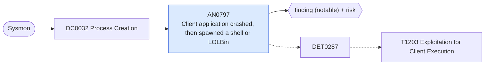

# AN0797 Client application crashed, then spawned a shell or LOLBin

[ATT&CK analytic](https://attack.mitre.org/detectionstrategies/DET0287#AN0797) · DET0287 Exploitation for Client Execution – cross-platform behavior chain (browser/Office/3rd-party apps) · [T1203 Exploitation for Client Execution](https://attack.mitre.org/techniques/T1203) · tactics: execution · platforms: Windows

**Content type:** ttp → finding (notable) + risk · **Severity:** high · **Status:** implemented · **Technique prevalence score:** 108

A browser, Office application or document reader launches WerFault (it crashed), and within ten minutes the same application on the same host starts a shell, script host or proxy-execution utility. A crash followed by unexpected children is the footprint of a client-side exploit that partly failed or recovered.



## What ATT&CK asks for

> Cause→effect chain: (1) A client app (browser, Office, PDF/Flash/reader) experiences a crash/abnormal exit or loads from an unusual location, then (2) drops or modifies a file in user-writable paths, and/or (3) spawns an unexpected child (e.g., powershell/cmd/mshta/rundll32/wscript/installer), and (4) establishes outbound C2-like connections shortly after. Correlate application logs, file writes, process lineage, and network egress within a short window.

## What this implementation detects

A browser, Office application or document reader launches WerFault (it crashed), and within ten minutes the same application on the same host starts a shell, script host or proxy-execution utility. A crash followed by unexpected children is the footprint of a client-side exploit that partly failed or recovered.

**Not covered:** Application log 1000 crash records are not used (their EventData fields are unnamed in XML collection); the file-drop and egress legs are not joined.

## Tuning

ATT&CK mutable elements and where each is bound. Edit macros in `local/macros.conf` and lookups in place; do not edit the search.

| Mutable element | ATT&CK guidance | Bound to | Default |
|---|---|---|---|
| TimeWindow | Correlation window (e.g., 15m) between crash/write/child/network. | macro `mitre_an0797_window_seconds` | `600` |
| HighRiskChildren | List of child processes that should rarely spawn from Office/browsers (powershell.exe, cmd.exe, wscript.exe, mshta.exe, rundll32.exe, regsvr32.exe, msiexec.exe, curl.exe). | macro `mitre_an0797_children` | `Image IN ("*\\cmd.exe", "*\\powershell.exe", "*\\pwsh.exe", "*\\wscript.exe", "*\\cscript.exe", "*\\mshta.exe", "*\\rundll32.exe", "*\\regsvr32.exe", "*\\msiexec.exe", "*\\certutil.exe", "*\\bitsadmin.exe")` |
| UserPaths | Writable paths to watch (Downloads, %TEMP%, %APPDATA%, OneDrive, Office startup folders). | filter macro `mitre_an0797_filter` (not bound separately) | `search *` |
| AllowedPlugins | Known add-ins/extensions and updater binaries to reduce noise. | macro `mitre_an0797_client_apps` | `ParentImage IN ("*\\chrome.exe", "*\\msedge.exe", "*\\firefox.exe", "*\\iexplore.exe", "*\\winword.exe", "*\\excel.exe", "*\\powerpnt.exe", "*\\outlook.exe", "*\\acrord32.exe", "*\\acrobat.exe", "*\\foxitpdfreader.exe", "*\\java.exe", "*\\javaw.exe")` |
| EgressAllowlist | Known update/CDN domains and proxy egress CIDRs for suppression. | filter macro `mitre_an0797_filter` (not bound separately) | `search *` |

## Splunk

Stanza `[MITRE - AN0797 - Client application crashed, then spawned a shell or LOLBin - Rule]` in `DA-ESS-mitre-attack-detections`. Schedule `12-59/15 * * * *`, window `-75m@m` to `-5m@m`. Ships disabled.

```spl
`mitre_dc0032_sysmon` EventCode=1 `mitre_an0797_client_apps` (Image="*\\WerFault.exe" OR `mitre_an0797_children`)
| `mitre_normalize_host`
| eval client_app=lower(replace(ParentImage, "^.*\\\\", "")), crash_time=if(match(Image, "(?i)werfault\.exe$"), _time, null()), child_time=if(NOT match(Image, "(?i)werfault\.exe$"), _time, null()), child=if(isnotnull(child_time), CommandLine, null())
| stats min(crash_time) as crash_time max(child_time) as child_time values(child) as process values(user) as user by dest client_app
| where isnotnull(crash_time) AND isnotnull(child_time) AND abs(child_time - crash_time) <= `mitre_an0797_window_seconds`
| eval parent_process_name=client_app, firstTime=min(crash_time, child_time), lastTime=max(crash_time, child_time)
| `mitre_ctime(firstTime)` | `mitre_ctime(lastTime)`
| `mitre_an0797_filter`
```

Risk: `dest` (system, 70), `user` (user, 50). Threat objects: `parent_process_name`. Message: $parent_process_name$ crashed and spawned a shell on $dest$

Throttle: dest, parent_process_name for 86400s.

Data components: [DC0032](../data-components/DC0032-process-creation.md).

## Sigma

Rule file: `dist/sigma/rules/an0797_client_application_crashed_then_spawned_a_shell_or_lolbin.yml` (base rule plus a correlation rule).

Uses a temporal (unordered) correlation because the Splunk pySigma backend does not implement temporal_ordered.

## Known false positives

- An add-in that both crashes and legitimately shells out (rare); unstable plug-ins in browsers.
